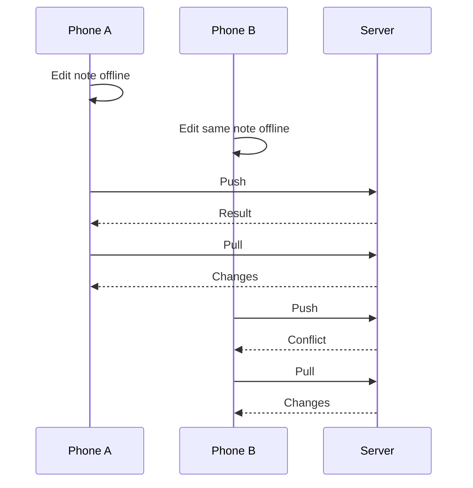

## Notes sync

Phones keep notes in SQLite with an outbox. The server keeps notes with versions, a change log, and processed change IDs. Sync is push plus pull, on the usual triggers.

- Conflicts are handled by version check and a conflict copy.
- Retries use change IDs. Sent changes aren't edited.
- A cursor tracks pull progress, paged.
- Batching limits apply.
