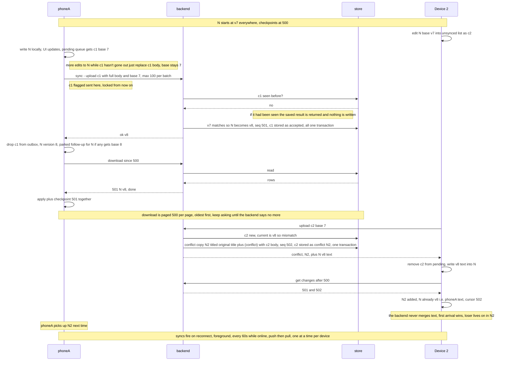

Sync design notes (notes app)

Failure first, since that's the tricky part. If the upload drops, the pending queue is kept and resent with the same change IDs. The backend looks each ID up in its processed-ID table and hands back the saved result, so it's never applied twice; for a conflict it also sends the record's current text and version fresh. Things leave the unsynced list only once the sync API answers accepted or conflict, and accepted ones also get their local version bumped. On the download side, the checkpoint only moves inside the same local transaction that applies a page, so if a download breaks halfway, the page that didn't commit gets fetched again from the last saved high-water mark and nothing already committed is lost. If the server is down or errors, the round is abandoned without touching local state and retried at the next trigger. Storage: the store on the backend has the notes with current body and version, the change log (seq, note, version, body) and the processed-change-ID table. Each handset has, all in SQLite, its notes with the version they're based on, its outbox (UUID, note, base version, full body, sent flag), and the cursor. Once an entry has gone out over the wire it's frozen and never touched again. Anything typed into that note afterwards becomes a second entry parked without a base until the first is answered; then it inherits the new version if the first was accepted, or the first one's old base if it conflicted (so it ends up as a copy too), and it rides along on the next upload.

Also, edits are local first with no network wait. One more race: if something comes down for a note that still has an unanswered change, the local copy is left alone but the checkpoint still moves on past it. The next upload then conflicts, gets turned into a copy on the server side, and the reply's current text and version are written into the note (unless a parked follow-up still needs the local text, in which case its own conflict reply does that).
