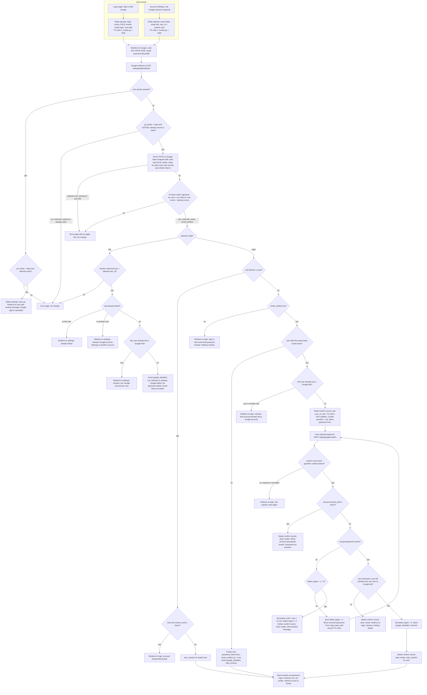
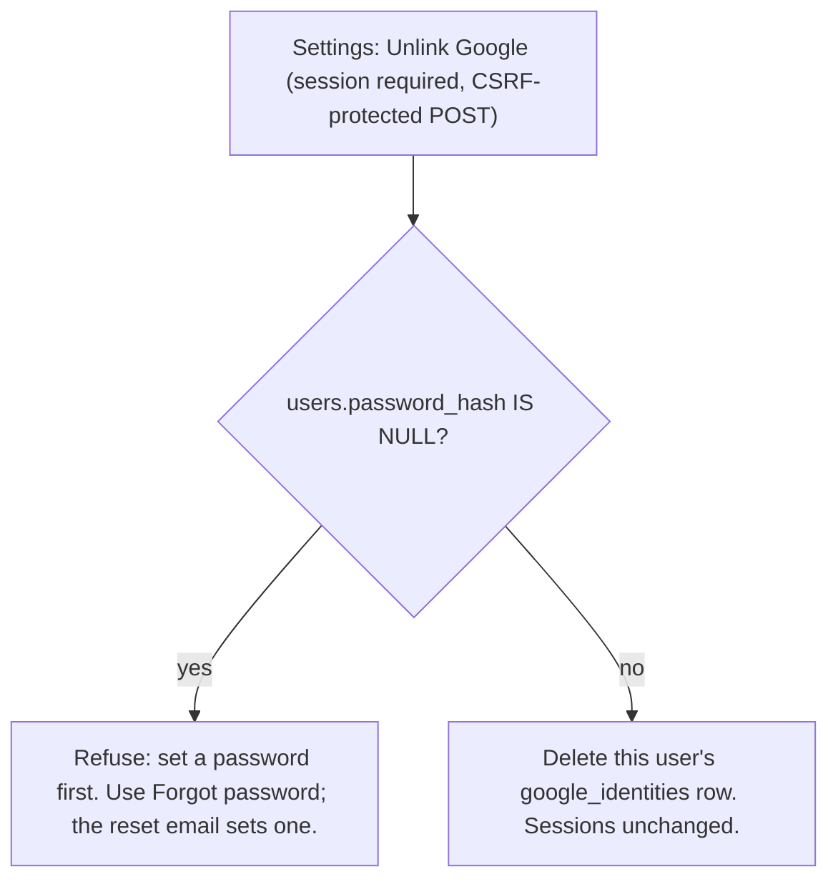

# Sign in with Google: flow and state design

Google sign-in (OpenID Connect, authorization-code flow with PKCE) sits beside email and password. Both entry points, the login page and Account Settings, share one callback. Every successful Google sign-in ends in the same session as a password login, through the existing `start_session(user_id)`.

Terms used below:
- **Attempt**: a short-lived Redis record created when the flow starts and deleted by the first callback.
- **Confirm record**: a short-lived Redis record for the password step, used when an unlinked Google account matches an existing user's verified email.
- **Link**: a `google_identities` row tying one Google `sub` to one user.

## Flowchart



Unlink from Account Settings (separate flow):



## Notes

**Schema change.** Google-created users have no password, so `password_hash` must become nullable. The migration is:

```sql
ALTER TABLE users ALTER COLUMN password_hash DROP NOT NULL;

CREATE TABLE google_identities (
  google_sub TEXT PRIMARY KEY,                                                    -- one Google account links to at most one user
  user_id    BIGINT NOT NULL UNIQUE REFERENCES users(id) ON DELETE CASCADE,       -- a user has at most one Google account
  linked_at  TIMESTAMPTZ NOT NULL DEFAULT now()
);
```

Login must now handle a NULL `password_hash`. Return the existing generic message, and run a dummy bcrypt compare so timing does not reveal the difference.

Identity is keyed by `sub` only. Google's email is read at sign-in and never written to `users.email`. A linked user whose Google email changes still resolves to the same account.

**Where state lives**

| State | Where | Holds | Created | Removed by | Lifetime |
|---|---|---|---|---|---|
| Attempt | Redis `goauth:attempt:{state}` | mode, user_id (link only), nonce, PKCE verifier, next path | Flow start | Callback `GETDEL`, valid or not; otherwise Redis TTL | 600 s from start |
| Cookie `gx` | Browser (HttpOnly, Secure, SameSite=Lax) | state value | Flow start | Callback clears it; Max-Age 600 | 600 s |
| Confirm record | Redis `goauth:confirm:{cid}` | google_sub, target user_id, next path | Unlinked sub matches an existing verified email | Success, lockout, cancel, or TTL | 600 s from callback; wrong passwords do not extend it |
| Cookie `gconfirm` | Browser (HttpOnly, Secure, SameSite=Lax) | cid (32 random bytes, base64url) | Same as confirm record | Same as confirm record | Same as confirm record |
| Google-created user | Postgres `users` | lowercased email, `email_verified_at = now()`, NULL password_hash | Verified email matches no user | Account deletion | Permanent |
| Link | Postgres `google_identities` | sub, user_id | Link success | Unlink; user deletion cascades | Permanent |
| Lockout | Postgres `users.failed_logins`, `locked_until` | existing fields | Wrong password | Existing rules | Existing rules |
| Session | Postgres `sessions` plus `sid` cookie | existing | `start_session` | Existing rules | Existing rules |

No Google access or refresh token is stored. The token response is read for `id_token` and then dropped.

**Failure outcomes**

| Failure | User sees | What changes |
|---|---|---|
| State unknown, expired or already used | Error page | Nothing |
| Google error param, state valid | Back at start, neutral "Google sign-in cancelled" | Attempt deleted |
| Google error param, state invalid | Error page | Nothing |
| Code exchange fails (network, timeout, non-200, invalid_grant) | Error page with try-again link | Nothing. The attempt was already consumed, so the code cannot be replayed. |
| ID token invalid (signature, iss, aud, exp, nonce) | Error page | Nothing |
| Unlinked, email_verified false | Login page: use email and password | Nothing created |
| Link: sub belongs to another user | Settings: refused | Nothing |
| Link: user already has another Google account | Settings: refused | Nothing |
| Confirm: wrong password | "Incorrect password", form stays open | failed_logins + 1 |
| Confirm: 5th wrong password | "Account temporarily locked" | Lock set, confirm record deleted |
| Confirm: account already locked | "Account temporarily locked", password not checked | Confirm record deleted |
| Confirm: record expired or cancelled | Login page: link expired | Nothing |
| Confirm: race, sub linked or user got a Google link meanwhile | Login page: refused | Confirm record deleted, nothing linked |
| Insert hits a unique constraint (google_sub, user_id) | Refused, as above | Transaction rolled back |
| Create user hits users.email unique constraint (concurrent sign-up) | Re-run the email lookup once | Nothing from the failed insert |
| Redis unavailable | Error page | Nothing (fail closed) |

**Choices beyond the brief (for review)**

1. The `gx` cookie binds the attempt to the browser that started it. Without it, an attacker could start a flow and send the victim the callback URL. In settings mode that would link the attacker's Google account to the victim's user.
2. Linked Google sign-in honours `locked_until`, which matches password rules. The brief is silent on this. The alternative is to let Google bypass the lock.
3. Linking from settings does not require `email_verified`. The brief allows unmatched emails, and the user is already signed in.
4. Reaching the lock on the password step, or finding the account already locked, deletes the confirm record. This applies "throw away the half-finished link" to both cases.
5. The confirm page has a cancel action that deletes the confirm record and clears `gconfirm`.
6. The confirm POST and the settings link and unlink POSTs use the same CSRF protection as the existing login form.
7. A password reset sets `password_hash`, which is the only way for a Google-only user to get a password. Unlink then becomes allowed.