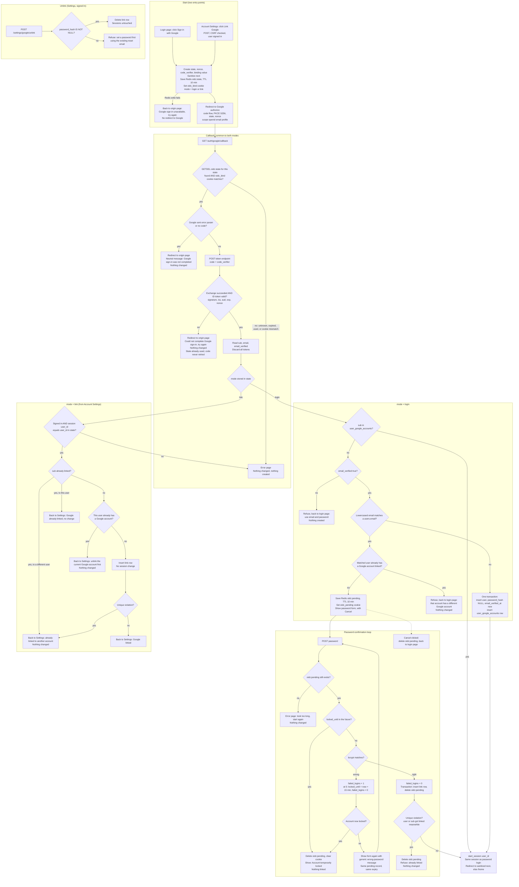

# Sign in with Google: flow and state

Read this section first if you haven't seen the existing code. Passwords work as in `auth_flow.md`: `POST /login`, the 5-failure lockout for 15 minutes, and `start_session(user_id)`, which creates the `sessions` row and the `sid` cookie. Google sign-in adds one new table and some short-lived Redis keys. It changes nothing else.

## Where state lives

**Permanent (PostgreSQL)**

```sql
ALTER TABLE users ALTER COLUMN password_hash DROP NOT NULL;  -- NULL = Google-only user

CREATE TABLE user_google_accounts (
  user_id    BIGINT PRIMARY KEY REFERENCES users(id) ON DELETE CASCADE, -- a user has at most one Google account
  google_sub TEXT NOT NULL UNIQUE,                                      -- a Google account links to at most one user
  linked_at  TIMESTAMPTZ NOT NULL DEFAULT now()
);
```

- We store no email, token or profile data here. Lookup is by `google_sub` only, so a changed Google email changes nothing.
- A row is removed by Unlink or by deleting the user (cascade). Nothing else removes it.
- Code that reads `password_hash` must treat NULL as "no password". A password login against a NULL hash counts as a wrong password and takes the same generic failure path. It must not crash.
- Password reset needs no change. It sets `password_hash`, which is how a Google-only user gets a password.
- `users.email` is never written from Google data, except for the row created in the "new user" branch.

**Temporary (Redis, never PostgreSQL)**

| Key | Holds | Created | Removed by |
|---|---|---|---|
| `oidc:state:<sha256(state)>` | `code_verifier`, `nonce`, `mode` (`login` or `link`), `user_id` (link mode only), a random browser-binding value, sanitized `next` | when the user clicks the Google button | The callback reads and deletes it in one atomic step (`GETDEL`, Redis 6.2 or later), so a callback is honoured once. The 600 s TTL removes it if no callback comes. |
| `oidc:pending:<id>` | Google `sub`, target `user_id`, sanitized `next` | when the password-confirmation prompt is shown | On successful link, on account lock, on Cancel, on "refused" outcomes at confirm time, or after 600 s TTL. Wrong passwords do not extend the TTL. |

Two short-lived cookies carry these. Both are HttpOnly, Secure and SameSite=Lax:
- `oidc_bind`: the random binding value, set at start. The callback must present it. It stops someone else's callback URL from signing you in, and it is cleared at the callback.
- `oidc_pending`: the `<id>` of the pending record, set when the prompt is shown. It is cleared when the record is discarded.

The `sid` session, the `sessions` table and the lockout counters are unchanged.

## Notes on the flow

- **Start.** The login page entry is `GET /login/google`. The settings entry is a CSRF-protected `POST` from a signed-in session. Both run the same start step. `next` is checked with the same "relative path on our site" rule as `start_session` before it is stored. The authorize request uses `response_type=code`, PKCE `S256`, `state`, `nonce` and `scope=openid email profile`. If the Redis write fails, we do not redirect to Google. We show "try again" on the page the user came from.
- **Callback order matters.** The state is consumed first, even when Google reports an error. Only then do we branch. This way an unknown, expired or reused `state` always gets the error page, and a Cancel with a valid `state` returns the user to where they started.
- **ID token.** After the code exchange we verify the signature (Google JWKS), `iss`, `aud` (our client id), `exp` and that `nonce` equals the stored one. We read `sub`, `email` and `email_verified`, then drop the tokens. We keep no access or refresh token.
- **Both modes.** Every outcome that creates or links something does so in one database transaction. The unique constraints are the final guard. If a concurrent request trips one, the result is the matching "refused" outcome and nothing is half-written. The new-user insert is the exception: a unique violation there means a user with that email appeared meanwhile, so re-run the decision once and it falls into the confirm branch.
- **Settings link** is not a sign-in, so it calls no `start_session`. The existing session stays as it is. It needs no password and ignores email and `email_verified`. It requires the current session's user to equal the `user_id` stored at start. Otherwise it is the error page.
- **Unlink** is `POST /settings/google/unlink` from a signed-in session. It runs as a single `DELETE ... WHERE user_id = $1 AND EXISTS (password_hash IS NOT NULL)`. A user with no password sees "Set a password first, using the password reset email" (the existing `POST /forgot`).
- **Assumption to confirm.** A locked account is still reachable by Google sign-in when the `sub` is already linked. The lockout guards password guessing, and Google has proved identity. The brief doesn't say, so say so if you want it blocked.
- **Assumption to confirm.** Linking in the confirm loop does not change `email_verified_at` on the existing user.

## Flowchart



## Failure summary

| Failure | What the user sees | State change |
|---|---|---|
| `state` unknown, expired (over 10 min), already used, or binding cookie missing or different | Error page | None. The record is consumed if it existed. |
| Google returned `error` (for example, Cancel) | Back to the login page or Settings, neutral message | None. The record is consumed. |
| Code exchange fails (network, timeout, non-200, `invalid_grant`) or ID token fails validation | Back to the origin page, "could not complete, try again" | None. The record is consumed, so the code is not retried. Log the cause server-side. |
| Redis unavailable at start | Origin page, "try again" | None. No redirect to Google. |
| Redis unavailable at callback or confirm | Error page | None. |
| Unverified Google email, unlinked `sub` | Login page, "use email and password" | None. Nothing is created. |
| Matched account already has another Google account | Login page, refusal | None. |
| Wrong password in confirm loop | Form again, generic message | `failed_logins + 1`. The pending record is kept. |
| Fifth wrong password, or already locked | "Account temporarily locked" | Lock set as in `POST /login`. Pending record deleted, so no link. |
| Over 10 minutes at confirm | Error page | Pending record has expired. Nothing linked. |
| Settings link: `sub` is linked to someone else | Settings, refusal | None. |
| Unlink with no password | Settings, "set a password first" | None. |
