# Sign in with Google: flow and state

This document describes how "Sign in with Google" works in our server-rendered web app and where each piece of its state is kept. It is written for an engineer who has not read the existing auth code. It adds to the current password sign-in and does not replace it. The current behaviour is described in `existing/auth_flow.md`, and the current tables are in `existing/schema.sql`.

## Overview

A user starts a Google sign-in from the login page or from Account Settings. The app sends the browser to Google, Google checks the person and sends the browser back to us, and we check the result. If the result is usable, we either sign the user in, link Google to an account, or ask for a password first. Every successful Google sign-in ends in the same session as a password login.

## What we are adding

A user can sign in with a Google account, next to email and password. Google checks the person. We then read three facts from the signed ID token Google sends back: `sub`, `email` and `email_verified`. We never store Google access tokens, refresh tokens, or Google's name or picture. We also never change our stored email from Google's value.

Every successful Google sign-in ends in the same `start_session(user_id)` call that password login uses. `start_session` is the existing function that creates a row in `sessions` and sets the `sid` cookie. So a Google session is an ordinary session. No new kind of session exists.

The design adds one permanent table, `google_identities`. It also adds three kinds of temporary record:

- an **attempt**, which lives in Redis,
- a **flow cookie**, which lives in the browser,
- a **confirm record**, which lives in Redis.

## Terms used below

- **Origin.** The page the user started from: the login page or Account Settings. Failures send the user back here.
- **next.** The optional path the user wanted after signing in, as in the existing login flow. It is accepted only if it is a relative path on our site.
- **Google / OIDC / ID token.** OpenID Connect (OIDC) is a sign-in layer on top of OAuth 2.0. After Google checks the user, our server receives an ID token. It is a signed JWT (a JSON document with a cryptographic signature) that says who the user is.
- **Authorization code.** A one-time code Google gives our server after the user agrees. Our server swaps it for the ID token by calling Google directly (the "token exchange").
- **sub.** Google's permanent ID for one Google account. It never changes, unlike an email address. We identify Google accounts by `sub` only.
- **email_verified.** Google's statement that the email address was verified. We accept only the value `true`.
- **PKCE.** A check that the server exchanging the code is the same server that started the sign-in. We create a random `code_verifier`. We send only its hash, `code_challenge` (method S256), to Google. We send the verifier itself when we exchange the code.
- **state.** A random value we send to Google and get back on the callback. It ties the callback to the attempt that started it.
- **nonce.** A random value placed inside the ID token. We check that it matches the attempt, so a token from one attempt cannot be replayed in another.
- **Callback.** The request Google's redirect sends the browser to, at `GET /auth/google/callback`.
- **Attempt.** The Redis record created when a sign-in starts. It holds the state, nonce, code verifier, intent, origin or next, and the flow hash. It is keyed by a hash of `state`.
- **Intent.** Why the attempt was started: `login` (from the login page) or `link` (from Account Settings).
- **Flow cookie (`oidc_flow`).** A browser cookie holding a random value. It binds one sign-in attempt to the browser that started it.
- **Confirm record.** The Redis record created when a verified Google email matches an existing account. It holds the user, the `sub` and the next path while the user proves ownership with their password.
- **GETDEL.** A Redis command that reads a key and deletes it in one step. Two requests cannot both read the same key.
- **TTL.** Time to live. Redis deletes a key by itself after this time.
- **Transaction.** A group of database writes that either all happen or none happen.
- **Unique violation.** A database error raised when an insert would duplicate a value that must be unique, such as the same `sub` twice.
- **bcrypt.** The password hashing function we use. Checking a password means hashing the submitted value and comparing it with the stored hash.
- **sid cookie.** The existing session cookie.
- **Lockout.** The existing rule. Five wrong passwords in a row lock the account for 15 minutes.

## Diagram

```mermaid
flowchart TD
    LOGIN["Login page: Sign in with Google"] --> START_L["GET /auth/google/start<br/>intent = login, next"]
    SETTINGS["Account Settings: Link Google<br/>user must be signed in"] --> START_S["POST /settings/google/link<br/>intent = link, user_id = signed-in user"]
    START_L --> ATT["Save attempt in Redis, TTL 10 min<br/>state, nonce, code_verifier, intent, next or origin, user_id, flow hash<br/>set oidc_flow cookie, Max-Age 10 min"]
    START_S --> ATT
    ATT --> GOOG["302 redirect to Google<br/>scope openid email profile, PKCE S256"]
    GOOG --> CB["GET /auth/google/callback<br/>GETDEL attempt by sha256 of state"]
    CB --> Q_ATT{"Attempt found and under 10 min old?"}
    Q_ATT -->|no| ERR_STATE["Error page: link expired or already used<br/>nothing changes"]
    Q_ATT -->|yes| Q_FLOW{"Flow cookie matches attempt?"}
    Q_FLOW -->|no| ERR_STATE
    Q_FLOW -->|yes| Q_GERR{"Google sent an error param?<br/>for example the user pressed Cancel"}
    Q_GERR -->|yes| BACK_NEUTRAL["Redirect to origin page<br/>neutral message, nothing changes"]
    Q_GERR -->|no| EXCH["Server POST to Google token endpoint<br/>code + code_verifier"]
    EXCH -->|network error, timeout, non-200| BACK_NEUTRAL
    EXCH -->|ok| VERIFY{"ID token valid?<br/>signature, iss, aud, exp, nonce"}
    VERIFY -->|no| BACK_NEUTRAL
    VERIFY -->|yes| INTENT{"Intent?"}

    INTENT -->|link| S_SESS{"Still signed in as attempt user_id?"}
    S_SESS -->|no| ERR_SESS["Error: sign in again<br/>nothing changes"]
    S_SESS -->|yes| S_SUB{"sub already in google_identities?"}
    S_SUB -->|linked to this user| S_SAME["Redirect to settings: already linked"]
    S_SUB -->|linked to another user| S_OTHER["Refuse: that Google account belongs to another user<br/>nothing changes"]
    S_SUB -->|no| S_HAS{"This user already has a different Google account?"}
    S_HAS -->|yes| S_TWO["Refuse: unlink the current Google account first"]
    S_HAS -->|no| S_INS["INSERT google_identities sub, user_id<br/>no password asked, emails not compared"]
    S_INS -->|unique violation| S_OTHER
    S_INS --> S_OK["Redirect to settings: Google linked"]

    INTENT -->|login| L_SUB{"sub in google_identities?"}
    L_SUB -->|yes| SESSION["start_session for the linked user<br/>same as password login"]
    L_SUB -->|no| L_VER{"email_verified is true?"}
    L_VER -->|no| L_UNV["Refuse: verify your email or use email and password<br/>nothing created"]
    L_VER -->|yes| L_EMAIL{"User with this lowercased email exists?"}
    L_EMAIL -->|no| L_NEW["One transaction: INSERT users with no password and email_verified_at = now<br/>INSERT google_identities"]
    L_NEW -->|unique violation on users.email or google_identities.sub| L_SUB
    L_NEW --> SESSION
    L_EMAIL -->|yes| L_HAS{"That user already has a different Google account?"}
    L_HAS -->|yes| L_TWO["Refuse: account already linked to another Google account"]
    L_HAS -->|no| CONF_NEW["Save confirm record in Redis, TTL 10 min from now<br/>user_id, sub, next<br/>reset oidc_flow cookie to Max-Age 10 min"]
    CONF_NEW --> CONF_PAGE["Redirect to /auth/google/confirm<br/>password form for the matched account"]

    CONF_PAGE --> CONF_SUBMIT["POST /auth/google/confirm with password"]
    CONF_SUBMIT --> C_REC{"Confirm record still exists?"}
    C_REC -->|no, expired or used| ERR_CONF["Error: start Google sign-in again<br/>nothing changes"]
    C_REC -->|yes| C_LOCK{"locked_until in the future?"}
    C_LOCK -->|yes| C_DROP_LOCK["Delete confirm record, discard the half-finished link<br/>Account temporarily locked, password not checked"]
    C_LOCK -->|no| C_PW{"bcrypt password matches?"}
    C_PW -->|no| C_COUNT{"failed_logins + 1 reaches 5?"}
    C_COUNT -->|no| C_RETRY["failed_logins + 1, keep confirm record<br/>generic wrong-password message, show form again"]
    C_RETRY --> CONF_PAGE
    C_COUNT -->|yes| C_LOCKED["failed_logins = 0, locked_until = now + 15 min<br/>delete confirm record, discard link"]
    C_PW -->|yes| C_RECHECK{"Target still has no Google account and sub still unlinked?"}
    C_RECHECK -->|no| C_REFUSE["Delete confirm record, refuse<br/>nothing changes"]
    C_RECHECK -->|yes| C_LINK["One transaction: failed_logins = 0, INSERT google_identities"]
    C_LINK -->|unique violation| C_REFUSE
    C_LINK --> C_DONE["GETDEL confirm record, clear oidc_flow cookie<br/>start_session, redirect to next"]
    C_DONE --> SESSION

    SESSION["start_session user_id<br/>delete old sid row, insert sessions row, set sid cookie<br/>redirect to next or /home"]

    SETTINGS --> UNLINK["POST /settings/google/unlink"]
    UNLINK --> U_PW{"users.password_hash is set?"}
    U_PW -->|no| U_REFUSE["Refuse: set a password first<br/>Forgot password sends the reset email"]
    U_PW -->|yes| U_DEL["DELETE google_identities row for this user"]
    U_DEL --> U_OK["Redirect to settings: Google unlinked<br/>sessions unchanged"]

    classDef fail fill:#fdecea,stroke:#b42318,color:#111
    class ERR_STATE,BACK_NEUTRAL,ERR_SESS,S_OTHER,S_TWO,L_UNV,L_TWO,ERR_CONF,C_DROP_LOCK,C_LOCKED,C_REFUSE,U_REFUSE fail
```



## Reading the diagram

**Two entry points.** The login page starts an attempt with intent `login`. Account Settings starts one with intent `link` and the signed-in user's id. Both save the attempt before the browser is sent to Google. If Redis is down at this point, the user sees an error page and is not sent to Google.

**Callback order.** The callback first reads and deletes the attempt with GETDEL, before any other check. So every callback is single-use, including callbacks that end in an error. Next, the flow cookie is compared with the attempt. A mismatch is handled like an unknown state. The attempt is already gone by then.

**Google errors and failed exchange.** If Google returns an error, such as Cancel, the user goes back to the origin page with a neutral message. The same happens if the code exchange fails (timeout, network error, non-200, or `invalid_grant`), or if the ID token is invalid. The authorization code can be used only once, so a failed exchange cannot be retried. The user must start a new attempt. Log the failure reason. Never log the code, the tokens or the nonce.

**Token checks.** The ID token must have a valid signature, the right issuer and audience, an unexpired `exp`, and a `nonce` that matches the attempt.

**Lookup on login.** The lookup is always by `sub` first. Email is used only when `sub` is unknown. A linked user whose Google email has changed still reaches the same account. Google never changes our stored email.

**New Google user.** When the `sub` is unknown, `email_verified` is true, and no user has that email, we create a user with no password and a verified email. We create the `google_identities` row in the same transaction. If a parallel request created the same user first, the insert fails with a unique violation. The callback then rolls back and looks up the `sub` again. If the `sub` is now linked, the user signs in as that account. If the conflict was on the email instead, the lookup falls through to the email-match path below.

**Email match and password confirmation.** When a verified Google email matches an existing account, the callback saves a confirm record and sends the user to a password form for that account. The form finds the confirm record through the flow cookie. The cookie holds a random value, and the record is keyed by a hash of that value. The 10-minute window starts at the callback. Wrong passwords do not extend it. Each POST checks the lock before it checks the password. A POST without the flow cookie gets the same error as an expired record.

**Lock during confirmation.** A POST checks `locked_until` before it checks the password. If the lock is active, the confirm record is deleted, so the half-finished link is thrown away. Nothing is written to `google_identities`. When the fifth wrong password is entered, the same thing happens: the lock is set to 15 minutes and the confirm record is deleted.

**Successful confirmation.** A correct password resets `failed_logins` to 0, as password login does. The link row is then inserted. The insert runs again after the password check, so a second link attempt that raced ahead loses here. Only then is the confirm record deleted and the session started.

**Linking from Settings.** The callback checks that the user is still signed in as the user the attempt was made for. It then links the `sub`. No password is asked for, and the email addresses are not compared. The link is refused if that `sub` belongs to someone else, or if this user already has a different Google account.

**Unlinking.** Unlinking is allowed only if the user has a password. Otherwise the user is told to set one first using the existing "Forgot password" reset email. Unlinking does not end any sessions.

**Invariant.** Two rules always hold:

1. A user with no password always has a Google link.
2. A user with no Google link always has a password.

Rule 1 holds because a password-less user is created only by the Google path, which always creates the link in the same transaction. A later password reset can give a Google-only user a password, which keeps the invariant. Rule 2 holds because unlinking requires a password first. Because of rule 1, the confirm path never meets a password-less user, and it only targets accounts with no Google link.

**Cookie settings.** The flow cookie uses SameSite=Lax, not Strict. The redirect back from Google is a cross-site top-level navigation. Browsers do not send Strict cookies on that request, so the callback would fail without the cookie.

## Where new state lives

| State | Where | Lifetime | Removed by |
|---|---|---|---|
| Attempt: state hash key, nonce, code_verifier, intent, next or origin, user_id (link only), flow hash | Redis `oidc:attempt:{sha256(state)}` | Temporary, TTL 10 min | Deleted at the first callback, whatever the outcome. Also removed by TTL. |
| Flow cookie `oidc_flow`: random 32 bytes | Browser cookie, HttpOnly, Secure, SameSite=Lax, Path=/ | Temporary. Max-Age 10 min at start. Reset to 10 min at callback when confirmation is needed. | Cleared on every terminal outcome. Also expires. |
| Confirm record: user_id, sub, next | Redis `oidc:confirm:{sha256(flow)}` | Temporary, TTL 10 min from callback, not extended by retries | Deleted on success, on lock, on refusal, or by TTL |
| `google_identities` row | PostgreSQL, new table | Permanent | Unlink, or deletion of the user (cascade) |
| New user row from Google sign-in | PostgreSQL `users` | Permanent | Same as any user. Password is NULL until a reset sets one. |
| `failed_logins`, `locked_until` | PostgreSQL `users`, existing | Existing lockout rules | Existing rules |
| `sessions` row | PostgreSQL, existing | Existing | Sign-out, expiry, or password reset |

Not stored anywhere: Google access tokens, refresh tokens, the Google email, and the Google name or picture.

## Schema change

```sql
ALTER TABLE users ALTER COLUMN password_hash DROP NOT NULL;

CREATE TABLE google_identities (
  sub       TEXT PRIMARY KEY,                            -- Google account; one user per Google account
  user_id   BIGINT NOT NULL UNIQUE REFERENCES users(id) ON DELETE CASCADE, -- one Google account per user
  linked_at TIMESTAMPTZ NOT NULL DEFAULT now()
);
```

Password login must treat a NULL `password_hash` as a wrong password. It returns the same generic message as an unknown email, and it must not call bcrypt on NULL.

## Failures

| Failure | What the user sees | Database change |
|---|---|---|
| Unknown, expired or reused state | Error page: link expired or already used | None |
| Flow cookie missing or mismatched | Same error page | None. The attempt is already deleted. |
| Google error param (Cancel) | Back to origin page, neutral message | None |
| Token exchange fails (timeout, network, non-200, invalid_grant) | Back to origin page, neutral message | None. The code is single-use, so start again. |
| ID token invalid (signature, iss, aud, exp, nonce) | Back to origin page, neutral message | None |
| Redis down at start | Error page, no redirect to Google | None |
| Redis down at callback | Error page, start again | None |
| Unlinked sub, email not verified | Refuse, point to email and password | None |
| Two callbacks create the same new user | The second hits a unique violation, rolls back, and looks up the sub again. It signs in to the user the first callback created. | Only one user row is kept |
| Parallel callbacks create the same user with an email conflict | The second rolls back and re-runs the lookup. It takes the email-match path. | Only one user row is kept |
| Confirm record expired, used, or flow cookie missing | Error page, start Google sign-in again | None |
| Wrong password, below the limit | Generic wrong-password message, form shown again | failed_logins + 1 |
| Fifth wrong password | Account temporarily locked. Link discarded. | failed_logins = 0, locked_until = now + 15 min |
| Lock already active at confirm | Account temporarily locked. Password not checked. | None. Confirm record deleted. |
| Target gained a Google account meanwhile, or unique violation on link | Refuse | None. Confirm record deleted. |
| Settings link to a Google account owned by another user | Refuse | None |
| Settings link while the user already has a different Google account | Refuse, unlink first | None |
| Session changed before settings callback | Error, sign in again | None |
| Unlink without a password | Refuse, use Forgot password | None |

## Decisions to confirm

1. **Linked sign-in while locked.** The draft lets a linked Google sign-in succeed even when `locked_until` is in the future. The lock counts password guesses, and Google sign-in checks no password. The alternative is to block it with the same lock message. This needs a product decision.
2. **Settings link and unverified email.** The draft does not require `email_verified` for a link made from Settings, since the user is already signed in. The brief only names the sign-in rule.
3. **Verification flag on a matched account.** After a confirmed link, the draft leaves `email_verified_at` as it is. Google has verified the email, but the brief does not ask for that flag to change.
4. **Redis eviction.** The `oidc:*` keys must not be dropped silently. If Redis evicts them under memory pressure, the user gets the expired-link error and can retry. That failure is safe but annoying. Keep these keys out of any eviction policy, or use a separate Redis instance.