# Sign in with Google: flow and state

Google sign-in (OpenID Connect, authorization code with PKCE) is added beside email and password. Every successful Google sign-in ends in the same `start_session(user_id)` call that password login uses. The existing tables are `users`, `sessions` and `password_reset_tokens`. Redis is already used for short-lived data, so the two new temporary records go there too.

## Diagram

```mermaid
flowchart TD
    LOGIN["Login page: Sign in with Google"] --> START_L["GET /auth/google/start<br/>intent login, next"]
    SETTINGS["Account Settings: Link Google<br/>signed in, POST /settings/google/link"] --> START_S["Start link<br/>intent link, user_id = session user"]
    START_L --> ATT["Create attempt in Redis, TTL 10 min<br/>state, nonce, code_verifier, intent, next or origin, flow hash<br/>set flow cookie"]
    START_S --> ATT
    ATT --> GOOG["302 to Google<br/>scope openid email profile, PKCE S256"]
    GOOG --> CB["GET /auth/google/callback<br/>GETDEL attempt by sha256 of state"]
    CB --> Q_ATT{"Attempt found and under 10 min old?"}
    Q_ATT -->|no| ERR_STATE["Error page: link expired or already used<br/>nothing changes"]
    Q_ATT -->|yes| Q_FLOW{"Flow cookie matches attempt?"}
    Q_FLOW -->|no| ERR_STATE
    Q_FLOW -->|yes| Q_GERR{"Google sent an error param?<br/>for example user pressed Cancel"}
    Q_GERR -->|yes| BACK_NEUTRAL["Redirect to origin page<br/>neutral message, nothing changes"]
    Q_GERR -->|no| EXCH["Server POST to token endpoint<br/>code + code_verifier"]
    EXCH -->|network error, timeout, non-200| BACK_NEUTRAL
    EXCH -->|ok| VERIFY{"ID token valid?<br/>signature, iss, aud, exp, nonce"}
    VERIFY -->|no| BACK_NEUTRAL
    VERIFY -->|yes| INTENT{"Intent?"}

    INTENT -->|link| S_SESS{"Still signed in as attempt user_id?"}
    S_SESS -->|no| ERR_SESS["Error: sign in again<br/>nothing changes"]
    S_SESS -->|yes| S_SUB{"sub already in google_identities?"}
    S_SUB -->|linked to this user| S_SAME["Redirect to settings: already linked"]
    S_SUB -->|linked to another user| S_OTHER["Refuse: that Google account belongs to another user<br/>nothing changes"]
    S_SUB -->|no| S_HAS{"This user already has a different Google account?"}
    S_HAS -->|yes| S_TWO["Refuse: unlink the current Google account first"]
    S_HAS -->|no| S_INS["INSERT google_identities sub, user_id<br/>unique violation means refuse"]
    S_INS --> S_OK["Redirect to settings: Google linked<br/>no password asked, emails not compared"]
    S_INS -->|unique violation| S_OTHER

    INTENT -->|login| L_SUB{"sub in google_identities?"}
    L_SUB -->|yes| SESSION["start_session for the linked user<br/>same as password login"]
    L_SUB -->|no| L_VER{"email_verified is true?"}
    L_VER -->|no| L_UNV["Refuse: verify your email or use email and password<br/>nothing created"]
    L_VER -->|yes| L_EMAIL{"User with this lowercased email exists?"}
    L_EMAIL -->|no| L_NEW["One transaction: INSERT users with no password and email_verified_at = now<br/>INSERT google_identities"]
    L_NEW -->|unique violation from a concurrent callback| L_SUB
    L_NEW --> SESSION
    L_EMAIL -->|yes| L_HAS{"That user already has a different Google account?"}
    L_HAS -->|yes| L_TWO["Refuse: account already linked to another Google account"]
    L_HAS -->|no| CONF_NEW["Save confirm record in Redis, TTL 10 min from now<br/>user_id, sub, next<br/>flow cookie reset to Max-Age 10 min"]
    CONF_NEW --> CONF_PAGE["Redirect to /auth/google/confirm<br/>password form for the matched account"]

    CONF_PAGE --> CONF_SUBMIT["POST /auth/google/confirm with password"]
    CONF_SUBMIT --> C_REC{"Confirm record still exists?"}
    C_REC -->|no, expired or used| ERR_CONF["Error: start Google sign-in again<br/>nothing changes"]
    C_REC -->|yes| C_LOCK{"locked_until in the future?"}
    C_LOCK -->|yes| C_DROP_LOCK["Delete confirm record, discard the half-finished link<br/>Account temporarily locked, password not checked"]
    C_LOCK -->|no| C_PW{"bcrypt password matches?"}
    C_PW -->|no| C_COUNT{"failed_logins + 1 reaches 5?"}
    C_COUNT -->|no| C_RETRY["failed_logins + 1, keep confirm record<br/>generic wrong password, show form again"]
    C_RETRY --> CONF_PAGE
    C_COUNT -->|yes| C_LOCKED["failed_logins = 0, locked_until = now + 15 min<br/>delete confirm record, discard link"]
    C_PW -->|yes| C_RECHECK{"Target still has no Google account and sub still unlinked?"}
    C_RECHECK -->|no| C_REFUSE["Delete confirm record, refuse<br/>nothing changes"]
    C_RECHECK -->|yes| C_LINK["One transaction: failed_logins = 0, INSERT google_identities"]
    C_LINK -->|unique violation| C_REFUSE
    C_LINK --> C_DONE["GETDEL confirm record, clear flow cookie<br/>start_session, redirect to next"]
    C_DONE --> SESSION

    SESSION["start_session user_id<br/>delete old sid row, insert sessions row, set sid cookie<br/>redirect to next or /home"]

    SETTINGS --> UNLINK["POST /settings/google/unlink"]
    UNLINK --> U_PW{"users.password_hash is set?"}
    U_PW -->|no| U_REFUSE["Refuse: set a password first<br/>Forgot password sends the reset email"]
    U_PW -->|yes| U_DEL["DELETE google_identities row for this user"]
    U_DEL --> U_OK["Redirect to settings: Google unlinked<br/>sessions unchanged"]

    classDef fail fill:#fdecea,stroke:#b42318,color:#111
    class ERR_STATE,BACK_NEUTRAL,ERR_SESS,S_OTHER,S_TWO,L_UNV,L_TWO,ERR_CONF,C_DROP_LOCK,C_LOCKED,C_REFUSE,U_REFUSE fail
```



## Notes on the diagram

- **Attempt.** Both entry points create the same attempt record before the redirect to Google. If Redis is down at this point, the user sees an error page and is not sent to Google.
- **Callback order.** The attempt is read and deleted (GETDEL) first, before any other check. That makes every callback single-use, including ones that end in an error. The flow cookie is checked against the attempt. A mismatch is treated like an unknown state.
- **Google errors and failed exchange.** These send the user back to the page they started from (`origin`) with a neutral message. The code is single-use, so a failed exchange cannot be retried. The user has to start a new attempt. Log the failure reason, but never log the code, the tokens or the nonce.
- **Lookup order on login.** The lookup is always by `sub` first. Email is used only when `sub` is unknown. A linked user whose Google email changed still reaches the same account, and our stored email is never changed.
- **Confirmation window.** The 10 minutes to confirm starts at the callback. Wrong passwords do not extend it. Each POST checks the lock before it checks the password.
- **Lock during confirmation.** When the lock is hit, the confirm record is deleted, so the half-finished link is thrown away. Nothing is written to `google_identities`.
- **Invariant.** A user with no password always has a Google link, and a user who has no Google link always has a password. This holds because the password-confirm path only targets users with no Google link, and unlinking requires a password. A password-less user is created only by the Google path, so the confirm path never meets one.
- **Flow cookie.** It uses SameSite=Lax, not Strict. Strict cookies are not sent on the top-level redirect back from Google, so the callback would fail.

## Where new state lives

| State | Where | Lifetime | Removed by |
|---|---|---|---|
| Attempt: state hash key, nonce, code_verifier, intent, next or origin, user_id (link only), flow hash | Redis `oidc:attempt:{sha256(state)}` | Temporary, TTL 10 min | Deleted at the first callback, whatever the outcome. Also removed by TTL. |
| Flow cookie `oidc_flow`: random 32 bytes | Browser cookie, HttpOnly, Secure, SameSite=Lax, Path=/ | Temporary. Max-Age 10 min at start. Reset to 10 min at callback when confirmation is needed. | Cleared on every terminal outcome. Also expires. |
| Confirm record: user_id, sub, next | Redis `oidc:confirm:{sha256(flow)}` | Temporary, TTL 10 min from callback, not extended by retries | Deleted on success (GETDEL), on lock, on refusal, or by TTL |
| `google_identities` row | PostgreSQL, new table | Permanent | Unlink, or deletion of the user (cascade) |
| New user row from Google sign-in | PostgreSQL `users` | Permanent | Same as any user. Password is NULL until a reset sets one. |
| `failed_logins`, `locked_until` | PostgreSQL `users`, existing | Existing lockout rules | Existing rules |
| `sessions` row | PostgreSQL, existing | Existing | Sign-out, expiry, or password reset |

Not stored anywhere: Google access tokens, refresh tokens, the Google email, and the Google name or picture.

## Schema change

```sql
ALTER TABLE users ALTER COLUMN password_hash DROP NOT NULL;

CREATE TABLE google_identities (
  sub       TEXT PRIMARY KEY,                            -- Google account; one user per Google account
  user_id   BIGINT NOT NULL UNIQUE REFERENCES users(id) ON DELETE CASCADE, -- one Google account per user
  linked_at TIMESTAMPTZ NOT NULL DEFAULT now()
);
```

Login code must treat a NULL `password_hash` as a wrong password. It should return the same generic message as an unknown email, and it must not call bcrypt on NULL.

## Failures

| Failure | What the user sees | Database change |
|---|---|---|
| Unknown, expired or reused state | Error page: link expired or already used | None |
| Flow cookie missing or mismatched | Same error page | None |
| Google error param (Cancel) | Back to origin page, neutral message | None |
| Token exchange fails (timeout, network, non-200, invalid_grant) | Back to origin page, neutral message | None. Code is single-use, so start again. |
| ID token invalid (signature, iss, aud, exp, nonce) | Back to origin page, neutral message | None |
| Redis down at start | Error page, no redirect to Google | None |
| Redis down at callback | Error page, start again | None |
| Unlinked sub, email not verified | Refuse, point to email and password | None |
| Two callbacks create the same new user | Second one retries from the linked check, then takes the confirm path | Only one user row is kept |
| Confirm record expired or already used | Error page, start Google sign-in again | None |
| Wrong password, below the limit | Generic wrong-password message, form shown again | failed_logins + 1 |
| Fifth wrong password | Account temporarily locked. Link discarded. | failed_logins = 0, locked_until = now + 15 min |
| Lock already active at confirm | Account temporarily locked. Password not checked. | None. Confirm record deleted. |
| Target gained a Google account meanwhile, or unique violation on link | Refuse | None. Confirm record deleted. |
| Settings link to a Google account owned by another user | Refuse | None |
| Settings link while the user already has a different Google account | Refuse, unlink first | None |
| Session changed before settings callback | Error, sign in again | None |
| Unlink without a password | Refuse, use Forgot password | None |

## Decisions to confirm

1. **Linked sign-in while locked.** The draft lets a linked Google sign-in succeed even when `locked_until` is in the future. The lock counts password guesses, and Google sign-in checks no password. The alternative is to block it with the same lock message. This needs a product decision.
2. **Settings link and unverified email.** The draft does not require `email_verified` for a link made from Settings, since the user is already signed in. The brief only names the sign-in rule.
3. **Verification flag on a matched account.** After a confirmed link, the draft leaves `email_verified_at` as it is. Google has verified the email, but the brief does not ask for that flag to change.
4. **Redis eviction.** The `oidc:*` keys must not be dropped silently. If they are, the user gets the expired-link error and can retry, so the failure is safe but annoying.
