# Sign in with Google: design notes and flow

## Read this first

**Background.** The app is one server-rendered backend. PostgreSQL holds permanent data and Redis holds short-lived data. Today a user has an email and a bcrypt password. `start_session(user_id)` is the only function that logs someone in. It deletes the `sessions` row for the browser's `sid` cookie (if there is one), inserts a new `sessions` row, sets the `sid` cookie, and redirects to the `next` query parameter (only if it is a relative path on our site) or to `/home`.

**What this change does.** It adds Google as a second way to prove who you are, using OpenID Connect with the authorization-code flow. Scopes are `openid email profile`. The flow uses three protections:

- **PKCE**: a one-time `code_verifier` that proves the code exchange comes from the same server that started the flow.
- **`state`**: a random value that identifies one attempt.
- **`nonce`**: a random value that must come back inside the ID token.

**In short**

1. The user clicks a button. We store the attempt's secrets in Redis and send the browser to Google.
2. Google sends the browser back to our callback URL.
3. The callback checks the attempt, exchanges the code for an ID token, and reads three fields from it.
4. Exactly one of these happens:
   - a known Google account signs in;
   - a new user is created and signs in;
   - an existing user is asked for their password, and the account is linked if it is correct;
   - the attempt is refused.
5. Every success ends in `start_session`.

**Ground rules**

- Google never creates a new kind of session. Every successful Google sign-in calls the existing `start_session(user_id)`.
- A Google account is identified by the ID token's `sub` (Google's stable account id), never by email.
- We read only `sub`, `email` and `email_verified` from the ID token. We keep no Google access or refresh tokens, and we do not store Google's email.
- Emails are lowercased before any lookup, as everywhere else.
- Google never changes the email stored in `users`.
- A Google account links to at most one user, and a user has at most one Google account.

**Terms used below**

- **origin**: where the flow started, either `login` (login page) or `settings` (Account Settings). After a failure, the user is sent back to the origin page.
- **next**: the post-login redirect target. It is checked when the flow starts and kept only if it is a relative path on our site.
- **ticket**: a random id for a half-finished link that is waiting for the user's password (see "Password confirmation").
- **GETDEL**: the Redis command that reads a key and deletes it in one step.
- **Flowchart colors**: green is success, red is a refusal or error, yellow is a neutral message. Uncolored boxes are ordinary steps.

## Where state lives

### Permanent (PostgreSQL)

```sql
CREATE TABLE user_google_accounts (
  user_id    BIGINT PRIMARY KEY REFERENCES users(id) ON DELETE CASCADE, -- a user has at most one Google account
  google_sub TEXT   NOT NULL UNIQUE,                                    -- a Google account links to at most one user
  linked_at  TIMESTAMPTZ NOT NULL DEFAULT now()
);

ALTER TABLE users ALTER COLUMN password_hash DROP NOT NULL; -- NULL means "no password"
```

- The database enforces both uniqueness rules. The code checks first so it can show a clear message. If the insert still hits a unique violation (a race), treat it as "refused".
- **Removed by:** the unlink action, or deleting the user (cascade).
- Password login treats a NULL `password_hash` as a wrong password. It shows the same generic message and still runs a dummy bcrypt compare, so response time does not reveal that the account has no password. The same rule applies on the confirmation form below.
- A Google-only user can get a password through the existing `POST /forgot` email. That flow sets `password_hash`, marks the email verified and deletes all of the user's sessions.

### Temporary (Redis, both keys with a hard 600 s TTL)

| Key | Holds | Created | Removed by |
|---|---|---|---|
| `gauth:{state}` | `code_verifier`, `nonce`, `origin`, `next`, `user_id` (settings only) | When the user starts sign-in | `GETDEL` as the first Redis step of the callback, so one attempt is honoured once. If the callback never comes, the TTL expires it. |
| `glink:{ticket}` | `google_sub`, `user_id` of the matched account, `next` | At the callback, when a password confirmation is needed | Deleted on successful link, on account lockout, or when the final re-check refuses. If the user walks away, the TTL expires it. |

- The 10-minute Google round trip is the `gauth` TTL. The 10-minute confirmation window is the `glink` TTL.
- Wrong passwords do not extend the `glink` TTL.
- No Google email, token or code is ever stored in Redis.

### Temporary (browser cookies)

Both cookies are HttpOnly, Secure and SameSite=Lax, with Max-Age 600. Lax is required because Google sends the user back with a top-level GET, and Strict cookies would not be sent on it.

- `gstate` holds the `state` value. It ties the callback to the browser that started the flow, which blocks login CSRF (an attacker making a victim's browser finish the attacker's login). It is cleared at the callback.
- `gticket` holds the ticket id for `glink:{ticket}`. It is cleared when the ticket is deleted.

The existing `sid` cookie and `sessions` table are unchanged.

## Flowchart

Read it top to bottom: (1) start, (2) callback validation, then either (3a) settings or (3b) login, and (4) the password loop. Only the login path (3b) can start a session. It reaches `SESS` in three ways: a linked `sub`, a newly created user, or a correct password in step 4. Every other outcome is a refusal or a neutral message, and settings (3a) never creates a session.

```mermaid
flowchart TD
  classDef bad fill:#fde8e8,stroke:#b42318,color:#000
  classDef good fill:#e6f4ea,stroke:#1e7e34,color:#000
  classDef neutral fill:#fff4d6,stroke:#9a6700,color:#000

  subgraph START["1. Start (two entry points)"]
    LP["Login page: click Sign in with Google"]
    AS["Account Settings (signed-in users only): click Link Google"]
    AS --> ASC{"Does this user already have a Google account?"}
    ASC -->|yes| ASX["Settings page: already linked. Nothing stored."]:::neutral
    ASC -->|no| SS2["origin = settings, user_id taken from sid session"]
    LP --> SS1["origin = login, next kept only if a relative path"]
    SS1 --> GEN
    SS2 --> GEN
    GEN["Generate state, nonce, PKCE code_verifier. Store gauth:state in Redis, TTL 600 s. Set gstate cookie."]
    GEN --> RW{"Redis write succeeded?"}
    RW -->|no| RWX["Back to origin page: Google sign-in is unavailable, try again. Nothing stored."]:::neutral
    RW -->|yes| GO["302 to Google: response_type=code, scope=openid email profile, state, nonce, code_challenge S256"]
  end

  GO --> USER["User at Google"]
  USER --> CB["GET /auth/google/callback with state plus code or error"]

  subgraph CALLBACK["2. Callback: validate the attempt"]
    CB --> CK{"gstate cookie equals state?"}
    CK -->|no| ERRP["Error page. Nothing changed."]:::bad
    CK -->|yes| GD["GETDEL gauth:state, clear gstate cookie. If Redis is down, show the error page."]
    GD --> GF{"Record found? Unknown, expired or used state means no"}
    GF -->|no| ERRP
    GF -->|yes| OS{"origin = settings and the current sid user differs from stored user_id?"}
    OS -->|yes| ERRP
    OS -->|no| GE{"Google sent error, e.g. user pressed Cancel?"}
    GE -->|yes| NEUT["Redirect to origin page (login keeps next) with neutral message: Google sign-in was not completed. Nothing changed."]:::neutral
    GE -->|no| EX["Exchange code at Google token endpoint with code_verifier. Short timeout, no retry."]
    EX --> EXOK{"Exchange succeeded?"}
    EXOK -->|"no: network error, timeout, non-200"| EXF["Redirect to origin page: We could not complete Google sign-in. Try again or use email and password. Nothing changed. State is already spent, so the user starts over."]:::neutral
    EXOK -->|yes| VAL{"ID token valid? Signature via Google keys, iss, aud, exp, and nonce equals stored nonce"}
    VAL -->|no| EXF
    VAL -->|yes| READ["Read sub, email (lowercase), email_verified. Discard the tokens and everything else."]
    READ --> ORG{"origin"}
  end

  subgraph SETTINGS["3a. Link from Settings (no password asked, emails need not match)"]
    ORG -->|settings| SL{"Is sub already linked?"}
    SL -->|"to this user"| SL1["Settings: already linked. No change."]:::neutral
    SL -->|"to another user"| SL2["Settings: that Google account is linked to someone else. Refused, no change."]:::bad
    SL -->|no| SL3{"Does this user already have a Google account?"}
    SL3 -->|yes| SL4["Settings: unlink the current Google account first. Refused."]:::bad
    SL3 -->|no| SL5["INSERT user_google_accounts (user_id, sub). A unique violation from a race is treated as refused."]
    SL5 --> SL6["Settings: Google linked. No new session; the current sid stays."]:::good
  end

  subgraph LOGIN["3b. Sign in from the login page"]
    ORG -->|login| LK{"Is sub linked to a user?"}
    LK -->|yes| LKS["Use that user. Google email is ignored and stored email is not changed."]
    LKS --> SESS
    LK -->|no| LV{"email_verified true?"}
    LV -->|no| LVX["Redirect to /login: Your Google email is not verified. Sign in with email and password. Nothing created."]:::bad
    LV -->|yes| LM{"Lowercased email matches users.email?"}
    LM -->|no| NEWU["One transaction: INSERT users (email, password_hash NULL, email_verified_at now), INSERT link. If the users insert hits a unique violation (another signup took the email), repeat the match check (LM)."]
    NEWU --> SESS
    LM -->|yes| LG{"Does the matched user already have a different Google account?"}
    LG -->|yes| LGX["Redirect to /login: that account is linked to another Google account. Refused. Nothing stored."]:::bad
    LG -->|no| TK["Create glink:ticket in Redis, TTL 600 s. Set gticket cookie."]
  end

  subgraph CONFIRM["4. Password confirmation loop (GET and POST /login/google/confirm)"]
    TK --> CF["Show password form for the matched account"]
    CF --> CT{"On each view and submit: gticket cookie matches a glink key in Redis?"}
    CT -->|"no: expired or used"| CTX["Redirect to /login: Google sign-in expired, start again. Nothing changed."]:::neutral
    CT -->|yes| LCK{"Matched user locked_until in the future?"}
    LCK -->|yes| DROP["Delete glink ticket and gticket cookie. Show: Account temporarily locked."]:::bad
    LCK -->|no| PW{"bcrypt matches?"}
    PW -->|no| INC["failed_logins + 1"]
    INC --> FIVE{"failed_logins reached 5?"}
    FIVE -->|yes| LOCK["locked_until = now + 15 min, failed_logins = 0"]
    LOCK --> DROP
    FIVE -->|no| WRONG["Show generic wrong password message. Ticket kept, TTL not extended."]
    WRONG --> CF
    PW -->|yes| ZERO["failed_logins = 0"]
    ZERO --> RECHK{"In one transaction: sub still unlinked and user still has no Google account?"}
    RECHK -->|no| RECX["Delete ticket and cookie. Refused, nothing linked."]:::bad
    RECHK -->|yes| LINK["INSERT user_google_accounts, delete glink ticket and gticket cookie"]
    LINK --> SESS
  end

  SESS["start_session(user_id): the same call as password login. Redirect to next if a relative path, else /home."]:::good
```



## Notes on each outcome

### Callback outcomes

| Outcome | What the user sees | What changed |
|---|---|---|
| Unknown, expired, reused or cookie-mismatched `state` | Error page | Nothing. |
| Settings flow, but the signed-in user is not the one who started it | Error page | `gauth` was consumed, nothing else. |
| Google `error` (e.g. Cancel) | Back to where they started, with a neutral message | `gauth` was consumed, nothing else. |
| Code exchange fails (network, timeout, non-200) | Back to origin with "could not complete Google sign-in" | `gauth` was consumed. No retry, because an authorization code is single-use and the state is spent. The user starts again. |
| ID token invalid (bad signature, `iss`, `aud`, `exp`, nonce mismatch) | Same as a failed exchange | Same. |
| Redis unavailable at start | Back to origin with "unavailable" | Nothing. |
| Redis unavailable at callback | Error page | Nothing. |

### Password confirmation

This step applies only when someone signs in with Google, the Google email is verified, and it matches an existing user who has no Google link yet.

- The matched user is the one found at callback time (stored in the ticket). The form never asks the user to choose an account.
- Wrong passwords use the existing counter in `users.failed_logins` and `locked_until`, shared with `POST /login`, so attempts from both routes add up.
- Before bcrypt, the lockout check runs exactly as in `POST /login`.
- Locking the account deletes the ticket, so the half-finished link is gone.

### Unlinking (`POST /settings/google/unlink`, signed in, CSRF-protected)

- If `password_hash` is NULL, refuse with: "Set a password first using the password reset email." The page links to `POST /forgot`.
- Otherwise delete the `user_google_accounts` row.
- Do the check and the delete in one statement, or in a transaction that locks the user row.
- Existing sessions are left alone.

## Decisions I made where the brief was silent

1. **Linked users who are locked out.** A Google sign-in for an already-linked user does not check `locked_until`. Lockout exists to slow password guessing, and Google is a different proof. To apply it anyway, add that check before `SESS` in the linked branch.
2. **Already locked when the password form is submitted.** I discard the ticket as well as refusing, so no half-finished link stays around.
3. **`email_verified` in Settings.** It is not required there, because the Google email is not used for anything in that path.
4. **Matched user's own email is unverified.** A correct password still links and signs in. I do not change `email_verified_at`, because Google never changes our stored data on a link.
5. **Browser binding.** The `gstate` and `gticket` cookies go beyond the brief. They stop an attacker's callback URL or ticket from being used in a victim's browser.