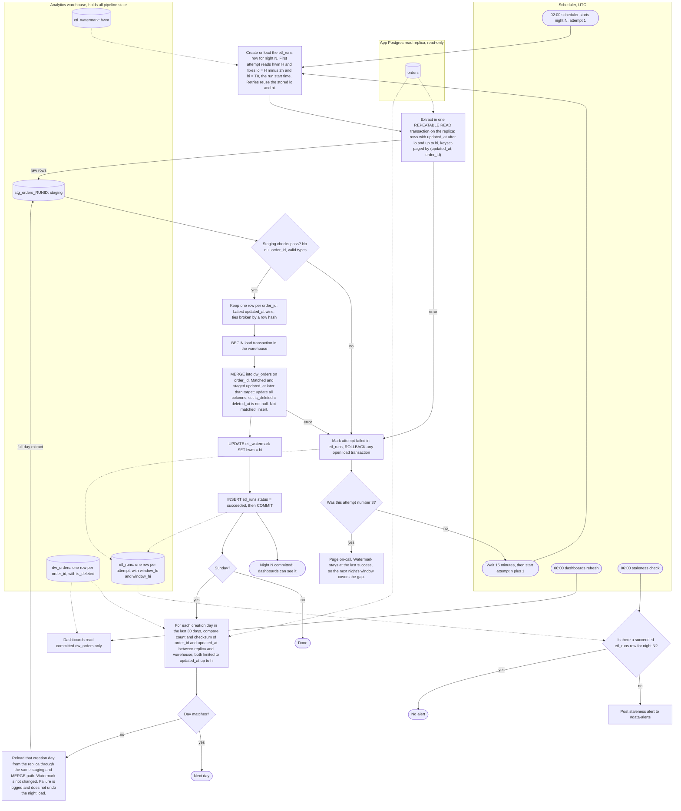

# Nightly orders ETL: pipeline flowchart

## Notes

**What starts each step.** The 02:00 UTC scheduler starts night N as attempt 1. A failed attempt starts the next attempt 15 minutes later, up to three attempts in total. The 06:00 UTC dashboard refresh and staleness check are separate scheduled triggers, not part of the load.

**Data movement.** Rows move from the app's replica (read-only) into a per-run staging table in the warehouse, then are merged into `dw_orders`. The app database is never written to. Reconciliation reads the replica and the warehouse and writes only to the warehouse.

**Where state lives.** All bookkeeping is in the warehouse:
- `etl_watermark` holds the high-water mark (`hwm`).
- `etl_runs` holds one row per attempt for each night, with `window_lo`, `window_hi`, attempt number, status and error.
- `stg_orders_RUNID` is the per-attempt staging table, dropped after commit or failure.
- `dw_orders` is the target, with one row per `order_id`, `is_deleted`, and `loaded_run_id`.

**Window and high-water mark.** The night's window is `lo = hwm - 2h` to `hi = T0`, where T0 is the run start time captured once. `hi` is stored on the `etl_runs` row, so retries repeat the exact same window. The high-water mark is set to `hi`, not to the maximum `updated_at` seen, because a late-visible row could sit below the maximum and be skipped. Setting it to `hi` is safe: any row stamped before `hi` that was invisible tonight is inside the next night's window, which starts at `hi - 2h`. That 2-hour overlap covers the 90-minute visibility lag of bulk-import transactions.

**Staging and dedupe.** Extraction is keyset-paged on `(updated_at, order_id)` inside one REPEATABLE READ transaction, so the extract is a consistent snapshot. The staged rows are reduced to one row per `order_id`, keeping the latest `updated_at`. Ties are broken by a row hash so the result is deterministic.

**Merge logic.** The MERGE is keyed on `order_id`. It updates a matched row only when the staged `updated_at` is strictly later than the target's. Unmatched rows are inserted. `is_deleted` is derived from `deleted_at IS NOT NULL` in the same statement. Because the guard is strict, re-running a night or extracting an older version never overwrites newer data, and the result is idempotent.

**Atomic visibility.** The MERGE and the watermark update run in one warehouse transaction that commits once. Dashboards read only committed state, so they see either the previous night or the complete new night, never a partial load. This assumes the warehouse supports multi-statement transactions. If it does not, the fallback is to load into a new table version and swap a view in one step.

**Failure and retry.** A failure at extract, staging checks or MERGE triggers ROLLBACK, marks the attempt failed in `etl_runs`, and leaves the watermark unchanged. Attempts 2 and 3 are 15 minutes apart. After attempt 3 fails, on-call is paged. A failed night does not lose data: the next night's window starts from the last successful `hwm`, so it picks up the gap.

**Staleness.** At 06:00 UTC, the check looks for a succeeded `etl_runs` row for night N. If there is none, it posts to #data-alerts. Dashboards still refresh at 06:00 and show the last committed night, which is consistent but one night old.

**Reconciliation.** Each Sunday, after the night's commit, the job compares each creation day in the last 30 days. Both sides are limited to `updated_at` up to `hi`, so in-flight changes do not cause false mismatches. The checksum is an order-independent aggregate, for example a sum of truncated md5 values of a canonical `order_id|updated_at` string in UTC microseconds, computed identically on both sides. A mismatched day is reloaded in full from the replica through the same staging and MERGE path. The watermark is not touched.

**Assumptions and open points.**
- The brief does not name a creation timestamp. This design assumes `orders` has a `created_at` column, which reconciliation uses to group rows by creation day. Dates are taken in UTC.
- If the replica itself is behind, a reload reproduces the same gap. The job should log days that still mismatch after reload, so they are visible on the next Sunday.
- Hard deletes never happen, so a reload never needs to remove rows from the warehouse.
- The exact checksum expression and the staging-check rules still need to be written and agreed with the team.