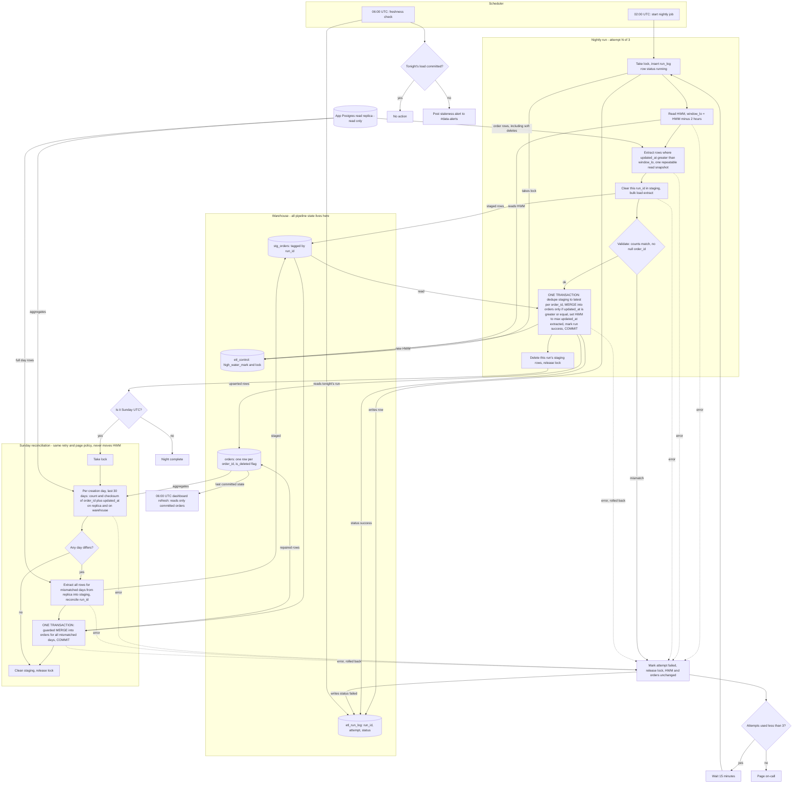

# Nightly orders ETL: replica to warehouse

## Design decisions

**Where state lives.** All state is in the warehouse. The replica is read-only. Three warehouse tables hold pipeline state.

| Table | Purpose |
|---|---|
| `etl_control` | One row per pipeline. Holds `high_water_mark` (timestamptz) and a `lock_owner` / `lock_expires_at` lease. The lease stops the nightly run and the Sunday reconciliation from overlapping. |
| `etl_run_log` | One row per attempt. Columns: `run_id`, `kind` (nightly or reconcile), `night_date`, `attempt` (1 to 3), `status` (running, success, failed), `window_lo`, `rows_extracted`, `new_hwm`, `started_at`, `finished_at`, `error`. |
| `stg_orders` | Staging copy of the replica columns plus `run_id`. Dashboards never read it. |

The target is `orders`, with primary key `order_id`. It has all source columns plus `is_deleted` (boolean).

**What starts each step.**
- The scheduler starts the nightly job at 02:00 UTC.
- Each step after that is triggered by the success of the previous one.
- A failure triggers the retry timer, or the page after attempt 3.
- A second scheduler entry at 06:00 UTC starts the freshness check.
- The Sunday reconciliation starts when that night's load commits, only on Sundays UTC.

**Extract.**
- Read the high-water mark (HWM) from `etl_control`.
- Set `window_lo = HWM - 2 hours`.
- On the replica, in one `REPEATABLE READ` read-only transaction, run:
  ```sql
  SELECT <all order columns>, (deleted_at IS NOT NULL) AS is_deleted
  FROM orders WHERE updated_at > :window_lo
  ```
- Soft deletes are ordinary writes that bump `updated_at`, so they arrive through the same query. No separate delete path is needed.
- On first ever run, the HWM is seeded to the epoch, which gives a full backfill.

**Stage.**
- Delete any existing `stg_orders` rows for this `run_id`, then bulk-load the extract into `stg_orders` tagged with `run_id`.
- Staging is separate from the final commit, so a failure here leaves `orders` and the HWM untouched.
- Before committing, validate that the staged row count equals the extract count and that `order_id` has no nulls.

**Merge and commit.** One warehouse transaction does all of the following:
1. Deduplicate staging to the latest version per `order_id`:
   ```sql
   SELECT * FROM stg_orders WHERE run_id = :r
   QUALIFY row_number() OVER (PARTITION BY order_id ORDER BY updated_at DESC) = 1
   ```
2. Upsert into `orders`:
   ```sql
   MERGE INTO orders t USING (<deduped>) s ON t.order_id = s.order_id
   WHEN MATCHED AND s.updated_at >= t.updated_at THEN UPDATE SET <all columns>
   WHEN NOT MATCHED THEN INSERT ...
   ```
3. Set `etl_control.high_water_mark = max(updated_at)` of the extracted rows. If the extract was empty, leave the HWM unchanged.
4. Mark the `etl_run_log` row as `success`.
5. `COMMIT`.

Why this is safe:
- **No half-loaded night.** Merge, HWM advance and run status commit together. Dashboards see either the previous complete state or the new complete state.
- **HWM advances only on success.** It is written inside the same transaction as the data.
- **One current row per `order_id`.** The key is `order_id`, and the `>=` guard means an older overlapping copy can never overwrite a newer row. Re-running a night is a no-op beyond refreshing identical rows.
- **Replica lag.** The HWM is the largest `updated_at` actually seen, not the wall clock. If the replica is behind, the HWM stays behind with it. Anything lag still hides beyond the 2-hour lookback is left to the Sunday reconciliation.

After commit, delete this run's staging rows. A housekeeping step also drops staging rows older than 7 days.

**Failure and retry.**
- Any failure in extract, stage, validate or merge rolls back the transaction. Nothing is committed and the HWM is unchanged.
- The attempt is marked `failed` in `etl_run_log` and the lock is released. A lease expiry covers a crashed process.
- If fewer than 3 attempts have been made, wait 15 minutes and start a new attempt. Each retry re-reads the HWM and recomputes the window.
- After the third failed attempt, page on-call. The worst case is attempts at about 02:00, 02:15 and 02:30 plus run time, so paging happens well before 06:00 unless the loads are slow.

**06:00 freshness check.**
- Dashboards refresh at 06:00 regardless. They read only committed data, so the worst case is yesterday's data, never partial data.
- The check queries `etl_run_log` for a `success` row for tonight's `night_date`. If there is none, it posts a staleness alert to #data-alerts, once per night.
- Retries keep running after the alert and may still commit later.

**Sunday reconciliation.** This is my choice for the details the brief left open.
- It starts only after the Sunday nightly load has committed. If that load permanently failed, reconciliation is skipped and on-call has already been paged. The next Sunday run covers the same 30-day range.
- It takes the same lock as the nightly job and never touches the HWM.
- For each order-creation day (`created_at::date`) in the last 30 days, it computes `count(*)` and a checksum on both the replica and the warehouse. The checksum is `SUM` of a 64-bit hash of `order_id || '|' || updated_at`, which does not depend on row order. The warehouse side includes deleted rows.
- Any day where either value differs is reloaded. All of that day's rows are extracted from the replica into `stg_orders` with a reconcile `run_id`. Then one transaction merges all mismatched days using the same `>=` guarded merge, so the result is atomic.
- It uses the same 2-more-tries, 15-minute-apart, then page policy. It does not trigger the staleness alert, because dashboards still see a complete state.
- Rows that changed during the comparison can cause a harmless extra reload. They are never lost.

## Flowchart



## Why it holds together

- **One row per order, newest version.** `order_id` is the merge key and the `updated_at >=` guard blocks stale overwrites.
- **Safe re-runs.** Merging the same rows twice produces the same table.
- **No lost late rows within 90 minutes.** The 2-hour lookback covers the bulk-import visibility delay.
- **Dashboards never see partial data.** The data and the HWM commit atomically, and staging is invisible to them.
- **Rows later than the lookback.** The Sunday checksum comparison catches them within 30 days of order creation. Anything made visible after that window is outside scope, as the brief defines it.
