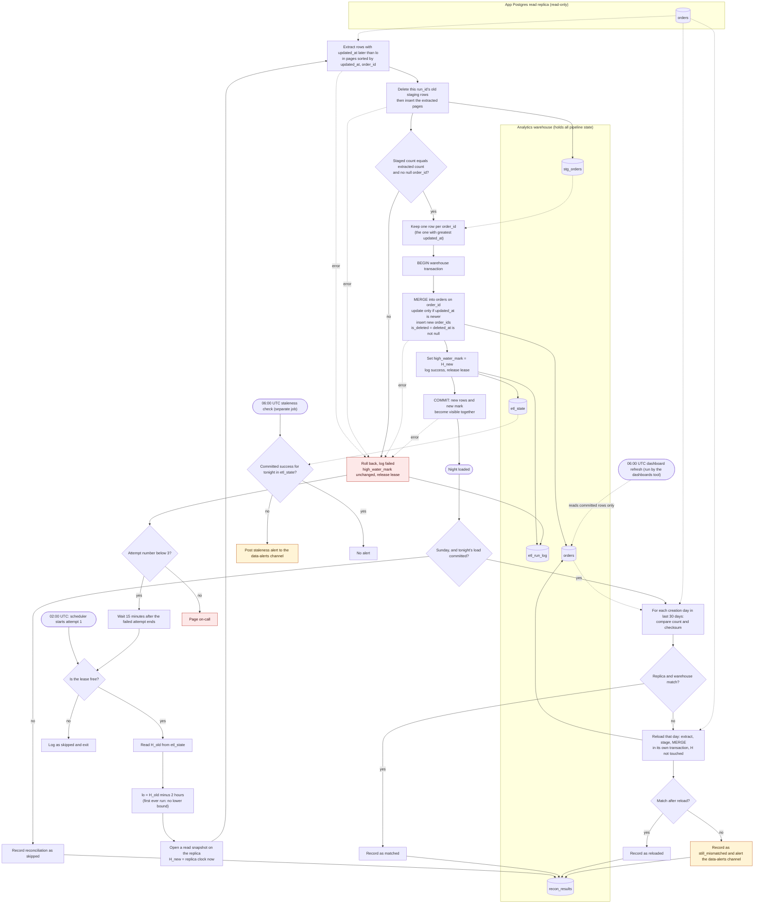

# Nightly orders ETL into the warehouse

Each night, a job copies rows that changed in the app's `orders` table into the analytics warehouse. It reads from a read replica (a read-only copy of the app's database), so it never touches the live app. It merges the changed rows into the warehouse so that each `order_id` appears exactly once, in its latest version.

The job saves its high-water mark (the timestamp that means "everything up to here is loaded") in the same transaction that commits the data. The mark and the data therefore always agree. Dashboards read only committed data. Once a week, a reconciliation compares the last 30 days of orders between the replica and the warehouse and reloads any day that differs.

### Terms used below
- **Replica**: a read-only copy of the app's Postgres database. The job only reads from it.
- **Warehouse**: the analytics database. All of the job's own bookkeeping lives here.
- **Attempt (run)**: one execution of the job. Each attempt gets its own `run_id`.
- **High-water mark (H)**: a timestamp stored in the warehouse that means "loaded up to here." `H_old` is the value an attempt starts with. `H_new` is the value it saves when it succeeds.
- **Lookback**: a 2-hour overlap. Each night's window starts 2 hours before `H_old`, so rows that became visible late are read again.
- **Lease**: a lock row in the warehouse so that only one attempt works at a time. A lease expires, so a crashed attempt cannot block later ones.
- **Snapshot**: a fixed view of the replica at one moment. Reads from the same snapshot agree with each other even while the app keeps writing.
- **Keyset paging**: reading a large result in pages. Each page starts just after the last row of the previous page, so no row is skipped or repeated at a page boundary.
- **Staging**: a temporary table where extracted rows wait before they are merged.
- **MERGE**: one SQL statement that updates rows that already exist and inserts rows that are new.
- **Transaction**: a group of database changes that commit together or not at all.

## Notes

### What starts each step
- The scheduler starts attempt 1 at 02:00 UTC. If an attempt fails, the next attempt starts 15 minutes after the failed one ends. There are at most three attempts. Each retry goes through the lease check and the window calculation again.
- The 06:00 UTC staleness check is a separate scheduled job. It reads only `etl_state`.
- The 06:00 UTC dashboard refresh is run by the dashboards tool. The pipeline does not trigger it.
- The Sunday reconciliation starts only after that night's load has committed. "That night's load" means the run that started at 02:00 UTC that day.

### Data movement
1. **Replica to staging.** The job runs a read-only query on the replica for `orders` rows whose `updated_at` is later than `lo`. The query returns pages sorted by `(updated_at, order_id)` using keyset paging. All pages come from one snapshot, so they agree with each other. Nothing is written to the app database.
2. **Staging.** `stg_orders` holds rows tagged with the attempt's `run_id`. Before inserting, the attempt deletes any rows already carrying its own `run_id`. A retry therefore replaces its earlier staging instead of adding to it. Dashboards never read staging.
3. **Staging to `orders`.** One MERGE per night, inside one warehouse transaction that also moves the high-water mark.
4. **Reconciliation.** Counts and checksums are read from both sides. A reload copies one creation day from the replica into staging, then merges that day into `orders` in its own transaction.

### Where state lives
All pipeline state is in the warehouse. The replica holds none.
- `etl_state` (one row per pipeline): `high_water_mark`, `lease_run_id`, `lease_expires_at`, `last_success_run_date`, `last_success_committed_at`.
- `etl_run_log` (one row per attempt): `run_id`, `attempt`, `started_at`, `finished_at`, `status` (running, success, failed, or skipped), `error`, `rows_extracted`, `rows_merged`.
- `stg_orders`: temporary staging rows, tagged by `run_id`.
- `recon_results` (one row per day checked): `creation_day`, `replica_count`, `warehouse_count`, `replica_checksum`, `warehouse_checksum`, `action` (matched, reloaded, still_mismatched, or skipped).

### Merge logic
- Rows match on `order_id`. An existing row is updated only if the incoming `updated_at` is strictly newer than the stored one. An equal `updated_at` means it is the same write, so the row is left alone. A new `order_id` is inserted.
- `is_deleted` is true when `deleted_at` is not null, and `deleted_at` is copied across. The job never removes a row from `orders`. The app's deletes arrive as updates, so the same rule handles them.
- Before the MERGE, staging is reduced to one row per `order_id`, keeping the row with the greatest `updated_at`. So the MERGE never sees two source rows with the same key.
- Because updates are guarded by `updated_at`, an older late-arriving version cannot overwrite a newer one. Re-running a night changes nothing for rows that have not changed.

### High-water mark: storage and advance
- Stored in `etl_state`. The value saved is `H_new`, the replica's clock reading taken when the extract's snapshot opens. It is not the largest `updated_at` seen. Using the largest `updated_at` would skip forever a row whose older `updated_at` becomes visible late.
- Moved in the same transaction as the MERGE, so the data and the mark commit together or not at all. A failed attempt leaves `H_old` in place, so the next attempt reads the same window.
- Why the 2-hour lookback covers bulk imports: a bulk-import row becomes visible only when its transaction commits, which can be up to 90 minutes after its `updated_at`. Suppose the row is not visible at snapshot time `S`. Its `updated_at` is then later than `S` minus 90 minutes. The next night's window starts at `H_new` minus 2 hours, which is `S` minus 2 hours. That is 30 minutes earlier than `S` minus 90 minutes, so the row falls inside the window. The extra 30 minutes covers clock skew between the app writer and the replica.
- First ever run: there is no `H_old`, so the extract has no lower bound and loads every row. The mark is saved on commit as usual.

### Concurrency
- An attempt takes the lease with a conditional UPDATE (one that succeeds only if the row is still in the state the attempt expects). It releases the lease on success or on final failure. An attempt that finds the lease held exits as skipped. So a manual re-run during a live run does nothing.
- If a lease expires, a new attempt can take it. So a crashed attempt cannot block the pipeline forever.
- A manual re-run after a success is harmless. `H` has already moved on, so the window re-reads only the overlap, and the MERGE changes nothing for unchanged rows.

### Failure and retry
- Any error (extract, staging, validation, MERGE, or commit) rolls back the warehouse transaction, writes a failed row to `etl_run_log`, leaves `H` unchanged, and releases the lease.
- At most three attempts. If the third attempt fails, the job pages on-call. There are no further automatic attempts.
- An attempt still running at 06:00 keeps going. The staleness alert still fires, because it reports only what had committed by 06:00.

### 06:00 UTC staleness check
- Reads `etl_state` for a committed success for that night's run date. If there is none, it posts an alert to the data-alerts channel.
- Dashboards show the last fully committed night. They never see a partial night, because `orders` changes only inside committed transactions.

### Sunday reconciliation
- Runs after that night's load commits. If the load did not commit, the reconciliation is skipped and recorded with action `skipped`.
- Scope: each order creation day in the last 30 days, by `orders.created_at`.
- Both sides compute the same thing: `count(*)`, and a checksum over `order_id` and `updated_at`. Timestamps are converted to UTC microseconds, and rows are taken in `order_id` order. That makes the checksum identical on both sides when the data is identical.
- If a day mismatches, it is reloaded through the same staging and MERGE, in its own transaction. The reload does not touch `H`. The day is then compared again. If it still differs, it is recorded as `still_mismatched` and posted to the data-alerts channel.
- Each reload commits on its own. Dashboards may therefore see a repaired day appear while reconciliation is still running. That changes one day, not a partial night.

### Assumptions and open items
- `orders.created_at` exists. The reconciliation needs it.
- The warehouse supports multi-statement transactions that include a MERGE. If it does not, build the new state in a side table and swap it in atomically.
- Two different versions with the same `updated_at` are not expected. If they can occur, add a write-sequence tie-break column (a column that records the order in which writes happened).
- The app writer's clock is within about 30 minutes of the replica's clock.
- The lease expiry must be longer than the longest possible run. If a run outlives its lease, a second run could start. Before the MERGE, the run should confirm, inside the same transaction, that it still holds the lease.
- Reconciliation covers only orders created in the last 30 days. A row created earlier that drifts is not repaired.
- A reload cannot move a row backwards. If the warehouse holds a newer version than the replica, that day stays mismatched and is alerted.
- Alerting for a failed reconciliation is a design choice. The brief does not specify it.
- "15 minutes apart" is read as 15 minutes after the failed attempt ends.