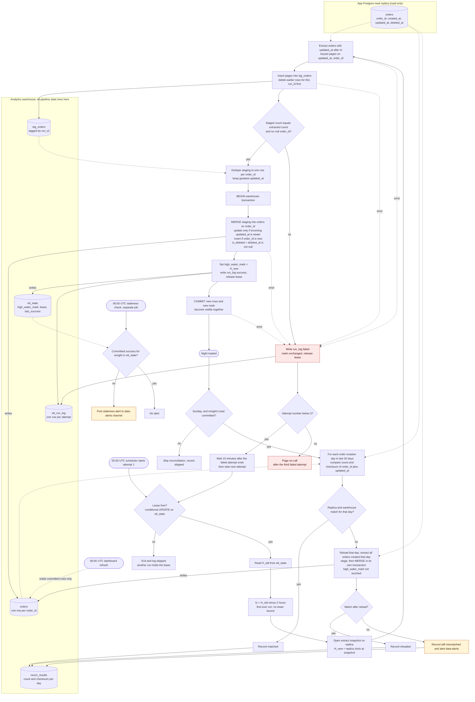

# Nightly orders ETL into the warehouse

Each night the job copies changed rows from the app's `orders` replica into the warehouse, merges them into one current row per `order_id`, and advances the high-water mark only inside the same transaction that commits the data. Dashboards read only committed rows, and a Sunday reconciliation repairs any day that drifted.

## Notes

### What starts each step
- The 02:00 UTC scheduler starts attempt 1. Attempts 2 and 3 start 15 minutes after the previous attempt ends, and each one goes through the same lease and window logic.
- The 06:00 UTC staleness check is a separate scheduled job. It reads only `etl_state`.
- The 06:00 UTC dashboard refresh is owned by the dashboards and is not triggered by the pipeline.
- The Sunday reconciliation starts only after that night's load has committed.

### Data movement
1. **Replica to staging.** A read-only extract of `orders` rows with `updated_at` after `lo`, paged by keyset on `(updated_at, order_id)` so a page boundary cannot skip rows. Nothing is written to the app database.
2. **Staging.** `stg_orders` is keyed by `run_id`. Earlier rows for the same `run_id` are deleted before insert, so a retry overwrites its staging instead of piling up. Dashboards never read staging.
3. **Staging to `orders`.** One MERGE per night, in one warehouse transaction with the mark update.
4. **Reconciliation.** Counts and checksums are read from both sides. A reload moves one creation day from the replica to staging and then to `orders`.

### Where state lives (all in the warehouse)
- `etl_state` (one row per pipeline): `high_water_mark`, `lease_run_id`, `lease_expires_at`, `last_success_run_date`, `last_success_committed_at`.
- `etl_run_log` (one row per attempt): `run_id`, `attempt`, `started_at`, `finished_at`, `status` (running, success, failed, skipped), `error`, `rows_extracted`, `rows_merged`.
- `stg_orders`: transient batch, tagged by `run_id`.
- `recon_results` (one row per day checked): `creation_day`, `replica_count`, `warehouse_count`, `replica_checksum`, `warehouse_checksum`, `action` (matched, reloaded, still_mismatched).
- The replica holds no pipeline state.

### Merge logic
- MERGE on `order_id`. The update applies only when the incoming `updated_at` is strictly newer than the stored one. An equal `updated_at` means the same write, so the row is left alone. A missing `order_id` is inserted.
- `is_deleted = deleted_at IS NOT NULL`, and `deleted_at` is copied. No row is ever removed from `orders`.
- Staging is deduped to one row per `order_id` (greatest `updated_at`) before the MERGE, so the MERGE never sees duplicate source keys.
- Because the update is guarded by `updated_at`, an older late-arriving version cannot overwrite a newer one. Re-running a night is a no-op for rows that have not changed.

### High-water mark: storage and advance
- Stored in `etl_state`, in the warehouse. The stored value is `H_new`, the replica clock at the extract snapshot. It is not `max(updated_at)`, because a row with an older `updated_at` that becomes visible late would be skipped.
- Advanced in the same warehouse transaction as the MERGE, so data and mark commit together or not at all. A failed attempt leaves `H` unchanged, so the next attempt reads the same window.
- Why the 2-hour lookback is enough: a row not visible at snapshot time `S` commits at `C > S`, and its `updated_at` is `T >= C - 90 min > S - 90 min`. That is `T > H_new - 90 min`, which is inside the next night's window starting at `H_new - 2 hours`. The remaining 30 minutes absorbs clock skew between the app writer and the replica clock.
- First ever run: no `H`, so it is a full load. The mark is set on commit.

### Concurrency
- A run takes a lease in `etl_state` with a conditional UPDATE and releases it on success or on final failure. A manual re-run during a live run exits as skipped. The lease expires, so a crashed run cannot block the pipeline forever.
- A manual re-run after success is harmless: `H` has advanced, so the window re-extracts the overlap and the MERGE is a no-op for unchanged rows.

### Failure and retry
- Any error (extract, stage, validation, MERGE, commit) writes a failed row to `etl_run_log`, leaves `H` unchanged, and releases the lease.
- Three attempts in total. A failed third attempt pages on-call and there are no further automatic attempts.
- An attempt that is still running at 06:00 keeps going. The staleness alert still fires, because it reports only what had committed at 06:00.

### 06:00 UTC staleness check
- The check reads `etl_state` for a committed success for tonight's run date. If there is none, it posts to `#data-alerts`.
- Dashboards show the last fully committed night. They never see a partial night, because `orders` changes only inside committed transactions.

### Sunday reconciliation
- Runs after tonight's load commits. If the load did not commit, it is skipped and recorded as skipped.
- Scope: each order creation day in the last 30 days, using `orders.created_at`.
- Comparison on both sides: `count(*)` and a checksum over `order_id` and `updated_at`, with timestamps normalized to UTC microseconds and rows in `order_id` order. Both sides must use the same expression.
- On a mismatch, the day is reloaded with the same staging and MERGE in its own transaction. The reload does not touch the high-water mark. The day is then compared again. If it still differs, it is recorded as `still_mismatched` and posted to `#data-alerts`.

### Assumptions and open items
- `orders.created_at` exists. The reconciliation needs it, and the brief implies it.
- The warehouse supports multi-statement transactions containing MERGE. If it does not, build the new state in a side table and swap it in atomically.
- Two different versions with the same `updated_at` are not expected. If they can occur, add a write-sequence tie-break column.
- The app writer's clock is within about 30 minutes of the replica clock.
- Alerting for a failed reconciliation is my choice; the brief does not specify it.
- "15 minutes apart" is read as 15 minutes after the failed attempt ends.