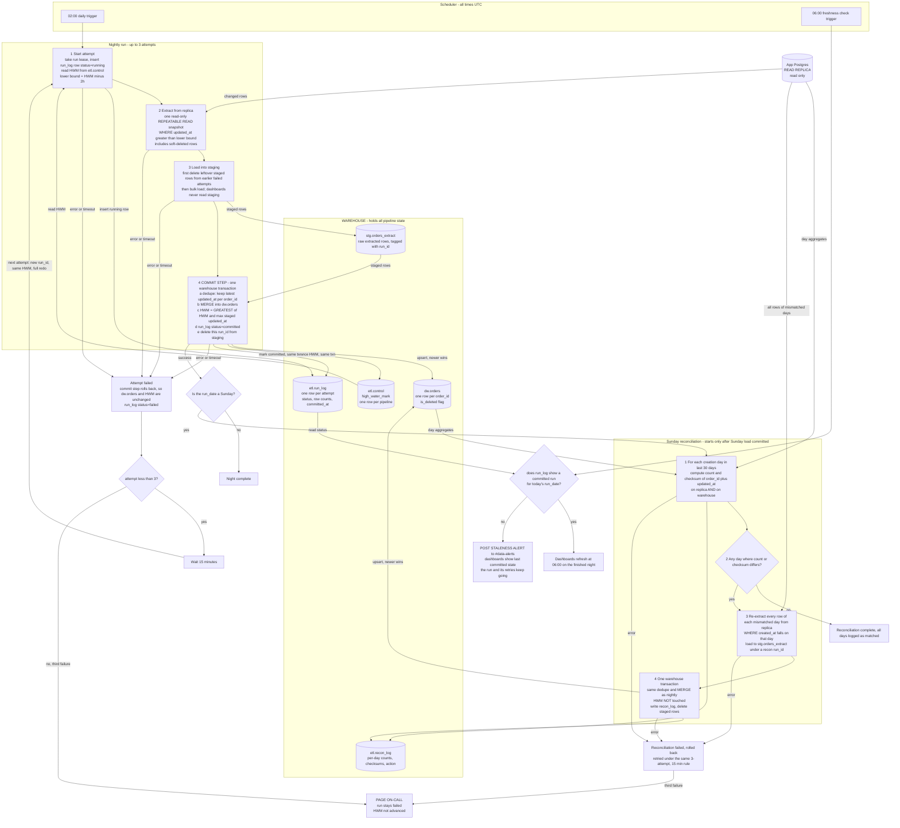

# Nightly orders ETL into the warehouse

## Summary

A scheduler job runs at 02:00 UTC and copies changed rows from the app's `orders` table into the analytics warehouse. Each run has three parts:

1. **Extract.** Read every order whose `updated_at` is later than the stored high-water mark (HWM) minus 2 hours. Read from the Postgres read replica only.
2. **Stage.** Bulk-load those rows into a staging table in the warehouse. Nothing reads staging except the commit step.
3. **Commit.** In one warehouse transaction, dedupe the staged rows, merge them into `dw.orders`, advance the HWM and mark the run committed.

Because the commit is a single transaction, dashboards see either the old data or the finished night, never a partial load. The 2-hour overlap means the same order is often extracted twice. The merge is built so that this is harmless. All pipeline state (HWM, run history, staging) lives in the warehouse. Nothing is written to the app database.

What starts work:

- The 02:00 trigger starts attempt 1 of the nightly run.
- A failed attempt starts a retry 15 minutes later (at most twice).
- The 06:00 trigger starts a freshness check.
- A committed Sunday run starts the reconciliation.

## Terms

- **HWM (high-water mark).** One timestamp in the warehouse: the largest `updated_at` the pipeline has loaded. The next night starts reading from just before it.
- **Lookback.** The 2-hour step back from the HWM. Bulk imports can hold a transaction open for up to 90 minutes, and `updated_at` is stamped at write time, not commit time. A row can therefore become visible on the replica up to 90 minutes after its `updated_at`. Reading from HWM minus 2 hours catches such rows with 30 minutes to spare.
- **Soft delete.** The app never deletes rows. It sets `deleted_at`, which also updates `updated_at`. The warehouse keeps these rows and sets `is_deleted = true`.
- **Attempt.** One try at a nightly run. Each attempt has its own `run_id`.
- **`run_date`.** The UTC date on which a nightly run was scheduled. A retry keeps the `run_date` of the run it repeats, even after midnight.
- **Run lease.** A lock row in the warehouse that stops two attempts from running at the same time.
- **Upsert.** Insert the row if its `order_id` is new, otherwise update the existing row. Here, "newer wins": an update applies only if the incoming `updated_at` is greater.

## Flowchart

Read it top to bottom. Cylinders are data stores, and arrows into or out of them show what is read or written. Everything inside the WAREHOUSE box is pipeline state.



## Where state lives

All state is in the warehouse.

| Object | Purpose |
|---|---|
| `etl.control` | One row per pipeline (`orders`) holding `high_water_mark timestamptz`. The only source of truth for where the next night starts. Seeded once at first deploy, either to the earliest `updated_at` or to a chosen backfill start. |
| `etl.run_log` | One row per attempt: `run_id`, `run_date`, `attempt`, `status` (running, failed, committed), the lower bound used, rows extracted and `committed_at`. It drives the retry count, the Sunday trigger and the 06:00 check. |
| `stg.orders_extract` | Landing table, tagged by `run_id`. Holds raw replica rows, possibly with duplicates. Dashboards never read it. |
| `dw.orders` | The served table, with exactly one row per `order_id`. |
| `etl.recon_log` | Per-day counts, checksums and whether a reload happened. |

The run lease keeps attempts from overlapping. The nightly run and the reconciliation never overlap either, because the reconciliation starts only after the Sunday load commits.

## What starts each step

- **02:00 UTC scheduler trigger.** Starts attempt 1.
- **Failure of any step.** The orchestrator waits 15 minutes, then starts the next attempt. This happens at most twice, so there are 3 attempts in total.
- **Third failure.** Pages on-call.
- **06:00 UTC scheduler trigger.** Starts a separate check job, independent of the load. It reads `run_log`. If today's run is not `committed`, it posts to #data-alerts. A run still retrying at 06:00 keeps going, and dashboards keep the last committed data until it commits.
- **Successful commit of a Sunday run.** Starts the reconciliation. It depends on that commit rather than on a clock time, so it always runs after that night's load. If Sunday's load fails all 3 attempts, the reconciliation does not run, and on-call has already been paged.

## Data movement and logic

**Extract.**
- The query is `SELECT * FROM orders WHERE updated_at > :lower`, with `:lower = HWM - interval '2 hours'`.
- It runs on the replica in one read-only `REPEATABLE READ` transaction, so the extract is a consistent snapshot.
- Soft-deleted rows are included, because setting `deleted_at` bumps `updated_at`.

**Stage.**
- Rows are bulk-loaded into `stg.orders_extract`, tagged with the attempt's `run_id`.
- This load is outside the commit transaction. That is safe because only the commit step reads staging.
- A failed attempt leaves its staged rows behind. The next attempt first deletes all leftover rows from earlier failed attempts, then loads. The run lease guarantees no other attempt is using staging at that moment. Each attempt has a new `run_id`, so its rows never mix with an earlier attempt's.

**Commit, in one transaction.** This step makes a night all-or-nothing.

```sql
BEGIN;

WITH latest AS (
  SELECT * FROM (
    SELECT s.*, ROW_NUMBER() OVER (PARTITION BY order_id
                                   ORDER BY updated_at DESC) AS rn
    FROM stg.orders_extract s WHERE run_id = :run_id
  ) ranked WHERE rn = 1
)
MERGE INTO dw.orders t
USING latest s ON t.order_id = s.order_id
WHEN MATCHED AND s.updated_at > t.updated_at THEN
  UPDATE SET /* all columns */ ..., is_deleted = (s.deleted_at IS NOT NULL)
WHEN NOT MATCHED THEN
  INSERT (...) VALUES (..., (s.deleted_at IS NOT NULL));

UPDATE etl.control
   SET high_water_mark = GREATEST(high_water_mark,
         (SELECT MAX(updated_at) FROM stg.orders_extract WHERE run_id = :run_id))
 WHERE pipeline = 'orders';   -- skipped if staging is empty

UPDATE etl.run_log SET status = 'committed', committed_at = now() WHERE run_id = :run_id;
DELETE FROM stg.orders_extract WHERE run_id = :run_id;

COMMIT;
```

- **One row per `order_id`.** The dedupe keeps the latest version within this extract. The `MERGE` key keeps one row across nights.
- **Newer wins.** The condition `s.updated_at > t.updated_at` means an older or identical version never overwrites a newer one. Re-running a night, or extracting the same order on two nights, changes nothing.
- **Deleted orders stay.** They are updated in place with `is_deleted = true` and never removed.

**Why the HWM advances inside the commit transaction.**
- The HWM, the merge and the `committed` status succeed or fail together. That satisfies "advance only once loaded" and "no half-loaded night".
- A crash at any point leaves the old HWM and old data, so a rerun is safe.
- The new HWM is the largest `updated_at` actually staged, never the wall clock. A row that becomes visible late therefore still falls inside the next night's lookback.
- `GREATEST` means the HWM never moves backward.

**Sunday reconciliation.** The lookback does not cover every late row, for example when the replica falls far behind. This weekly check finds and fixes what it missed.
- For each creation day (the UTC date of `created_at`) in the last 30 days, both sides compute `COUNT(*)` and an order-independent checksum.
- The checksum is the `SUM`, over the day's rows, of the first 64 bits of `md5(order_id || '|' || updated_at)`. `updated_at` is normalised to UTC at microsecond text precision, and the same expression runs on both sides.
- Warehouse counts include `is_deleted` rows, to match the replica.
- Every mismatched day is re-extracted in full from the replica and merged with the same logic, in one transaction covering all mismatched days.
- The reload only upserts. It never touches the HWM.
- If the replica is still behind and the warehouse already holds a newer `updated_at`, the `>` guard keeps the warehouse row. The day may then mismatch again next Sunday until the replica catches up. That is logged, not treated as an error.

## Failure behaviour

| Failure | Result |
|---|---|
| Replica unreachable or extract error | Attempt fails. Retry after 15 minutes. |
| Staging load fails | Same as above. |
| Commit step fails (merge or HWM update) | The transaction rolls back, so `dw.orders` and the HWM are exactly as before. Retry. |
| Crash after commit, before the scheduler hears back | Data and HWM are already correct. The retry re-extracts the same window and changes nothing. |
| 3rd attempt fails | Page on-call. The HWM stays put, and the next 02:00 run automatically covers the larger window. |
| Load not committed by 06:00 | Staleness alert to #data-alerts. Dashboards show the last committed state, not a partial one. |
| Reconciliation fails | Rolled back, retried under the same 3-attempt, 15-minute rule, then paged. The nightly path is unaffected. |

## Assumptions

- The warehouse supports multi-statement transactions with `MERGE`, or delete-and-insert inside one transaction. If it does not, the same atomicity can come from loading into a shadow table and swapping it in.
- `orders.created_at` never changes, so it can define the reconciliation day buckets.
- The scheduler can express "retry in 15 minutes, max 3 attempts", a step that depends on the Sunday load, and a separate 06:00 job.
- The reconciliation's retry-and-page policy is my choice. The brief specifies it only for the nightly run.