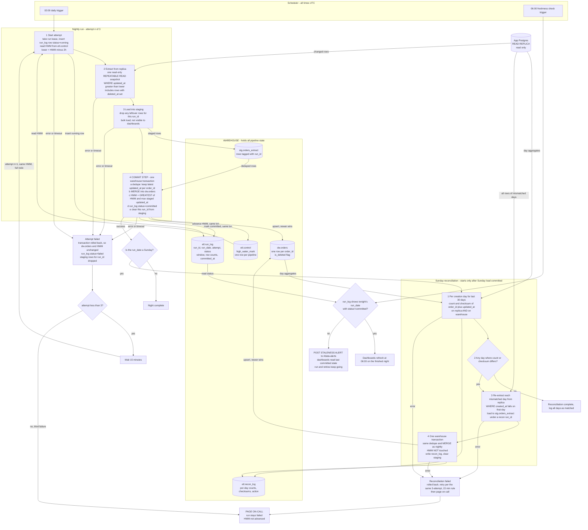

# Nightly orders ETL into the warehouse

## Summary

A scheduler job runs at 02:00 UTC. It reads rows changed since the stored high-water mark (HWM) minus 2 hours from the read replica and loads them into a staging table in the warehouse. In one warehouse transaction it then dedupes, merges into `dw.orders`, advances the HWM and marks the run committed. Because those steps commit together, dashboards see either the old state or the finished night, never a partial load. All pipeline state lives in the warehouse. Nothing is written to the app database.

## Flowchart



## Where state lives

All state is in the warehouse.

| Object | Purpose |
|---|---|
| `etl.control` | One row per pipeline (`orders`) with `high_water_mark timestamptz`. The only source of truth for where the next night starts. Seeded once at first deploy, either to the earliest `updated_at` or to a chosen backfill start. |
| `etl.run_log` | One row per attempt, with `run_id`, `run_date`, `attempt`, `status` (running, failed, committed), the lower bound used, rows extracted and `committed_at`. It drives the 06:00 check, the retry count and the Sunday trigger. |
| `stg.orders_extract` | Landing table, tagged by `run_id`. Raw replica rows, possibly with duplicates. Dashboards never read it. |
| `dw.orders` | The served table, with one row per `order_id`. |
| `etl.recon_log` | Per-day counts, checksums and whether a reload happened. |

The run lease prevents two attempts from overlapping. The nightly run and the reconciliation also never overlap, because the reconciliation only starts after the Sunday load commits.

## What starts each step

- **02:00 UTC scheduler trigger.** Starts attempt 1.
- **Failure of any step.** Starts the retry. The orchestrator waits 15 minutes and starts the next attempt. This happens at most twice, giving 3 attempts in total.
- **Third failure.** Pages on-call.
- **06:00 UTC scheduler trigger.** Runs a separate check job, independent of the load. It reads `run_log`. If tonight's run is not `committed`, it posts to #data-alerts. A run still in retry at 06:00 keeps going, and dashboards keep the last committed data until it commits.
- **Successful commit on a Sunday run.** Triggers the reconciliation. It is a dependency of that run, not a fixed clock time, so it always runs after that night's load. If Sunday's load fails all 3 attempts, the reconciliation does not run and on-call is already paged.

## Data movement and logic

**Extract.**
- The query is `SELECT * FROM orders WHERE updated_at > :lower`, with `:lower = HWM - interval '2 hours'`.
- It runs against the replica in one read-only `REPEATABLE READ` transaction, so the extract is a consistent snapshot.
- Soft-deleted rows are included, because `deleted_at` is a write that bumps `updated_at`.
- The 2-hour lookback covers the 90-minute bulk-import gap with 30 minutes to spare.

**Stage.**
- Rows are bulk-loaded into `stg.orders_extract` with the `run_id`.
- This load is not transactional with `dw.orders` and doesn't need to be. A failed attempt just deletes its staged rows.
- A retry gets a new `run_id`, so it never mixes with a previous attempt's rows.

**Merge, in one transaction.** Order and the `updated_at` guard make re-runs safe.

```sql
BEGIN;

WITH latest AS (
  SELECT * FROM (
    SELECT s.*, ROW_NUMBER() OVER (PARTITION BY order_id
                                   ORDER BY updated_at DESC) AS rn
    FROM stg.orders_extract s WHERE run_id = :run_id
  ) WHERE rn = 1
)
MERGE INTO dw.orders t
USING latest s ON t.order_id = s.order_id
WHEN MATCHED AND s.updated_at > t.updated_at THEN
  UPDATE SET /* all columns */ ..., is_deleted = (s.deleted_at IS NOT NULL)
WHEN NOT MATCHED THEN
  INSERT (...) VALUES (..., (s.deleted_at IS NOT NULL));

UPDATE etl.control
   SET high_water_mark = GREATEST(high_water_mark,
         (SELECT MAX(updated_at) FROM stg.orders_extract WHERE run_id = :run_id))
 WHERE pipeline = 'orders';   -- skipped if staging is empty

UPDATE etl.run_log SET status = 'committed', committed_at = now() WHERE run_id = :run_id;
DELETE FROM stg.orders_extract WHERE run_id = :run_id;

COMMIT;
```

- **One row per `order_id`.** The dedupe keeps the latest version within the extract. The `MERGE` key keeps one row across nights.
- **Newer wins.** `s.updated_at > t.updated_at` means an older or identical version never overwrites a newer one. Re-running a night, or extracting the same order on two nights, changes nothing.
- **Deleted orders stay.** They are updated in place with `is_deleted = true`, never removed.

**Why the HWM lives in the commit transaction.**
- The HWM, the merge and the `committed` status commit together or not at all. That meets "advances only once loaded" and "no half-loaded night".
- A crash at any point leaves the old HWM and old data, so a rerun is safe.
- The HWM is the max `updated_at` actually staged, never the wall clock. A row that becomes visible late is therefore caught by the next night's lookback.
- `GREATEST` means the HWM never moves backward.

**Sunday reconciliation.**
- For each creation day (`created_at` date, UTC) in the last 30 days, both sides compute `COUNT(*)` and an order-independent checksum.
- The checksum is `SUM` over rows of the first 64 bits of `md5(order_id || '|' || updated_at)`, with `updated_at` normalised to UTC at microsecond text precision. The same expression runs on both sides.
- Warehouse counts include `is_deleted` rows, to match the replica.
- Any mismatched day is re-extracted in full from the replica and merged with the same logic, in one transaction covering all mismatched days.
- The reload only upserts and never touches the HWM.
- If the replica is still behind and the warehouse already holds a newer `updated_at`, the `>` guard keeps the warehouse row. The day may mismatch again next Sunday until the replica catches up. That is logged, not an error.

## Failure behaviour

| Failure | Result |
|---|---|
| Replica unreachable or extract error | Attempt fails, staged rows are dropped, retry after 15 minutes. |
| Staging load fails | Same as above. |
| Merge or HWM update fails | The transaction rolls back, so `dw.orders` and the HWM are exactly as before. Retry. |
| Crash after commit, before the scheduler hears back | Data and HWM are already correct. The retry re-extracts the same window and changes nothing. |
| 3rd attempt fails | Page on-call. The HWM stays put, and the next 02:00 run covers the larger window automatically. |
| Load not committed by 06:00 | Staleness alert to #data-alerts. Dashboards show the last committed state, not a partial one. |
| Reconciliation fails | Rolled back, retried under the same 3-attempt, 15-minute rule, then paged. The nightly path is unaffected. |

## Assumptions

- The warehouse supports multi-statement transactions with `MERGE` or an equivalent delete-and-insert in one transaction. If it doesn't, the same atomicity can come from loading into a shadow table and swapping it in.
- `orders` has an immutable `created_at`, used for the reconciliation day buckets.
- The scheduler can express "retry in 15 minutes, max 3 attempts", a dependent Sunday step, and a separate 06:00 job.
- The reconciliation retry-and-page policy is my choice, since the brief only specifies it for the nightly run.
