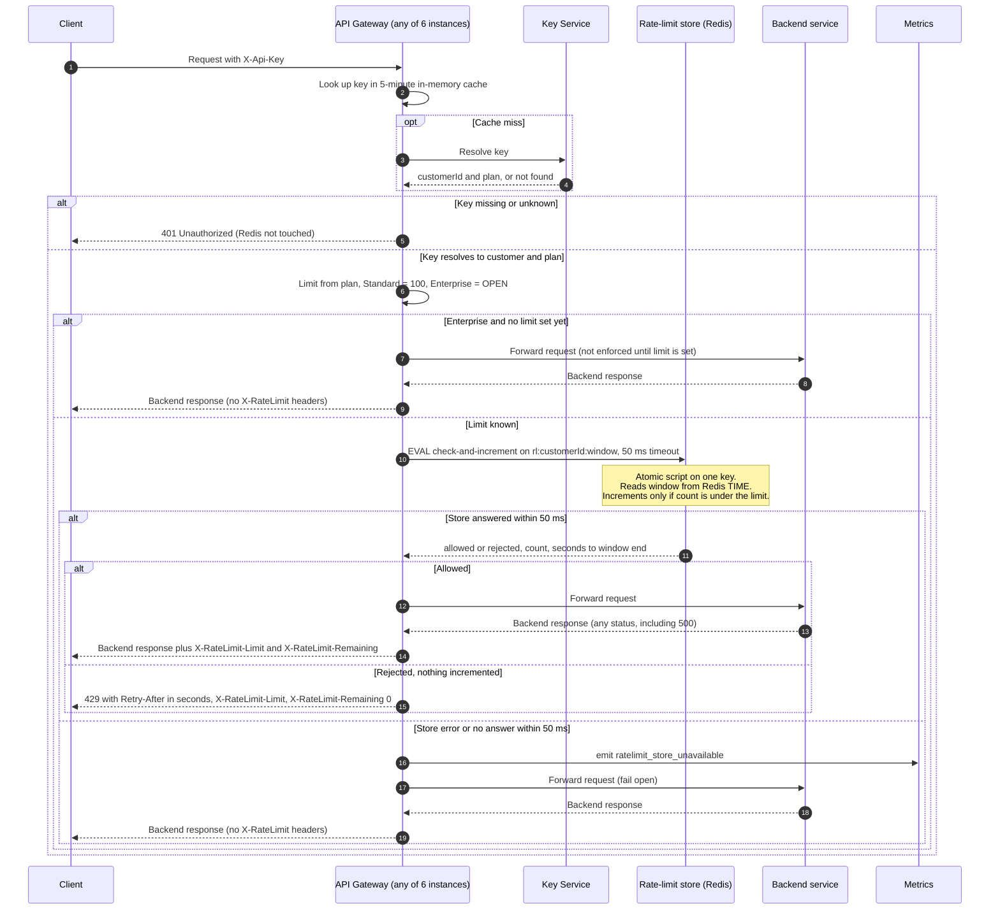

# Per-customer rate limiting on the public API

Design for a first version. Each gateway instance checks a shared Redis counter after authentication and before forwarding. One atomic script per request decides allow or reject, so the limit holds across all six instances. The diagram shows the request path, and the notes below it cover the decisions and open items.



## Decisions

**Store.** Redis, or any store with atomic server-side scripts. Each customer has one key per minute, `rl:{customerId}:{windowStart}`, with a TTL of 120 seconds. Keying on customer ID, not API key, gives one shared budget across all of a customer's keys (requirement 1).

**Window.** Fixed one-minute windows, aligned to the Redis clock. A fixed window is the simplest correct option. Its known weakness is a boundary burst: a customer can send up to about 200 requests across two seconds straddling a minute boundary. Accepted for v1. A sliding-window log or a weighted two-window estimate can replace it later without changing the API.

**Concurrency and overshoot.** The check and the increment run as one Lua script on one key, so Redis runs them without interleaving. Requests arriving at different gateway instances at the same moment are serialized by Redis, and the count can never pass the limit. The check runs before the increment, so a rejected request does not use budget (requirement 4). An allowed request is counted before forwarding, so a backend 500 still uses budget (requirement 5).

**Time source.** The script reads `TIME` from Redis, not the gateway clock. All instances then agree on the window boundary, whatever their clock skew. This requires Redis 5 or later, which is the default effects-replication behavior.

**Retry-After.** Seconds until the current window ends, rounded up, with a minimum of 1. Because windows are one minute long, the value is always between 1 and 60.

**Headers.** On allowed responses, `X-RateLimit-Limit` is the plan limit and `X-RateLimit-Remaining` is the limit minus the count after the increment, floored at 0. A 429 also carries `X-RateLimit-Limit` with `X-RateLimit-Remaining: 0`.

**Fail open.** The store call has a 50 ms timeout. On error or timeout, the gateway forwards the request unchanged, emits `ratelimit_store_unavailable`, and sends no `X-RateLimit-*` headers, because no count is known. Store errors never produce 429 or 5xx.

**Authentication first.** Key resolution happens before any store call. A 401 never reads or writes a counter (requirement 3).

**Script sketch.**

```lua
-- KEYS[1] = "rl:" .. customerId, ARGV[1] = plan limit
local t = redis.call('TIME')
local now = tonumber(t[1])
local window = math.floor(now / 60)
local key = KEYS[1] .. ':' .. window
local limit = tonumber(ARGV[1])
local count = tonumber(redis.call('GET', key) or '0')
local retry = (window + 1) * 60 - now
if count >= limit then
  return {0, count, limit, retry}           -- rejected, no increment
end
count = redis.call('INCR', key)
if count == 1 then redis.call('EXPIRE', key, 120) end
return {1, count, limit, retry}             -- allowed
```

## Open items

- **Enterprise limit (OPEN, Product decision).** No number is chosen here. Until Product sets one, the gateway does not enforce a limit for Enterprise and sends no rate-limit headers. This is a placeholder behavior that needs confirmation before launch. Once the number exists, it is a config value, not a code change.
- **Store failover.** If Redis fails over to a replica that lags, recent increments may be lost. The result is a few extra requests at most, within the fail-open tolerance. Accepted for v1.
- **No circuit breaker.** Every request waits up to 50 ms while the store is down. A breaker that skips the store for a short period after repeated failures would cut that latency. Left for a later version to keep v1 simple.
- **Key Service outage.** Behavior when the Key Service itself is down is outside this change. The existing gateway behavior applies.
- **Monitoring.** Alert on `ratelimit_store_unavailable` rate. Rejected-request rates per customer are useful but not required for v1.