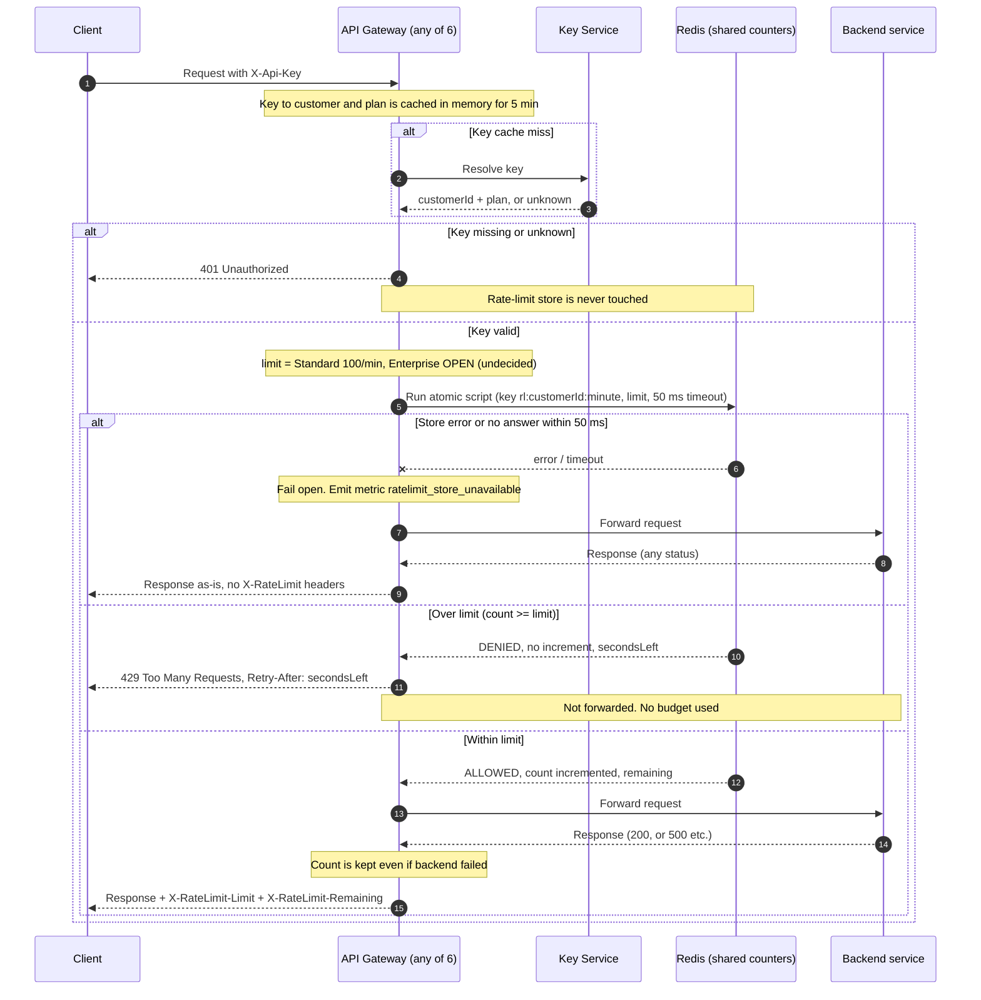

# Per-customer rate limiting: public API (v1)

## Design decisions

- **Store:** one shared Redis (replicated, primary/replica). All 6 gateway instances read and write the same counters, so there is no 6x overshoot (req 7).
- **Window:** fixed window, one minute, aligned to the wall clock. Key is `rl:{customerId}:{floor(now/60)}`. The counter expires after 120 s. A fixed window allows a burst of up to 2x the limit across a window boundary. This is accepted for v1.
- **Atomic check-and-count:** one Redis Lua script runs on the store per request. It does the following in one step, so concurrent requests on different instances cannot overshoot:
  1. Read the current count.
  2. If `count >= limit`, return `DENIED` and do not increment (429s use no budget, req 4).
  3. Otherwise `INCR`, set `EXPIRE` on the first hit, and return `ALLOWED` with `remaining = limit - newCount`.
- **Time source:** the script uses the Redis server clock (`TIME`) for the window, not the gateway clock. This keeps instances consistent if their clocks drift.
- **Limit by plan:** Standard = 100 per minute. **Enterprise = OPEN. Product has not decided the number.** The gateway reads the limit from a plan-to-limit config table, and Enterprise is left unset there. Until it is set, the plan must be decided before launch (see open questions).
- **Retry-After:** `ceil(secondsLeftInWindow)`, where `secondsLeftInWindow = 60 - (now mod 60)`, computed in the script. It is at least 1.
- **Fail open (req 8):** the gateway waits at most 50 ms for the script. On error or timeout it forwards the request and emits the metric `ratelimit_store_unavailable`. The response has no `X-RateLimit-*` headers, because the real count is unknown. There is no retry and no local fallback counter.
- **Backend failure:** a request that was allowed is already counted. A 500 from the backend does not refund it (req 5).
- **Counting rule:** the count happens once per request, after auth and before forwarding. Counters are per customer ID, so all of a customer's keys share one budget (req 1).

## Diagram

## Notes

- **Fail-open response:** the client sees the normal backend response, status unchanged, with no rate-limit headers. The only signal is the metric, which should be alerted on.
- **A timed-out call may still have counted.** If the script ran in Redis but the reply was late, that request is counted yet also forwarded. This slightly over-counts and is acceptable.
- **Redis failover:** a primary failover may lose a few seconds of counts. Customers may briefly get extra budget. Acceptable for v1.
- **Not in v1:** sliding window, per-route limits, burst allowances, local fallback counters.

## Open questions

1. **Enterprise limit:** the number is undecided. Needs a decision from Product before Enterprise customers go live. Until then it must not default to unlimited or to 100 without a deliberate choice.
2. Is the 2x boundary burst of the fixed window acceptable to Product?
