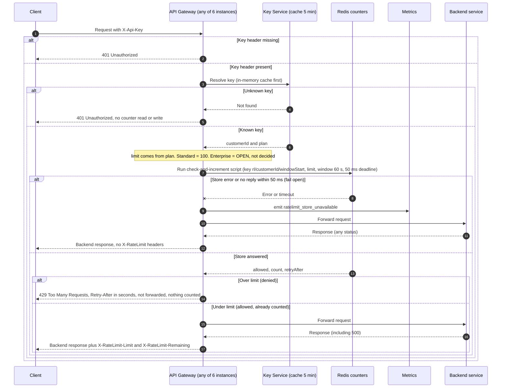

# Per-customer rate limiting on the public API

This is a design for a first version. The API gateway checks each request against a per-customer limit. It does this after it has confirmed the API key and before it forwards the request to the backend. The usage counts are stored in a shared Redis server. Each customer gets one fixed one-minute window. The check and the increment happen together in one Lua script, which Redis runs as a single uninterrupted step.

## Terms used in this document

- **API gateway**: the front door for all public traffic. It runs as 6 identical instances behind a load balancer (a component that spreads incoming connections across instances), so any instance may receive any request.
- **API key**: a secret the client sends in the `X-Api-Key` HTTP header to identify itself. A customer can have several keys.
- **Customer**: the account that owns one or more API keys. The rate limit applies per customer, not per key.
- **Key Service**: a separate service that turns an API key into a customer ID and a plan (Standard or Enterprise). The gateway caches its answers in memory for 5 minutes.
- **Redis**: a fast data store that all gateway instances share. Its counters are the single source of truth for how much each customer has used. Here, Redis runs as a primary (it accepts writes) with a replica (a copy that can take over if the primary fails).
- **Lua script**: a short program that the gateway sends to Redis with the `EVAL` command. Redis runs the whole script before it handles any other command, so no other request can change the counter partway through.
- **Fixed window**: a counter that resets at a fixed time. Here, it resets at the start of every whole minute.
- **TTL (time to live)**: how long Redis keeps a key before it deletes the key automatically.
- **Retry-After**: an HTTP response header that tells the client how many seconds to wait before trying again.
- **Fail open**: when the rate-limit store is broken or too slow, the gateway lets requests through instead of blocking them.
- **401 and 429**: HTTP status codes. `401 Unauthorized` means the key is missing or unknown. `429 Too Many Requests` means the customer is over the limit.

## Sequence



Reading the diagram:

- **Authentication comes first.** A request with a missing or unknown key gets a `401` before any counter is read or changed.
- **The check runs before forwarding.** A request over the limit gets a `429` and is never sent to the backend. It also uses none of the customer's budget.
- **A request is counted when it passes the check,** before it is forwarded. If the backend then fails (for example, with a `500`), the budget is still used.
- **If the store errors or does not answer within 50 ms,** the gateway forwards the request anyway and records a metric. It leaves out the `X-RateLimit` headers, because the true count is unknown.
- **Enterprise has no limit yet.** The diagram shows the Enterprise path going through the same check, but the number is an open decision (see below).

## Design decisions

- **Store: one shared Redis (a primary with a replica).** All six gateway instances read and write the same counters. A customer's traffic spread across instances therefore cannot multiply the limit (requirement 7). Keeping counts in each instance's own memory was rejected, because each instance would count only the requests it happened to receive. Counting inside the Key Service was rejected so that the Key Service does not take on request traffic. The replica is a copy kept for failover. Redis copies writes to the replica asynchronously, so a failover can lose the most recent increments. This design accepts that risk.
- **Counter key is per customer, not per API key.** The key is `rl/<customerId>/<windowStart>`, where `windowStart` is the start of the current minute according to the gateway's clock. All of a customer's API keys share one budget (requirement 1).
- **Window: fixed one minute.** This is simple and cheap. Because the window resets at a fixed time, a customer can send up to about twice the limit across a minute boundary. For example, they could send 100 requests at 0:59 and another 100 at 1:00. This is accepted for v1. A sliding window (one that counts the last 60 seconds from each request) is the upgrade path if this matters.
- **Atomic check-then-increment in one Lua script.** Two gateway instances cannot both take the last free slot, because Redis runs the script without interleaving other commands. The script increments the counter only when the count is under the limit, so a `429` never uses budget (requirement 4).
- **Count at check time, before forwarding.** A request that passes is already counted, so a backend `500` or timeout still uses budget (requirement 5).
- **Retry-After.** This is the number of seconds until the current window ends. It is computed from Redis's own clock (`TIME`), so differences between gateway clocks do not matter. It is always a whole number from 1 to 60.
- **X-RateLimit-Remaining.** This is `limit - count`, using the count after this request's increment, with a minimum of 0.
- **Fail open.** The 50 ms deadline covers the whole store call, and there is no retry. On an error or timeout, the gateway forwards the request, emits `ratelimit_store_unavailable`, and omits the `X-RateLimit` headers, because the true count is unknown. A timeout does not always mean the increment did not happen. Redis may have applied it just before the reply was lost. The request is forwarded either way. This matches what really happened, so the stored count stays correct.
- **Authentication first.** Missing or unknown keys return `401` before any Redis call (requirement 3).
- **Key expiry (TTL).** A counter key expires 61 seconds after its first increment. Old windows are deleted automatically, so the store does not fill up.

## Lua script (sketch)

```lua
-- KEYS[1] = rl/<customerId>/<windowStart>   ARGV[1] = limit   ARGV[2] = window seconds (60)
local limit  = tonumber(ARGV[1])
local window = tonumber(ARGV[2])
local now    = tonumber(redis.call('TIME')[1])
local retry  = window - (now % window)          -- seconds until the window resets, 1..60
local count  = tonumber(redis.call('GET', KEYS[1]) or '0')
if count >= limit then
  return {0, count, retry}                       -- denied, nothing incremented
end
count = redis.call('INCR', KEYS[1])
if count == 1 then redis.call('EXPIRE', KEYS[1], window + 1) end
return {1, count, retry}                         -- allowed, already counted
```

Notes on the script:

- It calls `TIME` inside Redis, so it needs Redis 5 or later. Redis 7 is assumed.
- `TIME` returns Redis's clock as seconds and microseconds. The script uses only the seconds part.
- The window key uses the gateway's clock, but `Retry-After` uses Redis's clock. Near a minute boundary, the two can disagree by a few milliseconds. This is accepted.

## Open decisions

1. **Enterprise limit (Product).** This design does not choose a number, and no number should be shipped as a guess. Enterprise requests still go through the check, but the limit is not set. Options for Product:
   - (a) Ship Standard enforcement first, and leave Enterprise unlimited, with no `X-RateLimit` headers, until the number is set.
   - (b) Ship the Enterprise check behind a config flag that stays off until the number is set.
2. **Plan changes lag up to 5 minutes.** The plan comes from the Key Service cache. So a change from Standard to Enterprise, or a revoked key, takes effect within the cache's 5-minute TTL. This is existing behavior and should be explained to Product.
3. **Key Service unavailable.** Not specified. Without a customer ID, the gateway cannot choose a counter. This path is out of scope for this design and follows the existing authentication behavior.
4. **Headers on 429.** Not specified. Recommended: also send `X-RateLimit-Limit` and `X-RateLimit-Remaining: 0`, so clients can back off without guessing.
5. **Alerting.** Set thresholds for `ratelimit_store_unavailable` and for the rate of `429` responses, so that fail-open periods are visible.