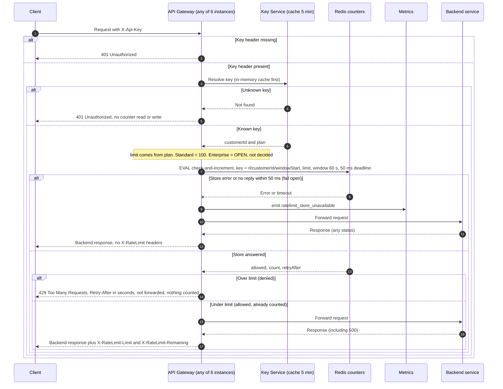

# Per-customer rate limiting on the public API

Design for a first version. The rate-limit check runs in the API Gateway after key authentication and before forwarding. Counters live in a shared Redis, one fixed one-minute window per customer, with check-and-increment done atomically in a Lua script.

## Sequence



## Design decisions

- **Store: one shared Redis (primary with replica).** All six gateway instances read and write the same counters, so a customer's traffic spread across instances cannot multiply the limit (requirement 7). In-process counters were rejected because each instance would count separately. Counting inside the Key Service was rejected to avoid coupling it to request traffic.
- **Counter key is per customer, not per key.** Key is `rl/<customerId>/<windowStart>`, where `windowStart` is the current minute from the gateway clock. All API keys of one customer share the budget (requirement 1).
- **Window: fixed one minute.** Simple and cheap. A customer can send up to about 2x the limit across a minute boundary. Accepted for v1. A sliding window is the upgrade path if that matters.
- **Atomic check-then-increment in one Lua script.** Redis runs the script without interleaving, so two instances cannot both take the last slot (no overshoot). The script increments only when under the limit, so a 429 never uses budget (requirement 4).
- **Count at check time, before forwarding.** A request that passes is already counted, so a backend 500 or timeout still uses budget (requirement 5).
- **Retry-After.** Seconds until the window ends, computed from Redis `TIME` so instance clock skew does not matter. It is an integer from 1 to 60.
- **Remaining.** `limit - count` after this request's increment, floored at 0.
- **Fail open.** A 50 ms client deadline covers the whole store call, with no retry. On error or timeout the gateway forwards the request, emits `ratelimit_store_unavailable`, and omits the X-RateLimit headers because the state is unknown. If Redis applied the increment just before the timeout, the request is forwarded anyway, so the count stays accurate.
- **Authentication first.** Missing or unknown keys return 401 before any Redis call (requirement 3).
- **Key TTL.** The counter key expires after 61 seconds, set on first increment, so old windows are cleaned up automatically.

## Lua script (sketch)

```lua
-- KEYS[1] = rl/<customerId>/<windowStart>   ARGV[1] = limit   ARGV[2] = window seconds (60)
local limit  = tonumber(ARGV[1])
local window = tonumber(ARGV[2])
local now    = tonumber(redis.call('TIME')[1])
local retry  = window - (now % window)          -- seconds until the window resets, 1..60
local count  = tonumber(redis.call('GET', KEYS[1]) or '0')
if count >= limit then
  return {0, count, retry}                       -- denied, nothing incremented
end
count = redis.call('INCR', KEYS[1])
if count == 1 then redis.call('EXPIRE', KEYS[1], window + 1) end
return {1, count, retry}                         -- allowed, already counted
```

Note: the script reads `TIME` inside Redis, which needs Redis 5 or later (Redis 7 assumed). The window key comes from the gateway clock, so clock skew can move a request across a minute boundary by a few milliseconds. This is accepted.

## Open decisions

1. **Enterprise limit (Product).** Not chosen here. Enterprise traffic still runs through the check, but the number is unset. Options for Product: (a) ship Standard enforcement first and leave Enterprise unlimited with no headers until the number is set, or (b) hold Enterprise enforcement behind a config flag. Do not ship a guessed number.
2. **Plan changes lag up to 5 minutes.** The plan comes from the Key Service cache, so a Standard-to-Enterprise change, or a revoked key, takes effect within the cache TTL. This is existing behavior and should be stated to Product.
3. **Key Service unavailable.** Not specified. Without a customer ID the gateway cannot pick a counter, so this path is out of scope for this design and follows the existing auth behavior.
4. **Headers on 429.** Not specified. Recommended: also send `X-RateLimit-Limit` and `X-RateLimit-Remaining: 0`, so clients can back off without guessing.
5. **Alerting.** Thresholds for `ratelimit_store_unavailable` and the 429 rate need to be set so that fail-open periods are visible.