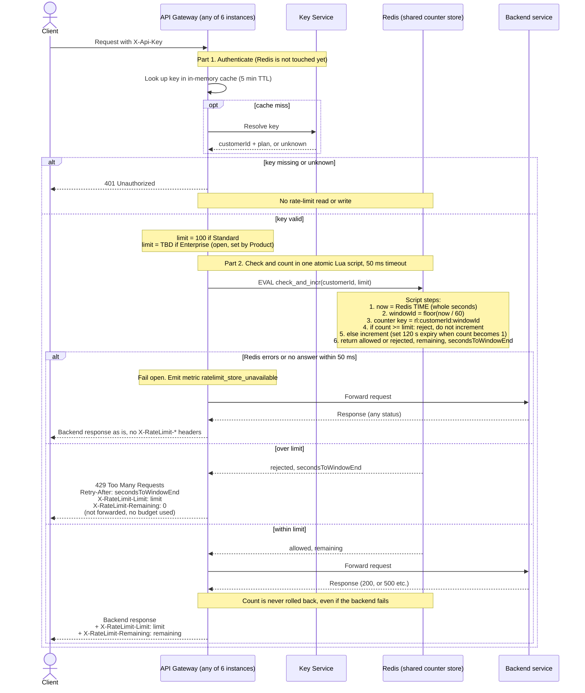

# Per-customer rate limiting on the public API

## Summary

The API Gateway counts requests per customer in a shared Redis instance. Each customer gets a budget per one-minute window: 100 requests for Standard, and an Enterprise number that is still open (see Open items). A request over budget gets `429` and is not forwarded. If Redis errors or is too slow, the gateway skips the check and forwards the request anyway ("fails open").

Terms:
- **Redis** is an in-memory key-value store. Here it holds one counter per customer per window.
- **Lua script** is a small script that Redis runs as one indivisible step, so no other command can run in the middle of it.
- **Window** is a fixed one-minute slice of the clock (for example 12:03:00 to 12:03:59).
- **Fail open** means that when the rate limiter itself is broken, requests are allowed through rather than blocked.

How to read the diagram: Part 1 authenticates the caller, and Redis is not involved. Part 2 asks Redis, in one atomic step, whether the customer is within budget and counts the request if so. Then one of three outcomes follows: Redis failed (fail open), over limit (`429`), or within limit (forward).

## Notes

**Store.** Redis, as one small shared instance (a primary plus a replica). Counters are read and written only on the primary. All 6 gateway instances use the same keys, so a customer's traffic is counted once however it is spread across instances. The key is `rl:{customerId}:{windowId}`. The gateway passes only the customer ID and the limit to the script, and the script computes the window ID and builds the key. Several API keys for one customer resolve to the same customer ID, so they share one counter. If the primary fails over, a few recent counts may be lost; we accept that in v1.

**Window.** Fixed one-minute windows aligned to the clock: `windowId = floor(unix_seconds / 60)`. The script reads the time from Redis (`TIME`), not from the gateway, so clock differences between gateway instances cannot matter. Each counter expires after 120 s, so old windows clean themselves up. Known trade-off: a client can send 100 requests at the end of one window and 100 at the start of the next, so up to 200 in a short burst. We accept this for v1. A sliding window can come later if it matters.

**Avoiding overshoot.** The check and the increment happen inside one Lua script, and Redis runs a script without running other commands in between. Two instances therefore cannot both read 99 and both proceed. The gateway never does a separate read followed by a write. The script increments only when `count < limit`, so rejected requests do not use up budget.

**Order of work.** Authentication comes first, and a `401` returns before any Redis call. The count happens before forwarding and is never undone, so a request that passed the check still uses budget when the backend returns `500`.

**Retry-After.** The script returns `secondsToWindowEnd = 60 - (now mod 60)`, where `now` is whole seconds from Redis `TIME`. This is always between 1 and 60, and the gateway sends it unchanged as `Retry-After`. When the window ends the counter starts fresh, so a retry after that many seconds succeeds unless the client has already used up the new window.

**Headers.**
- `X-RateLimit-Limit` is the customer's limit for their plan.
- `X-RateLimit-Remaining` is `limit - count` after this request, so it is 0 on the request that uses the last unit.
- Both are on every response to a request that passed the check, including backend errors.
- The `429` carries `Retry-After`, `X-RateLimit-Limit`, and `X-RateLimit-Remaining: 0`.

**Fail open.**
- The gateway sets a 50 ms timeout on the Redis call. On any error or timeout it forwards the request and increments the `ratelimit_store_unavailable` metric.
- The client sees the backend's normal response. The `X-RateLimit-*` headers are left out because the real values are unknown, and made-up values would mislead.
- No retry and no local fallback counter in v1. During a Redis outage limits are not enforced.
- Alert when `ratelimit_store_unavailable` stays elevated.

**Open items.**
- **Enterprise limit:** TBD, owned by Product. The plan-to-limit mapping is a config value (Standard = 100) with no Enterprise entry for now. A decision is needed before launch. The limit must not silently default to 100 or to unlimited, so the gateway's config validation should refuse to start while any plan has no limit. Setting the value needs no code change.
- **Plan change:** the plan comes from the 5-minute key cache, so a plan upgrade can take up to 5 minutes to apply.