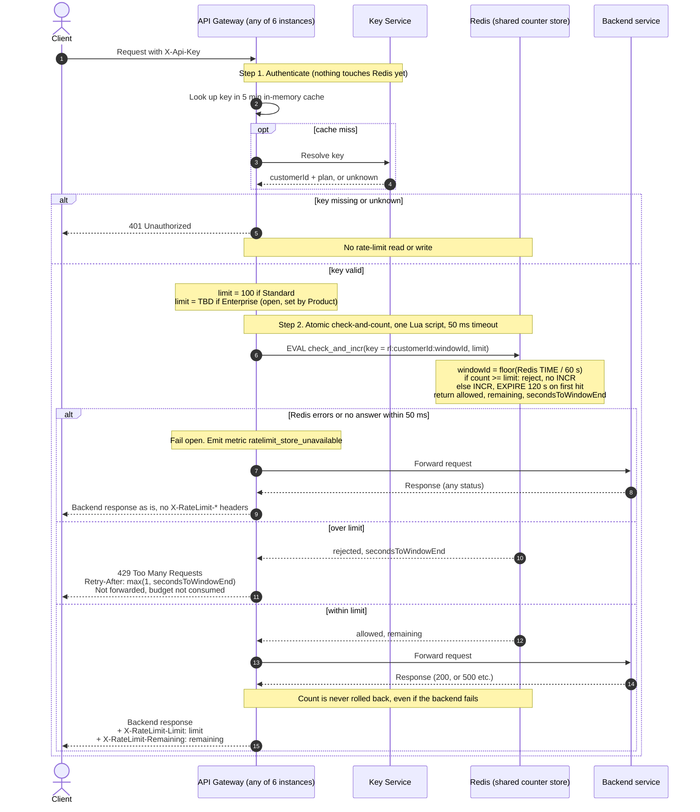

# Per-customer rate limiting on the public API

## Notes

**Store.** Redis, as a small shared instance (primary with a replica). The counter is only ever read and written on the primary. All 6 gateway instances use the same keys, so a customer's traffic is counted once however it is spread (requirement 7). The key is `rl:{customerId}:{windowId}`, so several API keys for one customer share one counter (requirement 1).

**Window.** Fixed one-minute windows aligned to the clock. `windowId = floor(unix_seconds / 60)`. The script reads the time from Redis (`TIME`), not from the gateway, so clock skew between instances cannot matter. Each counter expires after 120 s, so old windows clean themselves up. Known trade-off: a client can send 100 requests at the end of one window and 100 at the start of the next, so up to 200 in a short burst. We accept this for v1. A sliding window can come later if it matters.

**Avoiding overshoot.** The check and the increment happen in one Lua script, which Redis runs atomically. Two instances cannot both read 99 and both proceed. There is no separate read-then-write from the gateway. The script increments only when `count < limit`, so 429s never use up budget (requirement 4).

**Order of work.** Authentication comes first. A `401` returns before any Redis call (requirement 3). The count happens before forwarding and is never undone, so a backend `500` still uses budget (requirement 5).

**Retry-After.** The number of whole seconds until the current window ends: `ceil(60 - (now mod 60))`, with a minimum of 1. At that moment the counter resets, so a retry then will succeed unless the client has used up the new window.

**Headers.**
- `X-RateLimit-Limit` is the customer's limit for their plan.
- `X-RateLimit-Remaining` is `limit - count` after this request, so it is 0 on the request that uses the last unit.
- Both are on responses to requests that passed the check (requirement 6).
- The 429 carries `Retry-After`. It may also carry `X-RateLimit-Limit` and `X-RateLimit-Remaining: 0`.

**Fail open (requirement 8).**
- The gateway sets a 50 ms timeout on the Redis call. On any error or timeout it forwards the request and increments `ratelimit_store_unavailable`.
- The client sees the backend's normal response. The `X-RateLimit-*` headers are left out because the real values are unknown, and made-up values would mislead.
- No retry and no local fallback counter in v1. During an outage limits are not enforced.
- Alert on a sustained `ratelimit_store_unavailable` rate.

**Open items.**
- **Enterprise limit:** TBD, owned by Product. Until it is decided, the plan-to-limit mapping has no Enterprise entry, and this needs a decision before launch. It must not silently default to 100 or to unlimited. It is a config value, so setting it needs no code change.
- **Plan change:** the plan comes from the 5-minute key cache, so a plan upgrade can take up to 5 minutes to apply.
