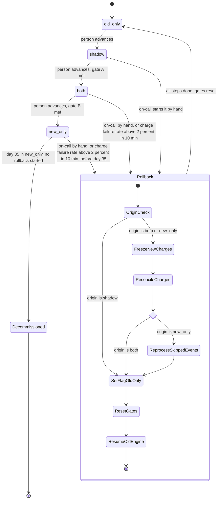

# Billing engine rollout: state machine

## Modes and transitions

Gate A: 7 consecutive days with a mismatch rate under 0.1% and at least 5,000 invoices compared.
Gate B: 14 days in `both` with no unresolved mismatches, plus Finance sign-off.

Moves forward are one step at a time and always made by a person. Rollback always ends in `old_only`. After that, the only way forward is `old_only` to `shadow`, and gate A starts from zero.

## What each mode does

| Mode | Old engine | New engine | Comparison |
|---|---|---|---|
| `old_only` | Computes, writes ledger, charges | Off | None |
| `shadow` | Computes, writes ledger, charges | Reads the same usage events and writes to the shadow store. It never charges and never writes the ledger. | Nightly per-customer compare. A mismatch is a total that differs by more than 1 cent. |
| `both` | Keeps computing every invoice into the shadow store. It does not charge. | Computes, writes ledger, charges | Continues |
| `new_only` | Stopped | Does everything | None needed |
| `Decommissioned` | Gone | Does everything | None |

`Decommissioned` is the point of no return. Reaching it needs 35 days in `new_only` with no rollback. From then on rollback is not possible.

## Rollback steps

Rollback does not flip the flag first. If it did, the old engine could start charging while the new engine still has charges in flight, and a customer could be charged twice for a period. The steps run in this order:

1. **FreezeNewCharges** (from `both` or `new_only`). The new engine stops starting new charges and stops writing the ledger. In-flight charges are allowed to finish or fail.
2. **ReconcileCharges.** For each in-flight or uncertain charge, check the payment provider and the ledger, which is the system of record. Every charge ends up recorded as charged or not charged. A charge that is unconfirmed is not retried until it is resolved.
3. **ReprocessSkippedEvents** (from `new_only` only). The old engine reads the usage events it skipped while stopped and computes those invoices. It does not charge in this step. Events are kept for 35 days, so this must finish before the oldest skipped event expires.
4. **SetFlagOldOnly.** `billing_mode` becomes `old_only`.
5. **ResetGates.** The 7-day count, the 14-day count and the mismatch history are cleared.
6. **ResumeOldEngine.** The old engine charges every period that has no charge in the ledger. Charges that came due during the rollback are made now, so none is dropped. A period that already has a ledger charge from the new engine is never charged again.

Rolling back from `shadow` skips steps 1 to 3. The new engine never charged or wrote the ledger there, so only the flag change, the reset and the resume are needed.

## Where the state lives

- **Mode:** the `billing_mode` flag in the config service. It is global and holds one of the four values. It stays at its current value for the whole rollback and only changes at step 4.
- **Rollback progress:** a durable rollback record with the origin mode, the current step, the start time and the trigger (manual or automatic). The brief does not say where progress is kept, so this record is my addition. It lets a restarted controller resume mid-rollback instead of guessing from the flag. Its place in the state machine is `Rollback`.
- **Charges and invoices:** the billing ledger, which is the system of record. The payment provider is checked during reconciliation, but the ledger is the final word on whether a period was charged.
- **Gate counters:** derived from the nightly comparison results in the shadow store. They are cleared at ResetGates.
- **Time in `new_only`:** the time the flag entered `new_only`. It drives the day-35 point of no return and the rollback deadline.

## What happens when something fails

- **New-engine errors in `shadow`:** recorded only. They never trigger a rollback and do not affect the ledger, because the new engine writes nothing there.
- **Charge failure rate above 2% over any 10-minute window, in `both` or `new_only`:** automatic rollback starts. On-call can also start one by hand in `shadow`, `both` or `new_only` at any time before day 35.
- **A rollback step fails:** every step can be retried safely, and none of them is skipped. The flag stays unchanged until step 4, so the system is never half-switched. On-call is paged if a step stays stuck. While stuck in step 1 or 2, charging is paused, so charges are delayed rather than doubled.
- **Reprocessing fails or is slow:** the rollback stays in `ReprocessSkippedEvents` and pages on-call. This is the most time-critical step, because the oldest skipped events expire on day 35 of `new_only`.
- **Nightly comparison job fails:** that day does not count toward the 7-day or 14-day gates. The gate counts consecutive days, so a missed run restarts the 7-day count.
- **Unresolved mismatch in `both`:** the 14-day gate cannot be met. The mismatch must be resolved first. It is not an automatic rollback trigger.
- **Failure after day 35 in `new_only`:** there is no rollback path, so it can only page and be fixed forward. Rollback is not available from `Decommissioned`.

## Open questions

These are not settled by the brief, and I have not assumed answers.

1. **The day-35 edge.** Events from the first day in `new_only` expire at day 35, so a rollback started late in the window may not be able to reprocess them. Define the last safe start time, or the rollback has to be refused near the end.
2. **Automatic trigger after day 35.** The brief says there is no way back from day 35, but it does not say what the 2% failure rule does then. This model assumes it only pages.
3. **Failure-rate details.** What is the minimum charge volume in a 10-minute window? Without one, a handful of charges could trip the 2% rule.
4. **Switching mid-period.** How are charges for a billing period that spans a mode change attributed, and what stops the new and old engine both charging the same period? This model relies on the ledger check in step 6.
5. **Moving forward after a rollback.** Gate B's 14 days in `both` restart too, because the gates reset. Please confirm that is intended.
