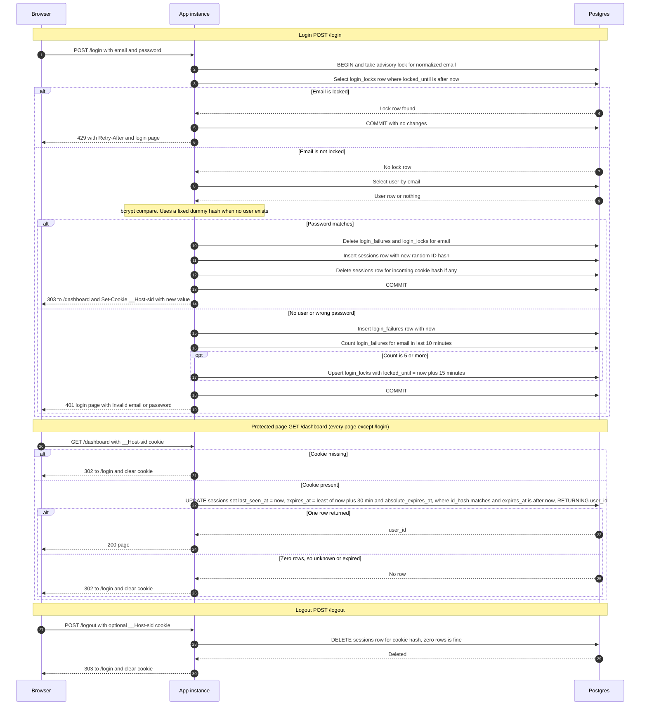

# Login with server-side sessions: design

## Decisions

| Area | Choice |
|---|---|
| Session store | Postgres `sessions` table. No Redis. |
| Failure counts | Postgres `login_failures` and `login_locks` tables. Not process memory. |
| Session ID | 32 bytes from a CSPRNG, base64url encoded. A new one is issued on every successful login. |
| Stored session key | SHA-256 of the cookie value. The raw ID is never stored, so a database read does not yield usable sessions. |
| Cookie | Name `__Host-sid`. Value is the opaque ID only. `HttpOnly; Secure; SameSite=Lax; Path=/`, no `Domain`, no `Max-Age` (browser-session cookie). |
| Clock | All expiry comparisons use Postgres `now()`, not app-server clocks, so two instances cannot disagree. |
| Expiry check | One `UPDATE ... RETURNING` per protected request. It checks and refreshes the session in one atomic statement. |
| Cleanup | Scheduled job every 5 minutes on either instance. Deletes are idempotent, so no leader election is needed. |
| Storage failure | Fail closed. Login and logout return 503. Protected pages return 503 and keep the cookie. |

### Why Postgres and not Redis

- Postgres is already the single shared, durable store for both instances. Redis would be a second store to run, monitor, secure, back up and keep consistent.
- Session creation, old-session deletion, lock clearing and the user lookup can share one transaction. That is not possible across Postgres and Redis.
- Expiry is enforced atomically in the same statement that validates the session. Redis TTLs would need a separate expiry rule.
- Load is one indexed write per request. That is fine for a small team app.
- Trade-off: this adds a write to every protected request. If traffic grows, move sessions behind a `SessionStore` interface to Redis. The schema and the rules do not change.

## Schema

- `sessions(id_hash bytea primary key, user_id, created_at, last_seen_at, absolute_expires_at = created_at + 12h, expires_at)`. `expires_at` is recomputed on every request as `least(now() + 30 min, absolute_expires_at)`. Index on `expires_at`.
- `login_failures(email, failed_at)`. Index on `(email, failed_at)`. One row per failed attempt.
- `login_locks(email primary key, locked_until)`.

## Rules

1. **Email**: `lower(trim(input))` before any lookup or counting.
2. **Lockout is per email string, not per account.** Failures are recorded for unknown emails too. A locked unknown email gets the same 429 as a locked real one, so lockout does not reveal whether an account exists.
3. **Sliding 10-minute window.** The lock fires when there are 5 or more `login_failures` rows for the email in the last 10 minutes. A fixed window would miss some 5-in-10 patterns, so it is not used.
4. **Lock check comes first.** While `locked_until > now()`, the password is never checked and no failure rows are written, so the lock is not extended by attempts made during it.
5. **Per-email serialization.** Each login transaction takes `pg_advisory_xact_lock(hashtextextended(email, 0))`. This stops concurrent attempts from both passing the count, including across the two instances. The lock is held through bcrypt, which is acceptable at this scale.
6. **Timing parity.** When no user exists, bcrypt runs against a fixed dummy hash, so the response time does not reveal existence.
7. **Success clears state.** It deletes that email's `login_failures` and `login_locks` rows.
8. **Session fixation.** On success, the new session row is inserted and the row for the incoming cookie hash is deleted in the same transaction, then the transaction commits. The response sets the new cookie.
9. **Expiry.** A session is valid only if `expires_at > now()`. Expired rows are never honored, even before cleanup removes them.
10. **Missing, unknown or expired** on a protected page: 302 to `/login` with a cleared cookie.
11. **Logout** always returns the same response, with or without a session: 303 to `/login` with a cleared cookie.
12. **Public routes**: `/login` (GET and POST) and the static assets its page needs. Every other route requires a session.

## Sequence diagram

## Notes that do not fit on the arrows

**Storage failure (every case fails closed):**

| Operation | Response | Cookie | Notes |
|---|---|---|---|
| Login | 503 "We can't sign you in right now. Try again in a minute." | n/a | No password check and no session is created. Lock state cannot be verified, so nothing proceeds. |
| Protected page | 503 with `Retry-After` | Kept | Not redirected to `/login`, because the login page also needs the database and the user would loop. |
| Logout | 503 "We couldn't sign you out. Try again." | Kept | Cookie is kept so the user can retry. The brief requires server-side destruction before replying, so the reply cannot claim success when deletion failed. |
| Cleanup job | No user impact | n/a | Logged, retried on the next run. |

All DB calls use short timeouts (about 2 seconds) so these failures return quickly.

**Cleanup (scheduled, every 5 minutes):**
- `DELETE FROM sessions WHERE expires_at <= now()`
- `DELETE FROM login_failures WHERE failed_at < now() - 10 minutes`
- `DELETE FROM login_locks WHERE locked_until <= now()`

Correctness does not depend on cleanup, because every check uses `expires_at > now()` and the lock time.

**Session lifetime:** a session ends at `min(last request + 30 min, created + 12 h)`. Every protected request refreshes the idle part. The absolute 12-hour cap is never extended.

**Cookie details:** `__Host-` requires `Secure`, `Path=/` and no `Domain`. Local HTTP development needs `localhost`, which modern browsers treat as a secure context. The clear-cookie response repeats all attributes with `Max-Age=0`.

**Response codes:** 303 after POST redirects (login and logout). The brief says "redirect" without a code, so 303 is a choice.

**Known limits, not in the brief:**
- Anyone can lock any email for 15 minutes with 5 wrong guesses. This is inherent to the requested lockout rule.
- The lock is per email only. There is no per-IP limit, so a distributed attack spreads across emails. Adding an IP limit is a possible follow-up.
- Login and logout forms have no CSRF token. `SameSite=Lax` stops cross-site POSTs from carrying the cookie, which covers logout. It does not cover login CSRF. A token on `POST /login` is recommended.
- No "remember me" option. The 12-hour cap applies to every login.
