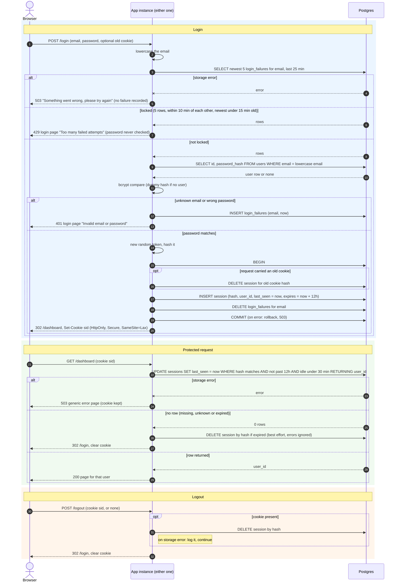

# Login with server-side sessions: design

## Decisions

**D1. Sessions live in Postgres, in a new `sessions` table.** Both instances already share the database, so sessions work behind the load balancer with no sticky routing. We do not add Redis. At a small team's scale, one indexed primary-key lookup per request is cheap. Redis would add a new service to run, secure, back up and monitor. It would also give us a second store whose state can disagree with Postgres. Revisit if session lookups show up in load metrics.

```
sessions(
  id            text primary key,   -- SHA-256 hex of the cookie token
  user_id       bigint not null references users(id),
  created_at    timestamptz not null,
  last_seen_at  timestamptz not null,
  expires_at    timestamptz not null  -- created_at + 12 hours (absolute cap)
)
index on sessions(expires_at)
index on sessions(user_id)
```

- The token is 32 bytes from a CSPRNG, base64url-encoded. The cookie value is this raw token (rule 5).
- On every request the server hashes the cookie value with SHA-256 and looks up the hash. Only the hash is stored, so a leaked database or backup cannot be replayed as live cookies. The raw token exists only in the browser and, briefly, in the memory of the request that handles it.

**D2. Failure counts live in Postgres, in a `login_failures` table.** This is a separate table from sessions.

```
login_failures(
  email         text not null,      -- lowercase; may be an email with no account
  failed_at     timestamptz not null
)
index on (email, failed_at)
```

- The table is keyed by the submitted email, not by `users.id`. An unknown email therefore gets counted and locked out exactly like a real one (rule 2).
- Each failed attempt inserts one row. A locked-out attempt (429) inserts nothing.
- **Lockout rule.** Before checking the password, read the newest 5 rows for the email from the last 25 minutes. The email is locked if all of these hold:
  - there are 5 rows;
  - the newest and the 5th-newest are at most 10 minutes apart (5 failures within 10 minutes);
  - `now()` is before the newest `failed_at` plus 15 minutes.
- The check runs before the current attempt is recorded. So the 5th wrong password gets 401 and records the 5th failure; the next attempt gets 429.
- Once the 15 minutes pass, the email may try again. Old rows may still be in the table, but any new failure is more than 10 minutes after the 5th-newest, so the rule does not lock again until 5 new failures.
- A row-per-failure design implements "5 failures within any 10-minute period" exactly. A fixed-window counter would not.
- A successful login deletes all rows for that email.
- Both instances see the same rows, so the limit holds regardless of which instance the load balancer picks.

**D3. Expiry is checked on every request, on the server, and recorded in the row.**
- A session is valid only if all of these hold:
  - `now() < expires_at`, which is the 12-hour cap.
  - `now() - last_seen_at < 30 minutes`, which is the idle timeout.
- Every protected request runs one statement that checks and renews in a single step. The check and the update cannot race between instances.

```sql
UPDATE sessions SET last_seen_at = now()
WHERE id = $hash AND expires_at > now() AND last_seen_at > now() - interval '30 minutes'
RETURNING user_id;
```

- Zero rows means the session is missing, unknown or expired. All three get the same handling (rule 7).
- Idle time restarts on each request. The absolute cap never moves. Whichever limit comes first ends the session.
- The cookie carries no expiry. It is a session cookie, and the server is the authority. Cookie lifetime is never trusted.
- All times come from the database clock (`now()`). This avoids clock skew between the two app instances.

**D4. Abandoned sessions are cleaned up two ways.**
- Correctness never depends on cleanup. Expired rows are already rejected by D3's query.
- Lazy: when D3 returns zero rows, the app also tries `DELETE FROM sessions WHERE id = $hash AND (expires_at <= now() OR last_seen_at <= now() - interval '30 minutes')`. It removes an expired row, and does nothing for a missing or unknown one. If this delete fails, the error is logged and ignored; the sweep removes the row later.
- Sweep: every instance runs a timer, at startup and then every 15 minutes. Each run executes `DELETE FROM sessions WHERE expires_at <= now() OR last_seen_at <= now() - interval '30 minutes'`. Two instances running at once is harmless because the delete is idempotent. The same run deletes `login_failures` rows older than 25 minutes, which is the longest the lockout rule looks back. If a run fails, it is logged and the next run retries. If no run happens, the tables only grow; sessions and lockouts stay correct.

**D5. When storage fails, the app fails closed.**
- Any database error during login or a session check returns HTTP 503 with a generic "Something went wrong, please try again" page. The error is logged on the server.
- A storage error never counts as a failed login attempt.
- It never grants access.
- It never reveals whether an account exists.
- If the database fails during the success transaction, the transaction rolls back and the user gets 503. No new session exists, the old session row stays, and the failure rows are not cleared.
- On a protected page, a storage error is not treated as "session invalid". The cookie is kept and the user is not redirected to `/login`. A brief database blip therefore does not sign everyone out. The user sees the 503 page and can retry.
- Logout when storage fails: clear the cookie and redirect to `/login`, but the server could not confirm destruction. The failure is logged. The session still dies at its normal expiry, and the sweep removes it. This is the one place where we choose to complete the user-visible action despite the error, because the user's intent is to leave.

## Other rules

- **Order of checks in `POST /login`.** Normalize the email to lowercase and look at the lockout state first. If locked, respond 429 without touching the password (rule 3). 429 says nothing about whether the account exists, because unknown emails get locked out too.
- **Responses.** Both 401 and 429 re-show the login page. 401 says "Invalid email or password", the same body for an unknown email and a wrong password, with no other difference in headers or content. 429 says "Too many failed attempts. Try again later." It gives no countdown.
- **Timing.** For an unknown email, run a bcrypt compare against a fixed dummy hash. Response time then does not reveal whether the account exists.
- **Each failure is recorded**, whether or not the account exists.
- **Session fixation (rule 4).** On success, always generate a new ID. If the request carried a cookie, delete that session row, valid or not. Insert the new row in the same transaction. Delete and insert are atomic, so there is no state with both sessions or neither.
- **Cookie.** `Set-Cookie: sid=<id>; HttpOnly; Secure; SameSite=Lax; Path=/`. There is no `Domain`, so the cookie is host-only. Clearing sets the same attributes with `Max-Age=0`.
- **CSRF.** SameSite=Lax blocks cross-site POSTs, including `POST /logout`. Cross-site form posts will not carry the cookie. No separate token is added.
- **Protected routes.** Middleware wraps every page route except `GET /login` and `POST /login`. For each request it runs D3's statement. On success it puts the returned `user_id` on the request context, and handlers read the user from there. Static assets (CSS, JS, images) are served without the check and must contain nothing user-specific. `POST /logout` is idempotent and behaves identically with or without a session.

## Sequence diagram



## Notes on the diagram

- **Bad credentials.** The failure insert happens before the 401 is sent. The two causes, unknown email and wrong password, share one branch because they must be indistinguishable.
- **Lockout.** The 429 branch never reads `users` and never runs bcrypt. The lockout is decided only by D2's rule, so it ends by itself 15 minutes after the 5th failure.
- **Success.** Deleting the old session, creating the new one and clearing failures are in one transaction. Either the user is fully logged in or nothing changed.
- **Logout with no session.** The `DELETE` is skipped, and the response is the same 302 with the same cleared cookie.
- **Not covered here.** Sign-up and password reset are out of scope. Password reset should later delete all of a user's sessions, which the `user_id` index supports.

## Open questions

- No alert is defined for a failing or missing sweep. Tables would only grow.
- Static assets skip the session check. If any asset becomes user-specific, it needs the middleware.
