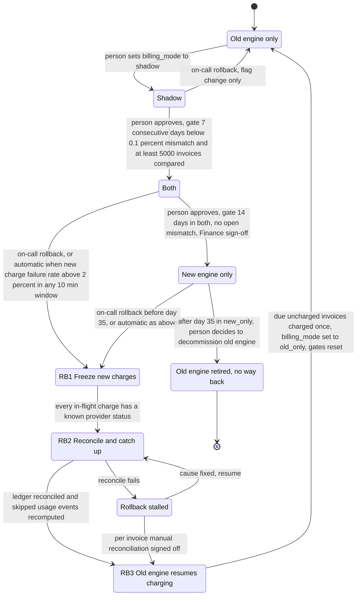

# Billing engine rollout: state machine

## Diagram

Forward moves are one step at a time, and a person makes and approves each one. Rollback is the only path that starts automatically, and every rollback ends in `old_only`.

## Who does what

- **A person** makes and approves each forward move (`shadow` to `both`, `both` to `new_only`). On-call starts a rollback by hand within the 35-day limit.
- **The rollout controller** (not written yet) keeps the rollout record, counts the gate days and shows whether each gate is met. It refuses a forward move until its gate is met. It refuses a rollback from `new_only` that starts after day 35. It starts RB1 on its own when the automatic rollback condition is met. It never moves the mode forward.

## Modes

- **old_only.** The old engine reads usage events, computes invoices, writes the ledger and charges customers. The new engine is off.
- **shadow.** The old engine still charges and writes the ledger. The new engine reads the same usage events and writes its invoices to the shadow store. It never charges and never writes the ledger. A nightly job compares, per customer, the old engine's invoices (from the ledger) with the new engine's (from the shadow store). A mismatch is any invoice total that differs by more than one cent. New-engine errors here are recorded but never trigger a rollback. Rollback from `shadow` is a flag change only, because the old engine has charged all along.
- **both.** The new engine charges and writes the ledger, so customers receive the new engine's invoices. For each invoice that is due, the new engine sends one charge to the provider, keyed on customer, billing period and invoice. The provider answers. Only then does the new engine write the invoice and the charge result to the ledger. The old engine keeps computing every invoice into the shadow store without charging, so it stays current and can take over. The nightly comparison continues with the sources swapped: per customer, the ledger (new engine) against the shadow store (old engine). The ledger is the record of what was billed, so it is the reference. A mismatch goes to a person. Nothing is corrected automatically.
- **new_only.** The new engine does everything. The old engine stops computing, so usage events are skipped from this point. The file counts the 35-day rollback clock from entry into this mode; the brief does not say (see Open questions).

## Rollback (RB1 to RB3)

From `both` or `new_only`. `billing_mode` does not change until RB3 finishes. The rollback step is kept in the rollout record.

1. **RB1 freeze.** Stop new-engine charging, so no new charge is sent. A charge already sent is never sent again. Look up each in-flight charge's status at the provider by its idempotency key. RB1 moves on only when every in-flight charge has a known status. A charge whose status is still unknown is looked up again, and is never re-sent. Reason: RB3 charges any invoice without a successful charge, so an unknown charge could be charged twice.
2. **RB2 reconcile and catch up.** The old engine reads the skipped usage events from the usage event log (35 days) and recomputes them into the shadow store, with no charges. Reconcile compares, per customer and billing period, the ledger (new engine's invoices), the provider's status for each key, and the shadow store (old engine's recomputed invoices). Reconcile fails if any difference remains, and the rollback then enters `rb_stalled`.
3. **RB3 cutover.** The old engine charges only invoices that are due and have no successful charge. An invoice has a successful charge if the ledger or the provider shows one under its key, so invoices the new engine already charged are skipped. The old engine writes each invoice and charge result to the ledger. It does not change ledger rows the new engine wrote. Then `billing_mode` is set to `old_only` and all gates reset.

During RB1 and RB2 customers get no new charges, and due invoices wait, as in a stall. The mode stays `both` or `new_only` until RB3 finishes, so whether an engine stops from the flag alone is open (see Open questions).

## Where the rollout state lives

- **The mode.** The single global `billing_mode` flag in the config service. Only the forward moves and rollback transitions write it.
- **Not specified in the brief.** The 7-day streak counter, the 14-day counter, the Finance sign-off, the day count in `new_only`, and the current rollback step. Recommendation: keep these in one rollout record next to `billing_mode`, written only by the transitions above, so a restarted controller resumes at the right step. This is an open decision.
- **Other stores.** The ledger is the system of record for what was billed. The provider holds payment status. The shadow store is separate from the ledger and is never customer-facing. The usage event log keeps 35 days, which sets the rollback deadline.
- **Idempotency.** Every charge is keyed on customer, billing period and invoice, so the old engine, the new engine and any rerun cannot charge the same period twice.

## What happens when something fails

- **Shadow mismatch.** Recorded nightly. A day with a mismatch rate at or above 0.1 percent breaks the 7-day streak, which restarts. The gate does not move.
- **Gate not met.** The mode stays where it is. Nothing advances on its own. For `both` to `new_only`, the gate also needs no open mismatch when a person approves. How approval is recorded is open.
- **Automatic rollback.** In `both` or `new_only`, a new-engine charge failure rate above 2 percent over any 10-minute window starts RB1 without a person. Errors in `shadow` never do this. Who is told is open.
- **Charge succeeded but ledger write failed (or the reverse).** Resolve by querying the provider with the idempotency key before anything is charged again. Never re-charge on an unknown status. How this is noticed, by a routine check or only in rollback, is open.
- **Rollback stalled.** If RB2 cannot reconcile, the rollback stops in `rb_stalled`. New-engine charging stays frozen, and the old engine does not charge until reconciliation is complete. Due charges are delayed, not dropped. On-call escalates. The exit is a fix that resumes RB2, or a signed-off manual reconciliation per invoice into RB3. The brief gives no time limit. The one hard limit is the 35-day usage event log: a rollback from `new_only` needs the skipped events, and they age out at day 35.
- **Day 35 in `new_only`.** The skipped usage events have aged out of the log. Rollback is closed, and a person may decide to decommission the old engine. There is no way back. A new-engine failure rate above 2 percent in `retired` starts no rollback, because `retired` has no transition to `old_only`. The response to such failures is open.
- **After any rollback.** The mode is `old_only`, all gates reset, and returning to `shadow` requires a person. The 7-day count starts over.

## Open questions

- Does the 0.1 percent apply to each day, as this file reads it, or to the 7-day window as a whole? The 5,000-invoice minimum is read the same way. What counts toward the 5,000: each invoice, or each customer and billing period?
- In `both`, what does "resolved" mean for a mismatch, who resolves it, and does a new unresolved mismatch restart the 14-day count?
- How do the engines learn the value of `billing_mode`: do they read it on every run, or is it pushed?
- How is the 2 percent charge failure rate measured, and do card declines count as failures? If they do, a card problem could trigger rollback.
- What starts a charge run in `both`: a schedule or an event?
- How is the new engine's charge path switched off in RB1, and is the flag alone enough to stop it?
- How does a forward move get enforced? Can someone set `billing_mode` directly and skip the gate? Who records approval?
- How does on-call start a rollback by hand?
- Who is told when an automatic rollback starts, and do RB2 and RB3 run without a person?
- Who notices a charge whose ledger write failed, outside rollback?
- Who is notified when `rb_stalled` is entered, and who decides when to escalate? No time limit is given.
- Who decommissions the old engine, and what does on-call do about new-engine failures in `retired`?
- Is the 35-day clock counted from entry into `new_only`? The brief does not say.
- Where is the Finance sign-off recorded?
