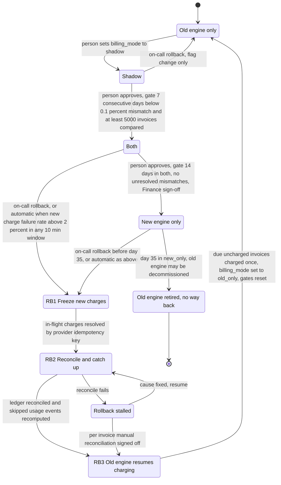

# Billing engine rollout: state machine

## Diagram

Forward moves are one step at a time and each one is made by a person. Rollback is the only path that can start automatically, and every rollback ends in `old_only`.

## Modes

- **old_only.** The old engine reads usage events, computes invoices, writes the ledger and charges customers. The new engine is off.
- **shadow.** The old engine still charges and writes the ledger. The new engine reads the same usage events and writes its invoices to a separate shadow store. It never charges and never writes the ledger. A nightly job compares the two engines' invoices per customer. A mismatch is any invoice total that differs by more than one cent. New-engine errors here are recorded but never trigger a rollback.
- **both.** The new engine charges and writes the ledger. The old engine keeps computing every invoice into the shadow store without charging, so it stays current and can take over. The comparison continues.
- **new_only.** The new engine does everything. The old engine stops computing, so usage events are skipped from this point. The 35-day clock for rollback runs from entry into this mode.
- **RB1 to RB3 (rollback).** From `both` or `new_only`, RB1 stops new-engine charging so no new charge is issued. RB2 has the old engine recompute the skipped usage events into the shadow store (no charges) and reconciles each customer and billing period against the ledger and the provider. RB3 has the old engine charge only invoices that are due and not yet charged, then sets the mode to `old_only`. From `shadow`, rollback is a flag change only, because the old engine has been charging all along.

## Where the rollout state lives

- **The mode.** The single global `billing_mode` flag in the config service. Only the forward moves and rollback transitions write it.
- **Not specified in the brief.** The 7-day streak counter, the 14-day counter, the Finance sign-off, the day count in `new_only`, and the current rollback step. Recommendation: keep these in one rollout record next to `billing_mode`, written only by the transitions above, so a restarted controller resumes at the right step. This is an open decision.
- **Other stores.** The shadow store is separate from the ledger. The ledger is the system of record. The usage event log keeps 35 days, which sets the rollback deadline.
- **Idempotency.** Every charge is keyed on customer, billing period and invoice, so the old engine, the new engine and any rerun cannot charge the same period twice.

## What happens when something fails

- **Shadow mismatch.** Recorded nightly. A day with a mismatch rate at or above 0.1 percent breaks the 7-day streak, which restarts. The gate does not move.
- **Gate not met.** The mode stays where it is. Nothing advances on its own.
- **Automatic rollback.** In `both` or `new_only`, a new-engine charge failure rate above 2 percent over any 10-minute window starts RB1 without a person.
- **Charge succeeded but ledger write failed (or the reverse).** Resolve by querying the provider with the idempotency key before anything is charged again. Never re-charge on an unknown status.
- **Rollback stalled.** If RB2 cannot reconcile, the rollback stops in `rb_stalled`. New-engine charging stays frozen and the old engine does not charge until reconciliation is complete. Due charges are delayed, not dropped. On-call must escalate, and the exit is either a fix that resumes RB2 or a signed-off manual reconciliation into RB3.
- **Day 35 in `new_only`.** The skipped usage events have aged out of the 35-day log. Rollback is closed and the old engine may be decommissioned. From this point there is no way back.
- **After any rollback.** The mode is `old_only`, all gates reset, and returning to `shadow` requires a person to make the move. The 7-day count starts over.

## Assumptions and open questions

- The 0.1 percent threshold and the 5,000-invoice minimum: the diagram reads them as applying across the 7-day window. The brief does not say whether each day must meet them individually. Confirm.
- The 35-day rollback limit is counted from entry into `new_only`. Confirm this is the intended start point.
- No time limit is given for `rb_stalled`. Confirm who decides when to escalate.
- The brief does not say who records Finance sign-off or where that record is kept.
