# Billing engine rollout: state machine

## Diagram

```mermaid
stateDiagram-v2
    direction LR

    [*] --> old_only

    %% Forward path: one step at a time, always started by a person
    old_only --> shadow : person advances
    shadow --> both : person advances, gate A met
    both --> new_only : person advances, gate B met and Finance signed off
    new_only --> decommissioned : person decommissions old engine, day 35 or later

    %% Rollback triggers
    shadow --> RB_StopNew : on-call, manual
    both --> RB_Halt : on-call manual, or auto when charge failure rate over 2 pct in 10 min
    new_only --> RB_Halt : same triggers, only before day 35

    %% Rollback from shadow: nothing was charged by the new engine
    RB_StopNew --> old_only : new engine off, gates reset

    %% Rollback from both or new_only
    RB_Halt --> RB_Reconcile : charge hold set, in-flight charge calls finished or timed out
    RB_Reconcile --> RB_Reconcile : outcome unknown, retry and page on-call
    RB_Reconcile --> source_check : every charge matched to ledger and provider
    state source_check <<choice>>
    source_check --> RB_Reprocess : rolled back from new_only
    source_check --> RB_Handover : rolled back from both
    RB_Reprocess --> RB_Reprocess : step fails, retry and page on-call
    RB_Reprocess --> RB_Handover : skipped usage events reprocessed, no charges made
    RB_Handover --> old_only : flag set to old_only, hold cleared, old engine charges, gates reset

    note right of decommissioned
        Terminal. No way back.
        Usage events older than 35 days are gone.
    end note
```

Gate A (`shadow` -> `both`): 7 consecutive days with a mismatch rate under 0.1%, and at least 5,000 invoices compared. A mismatch is a per-customer invoice total that differs by more than one cent.

Gate B (`both` -> `new_only`): 14 days in `both` with no unresolved mismatches, plus Finance sign-off.

Day 35 is counted from the moment `new_only` is entered. It matches the 35-day usage event log: after that, the events the old engine skipped are gone and cannot be replayed.

## What each mode does

Billing workers run the engines. Each worker follows the flag: it runs the old engine, the new engine or both, as the table says.

| Mode | Old engine | New engine |
|---|---|---|
| `old_only` | Computes, writes the ledger, charges | Off |
| `shadow` | Computes, writes the ledger, charges | Reads the same usage events and writes to the shadow store. Never charges and never writes the ledger. |
| `both` | Computes every invoice into the shadow store only, so it stays current | Computes, writes the ledger, charges |
| `new_only` | Stopped: workers no longer run it. Its read position in the usage event log stays where it was, and `RB_Reprocess` resumes from there. | Computes, writes the ledger, charges |

- **Usage events:** both engines read the same usage event log (kept 35 days). Reading is read-only, and each engine keeps its own read position, so the new engine cannot disturb the old one.
- **Nightly comparison:** the rollout controller runs it in `shadow` and `both`. It compares invoice totals per customer and stores each day's result in the rollout record. In `shadow` it compares the old engine's ledger invoices with the new engine's shadow-store invoices. In `both` it compares the new engine's ledger invoices with the old engine's shadow-store invoices. A mismatch is defined the same way in both modes.
- **Forward moves:** a person asks the controller to advance. The controller checks the gate from the rollout record and refuses if it is not met. If it is met, it sets the flag.
- **Switching charger at `shadow` -> `both`:** the old engine charges before and the new engine after, so the controller sets the charge hold first. While the hold is set, no worker charges. The controller waits for in-flight charge calls to finish or time out, sets the flag, then clears the hold. Charges due in between are charged late by the new engine, which skips any (customer, billing period) already in the ledger. `old_only` -> `shadow` and `both` -> `new_only` do not change who charges, so they need no hold.
- **`decommissioned`:** this is a manual action, available after 35 days in `new_only`. After it, rollback is impossible.

## Rollback steps

| Step | What happens |
|---|---|
| `RB_StopNew` | Used from `shadow` only. Turn the new engine off and set the flag to `old_only`. The shadow store is discarded or kept as evidence. Nothing was charged by the new engine, so there is nothing to reconcile. |
| `RB_Halt` | First, the controller sets the charge hold. Then wait until every in-flight charge call has returned or timed out. Charges that come due in the meantime are put in the charge queue under their idempotency keys. They are held, not dropped. |
| `RB_Reconcile` | Match every (customer, billing period) charge between the ledger and the payment provider. Any charge with an unknown outcome, including a timed-out call, is looked up at the provider before anything is retried. The provider is the truth about money moved. If the provider shows a charge the ledger lacks, add the ledger entry. If the ledger shows a charge the provider has no record of, once the lookup confirms that, treat it as due and leave it in the queue. |
| `RB_Reprocess` | Used from `new_only` only. The old engine replays the usage events it skipped, in non-charging mode, into the shadow store. This is needed because the old engine stopped computing in `new_only`. From `both` it is not needed, because the old engine never stopped. |
| `RB_Handover` | Set `billing_mode` to `old_only` as the last action, then clear the charge hold. The old engine then charges the queued charges that are due and not yet in the ledger. |

Who starts it: on-call runs a rollback command on the controller. For the automatic trigger, the controller watches charge outcomes and starts the rollback itself when the failure rate is over 2% in any 10-minute window.

After any rollback:
- The 7-day count and the 14-day count start from zero.
- The rollout must go through `shadow` again.
- A rollback in progress cannot be advanced or interrupted by a forward move.
- Only one rollback runs at a time. A second trigger while one is running is ignored.

## Double charges and dropped charges

- **Idempotency key:** every charge uses the key (customer, billing period). The ledger is checked before any charge and the provider rejects a repeat.
  - This assumes the payment provider supports idempotency keys. If it does not, the "look up at the provider first" rule in `RB_Reconcile` carries the whole guarantee.
- **One charger at a time:** at no moment may two engines both be allowed to charge. The charge hold enforces this at every switch: the hold is set, in-flight calls end, the flag changes, and only then is the hold cleared.
- **Flag last:** in a rollback the flag changes only at the end, so the order is always halt, reconcile, catch up, then hand over.
- **Nothing dropped:** a charge that is due while the hold is set is queued and then run by the next charging engine. Any (customer, billing period) that is due and not in the ledger gets charged exactly once. During the hold nobody charges, so these customers are charged late, not skipped.

## Where the rollout state lives

- **Mode:** the `billing_mode` flag in the config service holds the mode. It is the only thing workers read to choose an engine, and only the controller, acting on a person's request, moves it forward.
- **Rollout record:** I propose a durable record kept next to the ledger and written by the rollout controller. It holds:
  - the time each mode was entered
  - the gate counters
  - the daily comparison results
  - the Finance sign-off
  - the current rollback step and its trigger
  - the charge hold
  - the charge queue of held charges
- **Why a second place:** the flag has only four values. It cannot say "halted, reconciling", and the rollback steps need to survive a controller restart.
- **Charge hold:** the controller sets it at the start of `RB_Halt` and before the `shadow` -> `both` switch. Workers read it from the rollout record, not from a cache, before every charge. While it is set, no worker charges, whatever the flag says. This is also what makes a slow flag update safe: a worker that has not yet seen the new flag is still stopped by the hold.
- **Controller restart:** the controller resumes from the recorded step. Each step is safe to repeat.

## When something fails

| Failure | Behaviour |
|---|---|
| New-engine errors in `shadow` | Recorded, never a rollback trigger. They may lower the gate result through mismatches. |
| Charge failure rate over 2% in any 10-minute window, in `both` or `new_only` | Automatic rollback. On-call is notified. |
| Same failure rate in `new_only` at day 35 or later | No rollback is possible. Page on-call to fix forward. |
| Rollback step fails (`RB_Reconcile`, `RB_Reprocess`) | Stay in the step, retry, and page on-call. The hold stays set and due charges stay queued. The flag is not changed until `RB_Handover`. |
| Charge outcome unknown | Look it up at the provider. Never retry blind. |
| Nightly comparison job fails or has no data | The day does not count toward the 7-day or 14-day gate. The consecutive-day count resets. |
| Unresolved mismatch in `both` | `both` -> `new_only` stays blocked until it is resolved. It does not cause a rollback by itself. |

## Open points to confirm

1. **Gate A volume:** I read "at least 5,000 invoices compared" as a total across the 7-day window, not per day.
2. **Day-35 cutoff:** I allow rollback from `new_only` only before day 35. A reprocess started late would have to finish before the oldest skipped events age out of the 35-day log. If the reprocess cannot finish in time, I would block the rollback start earlier than day 35. That safety margin needs a number.
3. **Charge failure rate:** it has no minimum sample size. A burst of failures on very few charges in a 10-minute window would roll back automatically. A minimum volume may be worth adding.
4. **Decommission:** it is modelled as a person's action, not automatic.
5. **Resolving a mismatch:** what counts as resolved (fixed in the new engine, or accepted by Finance) and who records it is not decided.
6. **Rollback duration:** how long the hold lasts is not known. If it is long, a maximum delay for due charges may be needed.
7. **Timeouts and lag:** the charge-call timeout (which bounds how long `RB_Halt` and the `shadow` -> `both` switch wait) and how quickly workers notice a flag change are not known. The hold is read at charge time, so correctness does not depend on the lag, but the length of the pause does.
