# Billing engine rollout: state machine

## Diagram

```mermaid
stateDiagram-v2
    direction LR

    [*] --> old_only

    %% Forward path: one step at a time, always started by a person
    old_only --> shadow : person advances
    shadow --> both : person advances, gate A met
    both --> new_only : person advances, gate B met and Finance signed off
    new_only --> decommissioned : person decommissions old engine, day 35 or later

    %% Rollback triggers
    shadow --> RB_StopNew : on-call, manual
    both --> RB_Halt : on-call manual, or auto when charge failure rate over 2 pct in 10 min
    new_only --> RB_Halt : same triggers, only before day 35

    %% Rollback from shadow: nothing was charged by the new engine
    RB_StopNew --> old_only : new engine off, gates reset

    %% Rollback from both or new_only
    RB_Halt --> RB_Reconcile : new engine charging stopped, in-flight charges drained
    RB_Reconcile --> RB_Reconcile : outcome unknown, retry and page on-call
    RB_Reconcile --> source_check : every charge matched to ledger and provider
    state source_check <<choice>>
    source_check --> RB_Reprocess : rolled back from new_only
    source_check --> RB_Handover : rolled back from both
    RB_Reprocess --> RB_Reprocess : step fails, retry and page on-call
    RB_Reprocess --> RB_Handover : skipped usage events reprocessed, no charges made
    RB_Handover --> old_only : flag set to old_only, old engine charges, gates reset

    note right of decommissioned
        Terminal. No way back.
        Usage events older than 35 days are gone.
    end note
```

Gate A (`shadow` -> `both`): 7 consecutive days with a mismatch rate under 0.1%, and at least 5,000 invoices compared. A mismatch is a per-customer invoice total that differs by more than one cent.

Gate B (`both` -> `new_only`): 14 days in `both` with no unresolved mismatches, plus Finance sign-off.

## What each mode does

| Mode | Old engine | New engine |
|---|---|---|
| `old_only` | Computes, writes the ledger, charges | Off |
| `shadow` | Computes, writes the ledger, charges | Reads the same usage events and writes to the shadow store. Never charges and never writes the ledger. |
| `both` | Computes every invoice into the shadow store only, so it stays current | Computes, writes the ledger, charges |
| `new_only` | Stopped | Computes, writes the ledger, charges |

- **Nightly comparison:** it runs in `shadow` and `both`. It compares invoice totals per customer.
- **Forward moves:** a person makes each one, one step at a time, and it is allowed only when the gate is met.
- **`decommissioned`:** this is a manual action, available after 35 days in `new_only`. After it, rollback is impossible.

## Rollback steps

| Step | What happens |
|---|---|
| `RB_StopNew` | Used from `shadow` only. Turn the new engine off and set the flag to `old_only`. The shadow store is discarded or kept as evidence. Nothing was charged by the new engine, so there is nothing to reconcile. |
| `RB_Halt` | Stop all new-engine charging. Let in-flight charge calls finish or time out. Charges that come due in the meantime are queued durably under their idempotency keys. They are held, not dropped. |
| `RB_Reconcile` | Match every (customer, billing period) charge between the ledger and the payment provider. Any charge with an unknown outcome is looked up at the provider before anything is retried. |
| `RB_Reprocess` | Used from `new_only` only. The old engine replays the usage events it skipped, in non-charging mode, into the shadow store. This is needed because the old engine stopped computing in `new_only`. From `both` it is not needed, because the old engine never stopped. |
| `RB_Handover` | Set `billing_mode` to `old_only` as the last action, then clear the rollback marker. The old engine then charges the queued charges that are due and not yet in the ledger. |

After any rollback:
- The 7-day count and the 14-day count start from zero.
- The rollout must go through `shadow` again.
- A rollback in progress cannot be advanced or interrupted by a forward move.
- Only one rollback runs at a time. A second trigger while one is running is ignored.

## Double charges and dropped charges

- **Idempotency key:** every charge uses the key (customer, billing period). The ledger is checked before any charge and the provider rejects a repeat.
  - This assumes the payment provider supports idempotency keys. If it does not, the "look up at the provider first" rule in `RB_Reconcile` and `RB_Handover` carries the whole guarantee.
- **One charger at a time:** at no moment may two engines both be allowed to charge. The new engine stops in `RB_Halt`, and the old engine starts only in `RB_Handover`.
- **Flag last:** the flag changes only at the end, so the order is always halt, reconcile, catch up, then hand over.
- **Nothing dropped:** a charge that is due during a rollback is queued and then run by the old engine. Any (customer, billing period) that is due and not in the ledger gets charged exactly once.

## Where the rollout state lives

- **Mode:** the `billing_mode` flag in the config service holds the mode. It is the only thing workers read to choose an engine, and a person is the only one who moves it forward.
- **Rollout record:** I propose a durable record kept next to the ledger and written by the rollout controller. It holds:
  - the time each mode was entered
  - the gate counters
  - the daily comparison results
  - the Finance sign-off
  - the current rollback step and its trigger
  - a rollback-in-progress marker
- **Why a second place:** the flag has only four values. It cannot say "halted, reconciling", and the rollback steps need to survive a controller restart.
- **Rollback marker:** workers must check it. While it is set, the new engine does not charge even if the flag still says `both` or `new_only`.
- **Controller restart:** the controller resumes from the recorded step. Each step is safe to repeat.

## When something fails

| Failure | Behaviour |
|---|---|
| New-engine errors in `shadow` | Recorded, never a rollback trigger. They may lower the gate result through mismatches. |
| Charge failure rate over 2% in any 10-minute window, in `both` or `new_only` | Automatic rollback. On-call is notified. |
| Same failure rate in `new_only` at day 35 or later | No rollback is possible. Page on-call to fix forward. |
| Rollback step fails (`RB_Reconcile`, `RB_Reprocess`) | Stay in the step, retry, and page on-call. New-engine charging stays halted and due charges stay queued. The flag is not changed until `RB_Handover`. |
| Charge outcome unknown | Look it up at the provider. Never retry blind. |
| Nightly comparison job fails or has no data | The day does not count toward the 7-day or 14-day gate. The consecutive-day count resets. |
| Unresolved mismatch in `both` | `both` -> `new_only` stays blocked until it is resolved. It does not cause a rollback by itself. |

## Open points to confirm

1. **Gate A volume:** I read "at least 5,000 invoices compared" as a total across the 7-day window, not per day.
2. **Day-35 cutoff:** I allow rollback from `new_only` only before day 35. A reprocess started late would have to finish before the oldest skipped events age out of the 35-day log. If the reprocess cannot finish in time, I would block the rollback start earlier than day 35. That safety margin needs a number.
3. **Charge failure rate:** it has no minimum sample size. A burst of failures on very few charges in a 10-minute window would roll back automatically. A minimum volume may be worth adding.
4. **Decommission:** it is modelled as a person's action, not automatic.
