# Checkout across Cart, Inventory, Payment and Order

Checkout snapshots the cart, holds stock, takes payment, and then claims the hold only if the payment succeeds while the hold is still live. If the hold has lapsed, the order is cancelled and refunded in full. The cart is emptied only after the order is confirmed.

## Who owns what

| Service | Owns (its own database) | Talks to |
|---|---|---|
| Cart | Cart lines. Checkout does not change them. | Order (sends the snapshot over HTTP). Consumes OrderConfirmed. |
| Order | Orders, the line and price snapshot, status, cancel reasons | Cart, Inventory and Payment over HTTP. Publishes OrderConfirmed and OrderCancelled. |
| Inventory | Stock counts, reservations (Held, Claimed, Released) and expires_at | Order over HTTP. Runs the expiry sweep. |
| Payment | Charges, provider event ids, refunds | Provider only. Order over HTTP. Publishes ChargeSucceeded and ChargeDeclined. |
| Provider (external) | Card charges and refunds | Payment only, both ways: charge calls go out, webhooks come back. |

The customer email is not sent by any of the four services. The diagram has Order trigger it. Who sends it is an open question (see question 5).

## Flowchart

```mermaid
flowchart TD
    S1(["Customer presses Place order"])
    C1["Cart: send cart lines and prices to Order over HTTP<br/>Stores: nothing changes"]
    O1["Order: create order with a new order id, status Placed<br/>Stores: order, lines and price snapshot"]
    O2["Order: ask Inventory to reserve every line, hold 10 min"]
    I1{"Inventory: is every line in stock?<br/>one all-or-nothing DB transaction"}
    I3["Inventory: write nothing, reply with the short items"]
    O3["Order: status Rejected, short stock<br/>Stores: status and short items"]
    C2["Cart: show the customer which items are short<br/>Cart unchanged"]
    E1(["End: nothing reserved, nothing charged"])
    I2["Inventory: write reservation, status Held, expires_at = now + 10 min<br/>Stores: reservation, stock counts"]
    O4["Order: status Stock reserved<br/>ask Payment to charge, key = order id"]
    P1["Payment: write charge, status Pending<br/>unique on order id"]
    P2["Payment: call provider charge with Idempotency-Key = order id"]
    P3{"Provider accepted the request?"}
    P5["Payment: charge Failed, provider took no money"]
    O5["Order: status Awaiting payment"]
    P4(["Provider decides: seconds, up to 30 min"])
    W1(["Provider webhook: succeeded or declined, may repeat"])
    W2{"Payment: event id already stored?<br/>unique key on provider event id"}
    W3(["End: reply 200, change nothing"])
    W4{"Outcome?"}
    W5["Payment: store event, charge Declined<br/>outbox: ChargeDeclined"]
    W6["Payment: store event, charge Succeeded<br/>outbox: ChargeSucceeded, same transaction"]
    D1["Order: status Payment failed or declined<br/>ask Inventory to release the hold now"]
    D2["Inventory: reservation Released, stock back on sale<br/>no-op if already released"]
    D3(["End: customer told payment failed, cart unchanged, may retry"])
    K1["Order: on ChargeSucceeded, skip if already Confirmed or Cancelled<br/>else ask Inventory to claim the hold"]
    K2{"Inventory: hold still Held and expires_at in the future?<br/>one conditional update"}
    SW["Inventory sweep, every minute: Held rows past expires_at become Released"]
    K3["Inventory: reservation Claimed, stock sold for good<br/>repeat claim returns 200, no second decrement"]
    K4["Order: status Confirmed, publish OrderConfirmed"]
    K5["Cart: on OrderConfirmed, empty the cart"]
    K6(["End: customer sees confirmation"])
    L2["Order: status Cancelled, out of stock"]
    L3["Order: publish OrderCancelled, email customer: cancelled, refund issued"]
    L4["Order: ask Payment for a full refund"]
    L5["Payment: refund Pending, call provider refund with key refund-order id, full amount"]
    L6{"Provider refund result?"}
    L7["Payment: refund Succeeded"]
    L8["Payment: refund Failed, reason stored"]
    L9{"Attempts left?"}
    L10["Payment: refund stays Open in needs-attention queue and ops is alerted<br/>never marked done without provider confirmation"]
    L11(["End: customer has the money back"])

    S1 --> C1
    C1 --> O1
    O1 --> O2
    O2 --> I1
    I1 -->|"no: short items"| I3
    I3 --> O3
    O3 --> C2
    C2 --> E1
    I1 -->|"yes"| I2
    I2 --> O4
    O4 --> P1
    P1 --> P2
    P2 --> P3
    P3 -->|"no: refused"| P5
    P5 --> D1
    P3 -->|"yes"| O5
    O5 --> P4
    P4 -.-> W1
    I2 -.->|"10 min, no claim"| SW
    W1 --> W2
    W2 -->|"yes: duplicate"| W3
    W2 -->|"no: new event"| W4
    W4 -->|"declined"| W5
    W4 -->|"succeeded"| W6
    W5 --> D1
    D1 --> D2
    D2 --> D3
    W6 --> K1
    K1 --> K2
    SW -.-> K2
    K2 -->|"yes"| K3
    K2 -->|"no: hold lapsed"| L2
    K3 --> K4
    K4 --> K5
    K5 --> K6
    L2 --> L3
    L3 --> L4
    L4 --> L5
    L5 --> L6
    L6 -->|"succeeded"| L7
    L6 -->|"failed"| L8
    L8 --> L9
    L9 -->|"yes: retry, same key"| L5
    L9 -->|"no"| L10
    L7 --> L11

    classDef cust fill:#f3f4f6,stroke:#4b5563,color:#111827
    classDef cart fill:#dbeafe,stroke:#1d4ed8,color:#0b1f44
    classDef order fill:#dcfce7,stroke:#15803d,color:#0a2e17
    classDef inv fill:#fef3c7,stroke:#b45309,color:#3b2a05
    classDef pay fill:#ede9fe,stroke:#6d28d9,color:#23113f
    classDef prov fill:#ffffff,stroke:#6b7280,stroke-dasharray:4 3,color:#111827
    classDef fail fill:#fee2e2,stroke:#b91c1c,stroke-width:2px,color:#450a0a
    classDef ok fill:#bbf7d0,stroke:#166534,color:#052e16
    class S1 cust
    class C1,C2,K5 cart
    class O1,O2,O4,O5,K1,K4,L3,L4 order
    class I1,I2,K2,K3,SW,D2,I3 inv
    class P1,P2,P3,W2,W4,W6,L5,L6,L9,L7,W3 pay
    class P4,W1 prov
    class O3,P5,D1,D3,E1,W5,L2,L8,L10 fail
    class K6,L11 ok
```

Colour key: each node is filled with its owning service's colour (blue Cart, green Order, amber Inventory, purple Payment, white dashed for the provider). Red marks a failure or a state that needs attention. Every label also starts with the owning service's name. Solid arrows are synchronous steps or HTTP calls. Dashed arrows are waits or external events.

## The failure branches

- **Short stock** (I1 no, then I3, O3, C2, E1). Inventory writes nothing, so no reservation exists and no charge is requested. The reply lists the short items and Cart shows them to the customer. The rejected order stays on record for support.
- **Declined payment** (W5, D1, D2, D3). The hold is released at once rather than waiting out the 10-minute expiry. The cart is unchanged and the customer can retry.
- **Late success after the hold lapsed** (K2 no, then L2 to L11). The claim fails because the hold is already Released or sold. The order is cancelled as out of stock, the full amount is refunded automatically, and the customer is emailed. No partial order is ever fulfilled.
- **Failed refund** (L6 failed, L8, L9, L10). Retries reuse the same refund key, so a refund cannot be issued twice. A refund is marked Succeeded only when the provider confirms it. After the retry limit it stays Open in a needs-attention queue, with an alert, until a person resolves it. Nothing is closed silently.
- **Duplicate webhooks** (W2). The provider event id has a unique key, so a repeat returns 200 and changes nothing. The consumers are idempotent as well: Order skips a ChargeSucceeded when the order is already Confirmed or Cancelled, and a repeated claim returns 200 without decrementing stock a second time.

## Design rules the diagram relies on

- **Atomic claim.** The claim is one conditional update inside Inventory: the reservation must still be Held and expires_at must be in the future. The sweep and the claim cannot both succeed.
- **Outbox.** Each service writes its state change and its event in one local transaction, then publishes from an outbox table. Without this, a crash after a charge succeeds but before the event is published would leave a paid order that is never claimed.
- **Charge key = order id.** Retries reuse the key, so the provider cannot charge twice. A new checkout attempt after a decline gets a new order id, because the provider would return the old declined result for a reused key.
- **Refund key = refund plus order id.** One refund per order.
- **Cart emptied on OrderConfirmed only.** Every other outcome leaves the cart exactly as it was.

## Open questions

1. **Hold length against slow webhooks.** Most results arrive within seconds, but the hold lapses at 10 minutes. A payment that succeeds at minute 3, with its webhook arriving at minute 12, is refunded even if the stock is still free. The brief allows this. The alternative is to extend the hold while a charge is Pending. Which do you want?
2. **Ambiguous provider timeouts.** If the charge call times out, the charge stays Pending and the same key is retried. The outcome comes from the webhook or a provider lookup. The diagram shows only a clear refusal (P3 no). Please confirm this.
3. **Stuck orders.** Orders still in Stock reserved or Awaiting payment after the hold and webhook windows should be swept and reconciled with Payment. The diagram does not show this sweep. Should it?
4. **Edits during checkout.** On OrderConfirmed, Cart clears its whole contents, which would also drop items the customer added while paying. The alternative is to clear only the ordered lines.
5. **Who sends the email.** The brief requires it, but none of the four services is a mailer. Order can publish OrderCancelled to a mailer, or send the email itself.
6. **Refund retry limit.** The brief does not set one, nor does it say who is alerted.