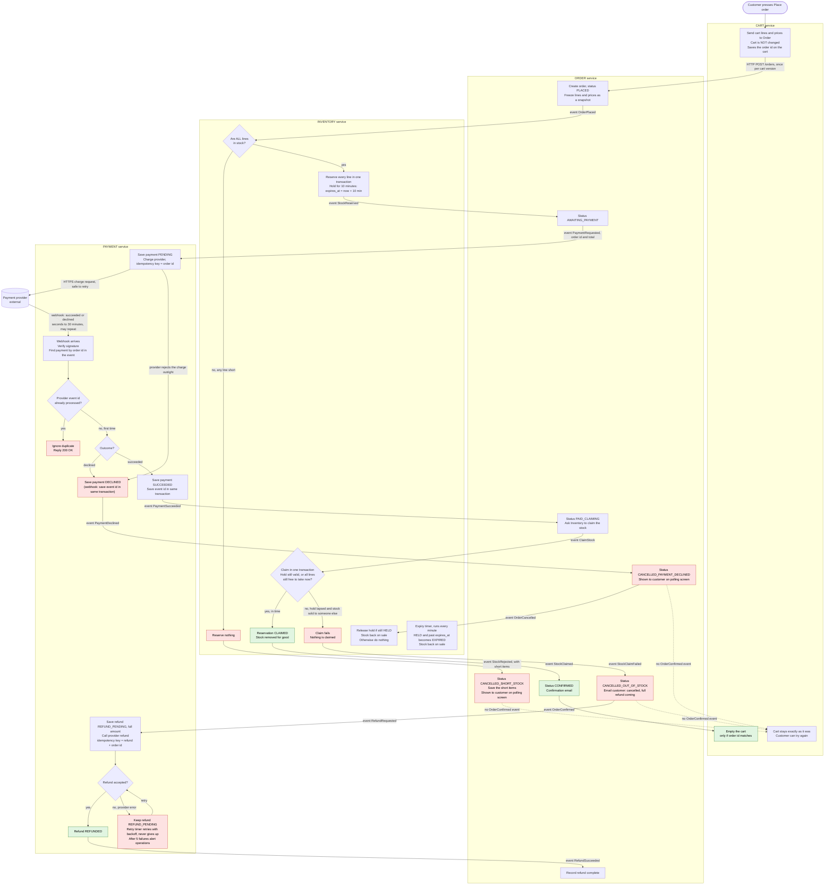

# Checkout across Cart, Inventory, Payment and Order

## How to read this

- There are four services. Each owns its own database, and none reads another's tables.
- **Events** (shown as `event X` on an arrow) go over the shared message broker. **HTTP** calls are labelled as such.
- Every service writes its events through a transactional outbox: the state change and the event are saved in one local transaction. A relay (a small loop inside each service) keeps scanning the outbox for unpublished events, publishes each to the broker, and marks it published only after the broker confirms. If the broker or relay is down, events simply wait in the outbox and go out later, so delivery is at least once and an event cannot be lost. Every consumer records the ids of events it has handled, so a redelivered event does nothing the second time.
- The customer sees progress by polling `GET /orders/{id}` on Order. Order's status (and short items) is all the customer screen shows. PLACED, AWAITING_PAYMENT and PAID_CLAIMING show as "in progress"; CONFIRMED shows the confirmation; the three CANCELLED statuses show the failure. Polling stops at CONFIRMED or any CANCELLED status. Email is sent only on confirmation and on out-of-stock cancellation.
- In the diagram, red nodes are failure branches and green is the success end. A dotted arrow means "no event is sent, so this service does nothing".

## Flowchart

## What each step does, in order

1. **Place order (Cart to Order).** Cart sends its lines and prices to Order over HTTP. Order creates the order, freezes the lines and prices as a snapshot, so later cart edits or price changes don't affect it, and returns the new order id in its reply. The reply comes straight away, with the order still PLACED; the work after that is driven by events (step 2). Cart saves that id on the cart (its lines are not changed) and hands it to the customer screen, which uses it to poll `GET /orders/{id}`. The cart version is a counter that Cart raises on every edit of its lines. The request is keyed on the cart id and cart version, so a double-click returns the same order. The key only matches an order that is still live or confirmed. If the earlier order with that key was cancelled (short stock, declined or out of stock), Order creates a new order with a new id, so pressing Place order again after a failure starts a fresh checkout. If the call fails or times out, or the reply is lost, Cart saves no id and does not retry by itself: the customer sees an error and the cart is unchanged. Pressing Place order again sends the same key, so Order returns the existing order if one was created, and Cart then saves that id and shows the polling screen as normal. Editing the cart after pressing Place order does not touch the order already placed (it runs on its snapshot); see the open question below.
2. **Reserve stock (Inventory).** Order saves the order and its `OrderPlaced` event in one transaction (outbox), so the event is always published eventually. Inventory consumes it, checks every line and reserves all of them in one transaction, or reserves none. Reservations are keyed by order id, so a repeated `OrderPlaced` finds the existing reservation (or is dropped by the handled-event check) and changes nothing.
    - **Short stock:** Inventory publishes `StockRejected` with the short items. Order marks the order cancelled and keeps the short items, so the polling screen shows which items are short. No payment is ever requested.
    - **All in stock:** each reservation gets `expires_at = now + 10 minutes`, and Inventory publishes `StockReserved`.
3. **Request payment.** Order moves to AWAITING_PAYMENT and publishes `PaymentRequested`. Payment saves the payment as PENDING, keyed by order id, before it calls the provider. It then sends the charge with the **order id as the idempotency key**, and also as the charge's reference, which the provider copies into every webhook for that charge. If the call times out or the provider has a temporary error, Payment resends the same request, and the provider cannot charge twice. If the provider rejects the charge outright (a definite error, not a timeout), no webhook will follow, so Payment treats it as a decline: it saves DECLINED and publishes `PaymentDeclined` (step 5). While waiting, the customer sees AWAITING_PAYMENT.
4. **Webhook arrives (Payment).** The provider's result arrives by webhook, between a few seconds and 30 minutes later. The hold lasts only 10 minutes, so in a slow payment the hold can lapse while the order is still AWAITING_PAYMENT: the timer marks it EXPIRED and the stock goes back on sale. Order is not told about the expiry and does not change status because of it; it stays AWAITING_PAYMENT until `PaymentSucceeded` or `PaymentDeclined` arrives. That is expected, and step 6 handles it. Payment verifies the signature, reads the order id from the event to find its payment, then checks the provider's event id against its table of processed events.
    - **Duplicate:** Payment replies 200 OK and does nothing else.
    - **First time:** Payment records the event id and the new payment status in **one transaction**. A crash between the two cannot lead to a double process or a lost event.
5. **Declined.** Payment publishes `PaymentDeclined`. Order sets CANCELLED_PAYMENT_DECLINED, which the customer sees on the polling screen (no email). The declined order is final and is never paid again: to retry, the customer presses Place order, which creates a new order and a new charge with a new idempotency key (step 1). Order publishes `OrderCancelled`. Inventory releases the hold straight away if it is still HELD. If it has already expired, been released, or does not exist, Inventory does nothing: the stock is already back on sale, and the order is unaffected. The cart is untouched.
6. **Succeeded.** Payment publishes `PaymentSucceeded`. Order checks its own status. If the order is AWAITING_PAYMENT, it moves to PAID_CLAIMING and publishes `ClaimStock`. If the order is in any other state (for example already cancelled), it keeps that status, sends no email, and publishes `RefundRequested` directly, which goes down the refund path in step 8. On `ClaimStock`, Inventory looks up the order's reservation and tries to claim in one transaction. Inside that transaction the free-stock check and the stock decrease are one atomic step per item, so two orders can never both take the last unit. There are three outcomes:
    - **Hold still valid** (status HELD, before `expires_at`): Inventory marks it CLAIMED and publishes `StockClaimed`. Available is unchanged, because the stock was already held.
    - **Hold lapsed** (status EXPIRED): Inventory tries once to take all the lines again, all-or-nothing. "Free" means the item's available count (see the table) is at least the line quantity right now. Stock sold to someone else is no longer available, so the attempt fails. If every line is free, the reservation goes from EXPIRED to CLAIMED, on hand drops by the line quantities, and available drops by the same amount (the stock was on sale, and now it is gone). Inventory publishes `StockClaimed`. This is an assumption of this design, because it avoids refunding an order we could still fulfil. If you want a lapsed hold to always fail, remove that second attempt.
    - **Anything else** (the attempt above fails, the reservation was RELEASED, or none exists): Inventory publishes `StockClaimFailed`. That is the bad case, where payment succeeded but the stock has gone.
7. **Confirmed.** On `StockClaimed`, Order sets CONFIRMED, sends the confirmation email and publishes `OrderConfirmed`. Cart consumes `OrderConfirmed` from the broker like any event. **Only now** does Cart empty the cart, and only if the order id in the event matches the one it saved. If it does not match (for example a second order was placed since), Cart ignores the event and the cart is unchanged.
8. **Late success, stock gone.**
    - **Order:** sets CANCELLED_OUT_OF_STOCK, emails the customer ("cancelled, full refund on its way") and publishes `RefundRequested`. The whole order is cancelled, and nothing ships.
    - **Payment:** saves a REFUND_PENDING record for the full amount before it calls the provider. The refund call uses its own idempotency key, so a retry cannot refund twice.
    - **Success:** Payment marks the refund REFUNDED and publishes `RefundSucceeded`. Order only records that the refund is complete, in its refund status. The order status, the polling screen and the emails do not change, whichever path led to the refund.
9. **Refund fails at the provider.** The refund record stays REFUND_PENDING and is written to the database, so it survives a restart. A retry timer re-sends pending refunds with backoff and never stops. After 5 failures Payment also alerts operations. A refund can only leave the pending state by succeeding.
10. **Expired holds.** A timer in Inventory runs every minute and returns any hold past `expires_at` to stock. The claim step in 6 checks `expires_at` and status inside its own transaction, so the timer and a late claim cannot both win.

## What each service stores

| Service | Stores |
|---|---|
| **Cart** | Carts and their lines, and a version counter raised on each edit. The id of the order created by the last Place order, so it can match `OrderConfirmed`. Handled-event ids. |
| **Order** | Orders with the request key (cart id and cart version), the frozen snapshot of lines, prices and total. Status (PLACED, AWAITING_PAYMENT, PAID_CLAIMING, CONFIRMED, CANCELLED_SHORT_STOCK, CANCELLED_PAYMENT_DECLINED, CANCELLED_OUT_OF_STOCK). The short items. Refund status. Outbox and handled-event ids. |
| **Inventory** | Stock on hand per item. Reservations: order id, lines, `expires_at`, and status HELD, CLAIMED, EXPIRED or RELEASED. **Available = on hand minus the quantities in HELD reservations.** Reserving creates a HELD reservation (available falls). Claiming a HELD reservation marks it CLAIMED and lowers on hand (available unchanged). Expiry or release marks it EXPIRED or RELEASED (available rises). Outbox and handled-event ids. |
| **Payment** | Payments: order id, amount, status PENDING, SUCCEEDED or DECLINED. Refunds: order id, amount, status REFUND_PENDING or REFUNDED, attempt count. **Processed provider event ids** (unique), used to drop duplicate webhooks. Outbox. |

## Edge cases and decisions

- **Only Payment talks to the provider.** The charge and refund calls and the webhook endpoint all live in Payment. No other service sees provider credentials.
- **No double charge.** The charge key is the order id, and retries reuse it. One order can have at most one charge.
- **Failure leaves the cart alone.** Cart changes only on `OrderConfirmed`. The three failure paths (short stock, declined, out of stock) all leave the cart as it was, so the customer can press Place order again. Order sees the earlier order with that key is cancelled and creates a new order and a new snapshot (step 1).
- **Redelivered events are safe.** Because every service records the event ids it has handled, a message delivered twice has no second effect.
- **Order applies each event only in the status it expects.** `StockReserved` and `StockRejected` count only while the order is PLACED, and `StockClaimed` and `StockClaimFailed` only while it is PAID_CLAIMING. In any other status Order ignores them. `PaymentSucceeded` is the one event with its own rule (step 6), because it must still trigger a refund.

## Open questions

- I used 5 failed refund attempts as the alert point, and one minute as the expiry timer interval. Both are easy to change. The polling interval of the customer screen is also not set.
- No timeout is defined for a charge that never gets a webhook or a clear answer. The order would stay AWAITING_PAYMENT and the hold would expire. We have not decided whether Payment should ask the provider for the status after some time.
- If a customer edits the cart and presses Place order while an earlier order is still in flight, two orders can exist for one cart, and Cart only matches the latest order id on `OrderConfirmed`. Not yet decided how to prevent this.
- We assume the provider copies our charge reference (the order id) into its webhooks. If it does not, Payment would need to store the provider's own payment id and match on that.
