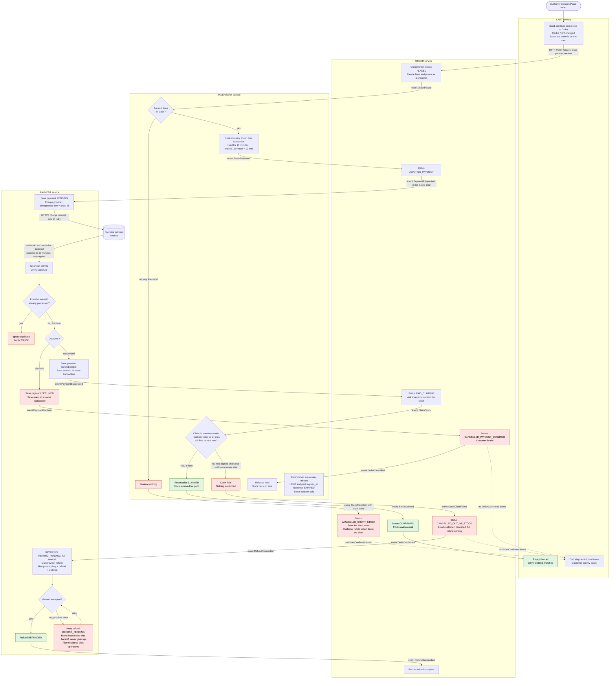

# Checkout across Cart, Inventory, Payment and Order

## How to read this

- There are four services. Each owns its own database, and none reads another's tables.
- **Events** (shown as `event X` on an arrow) go over the shared message broker. **HTTP** calls are labelled as such.
- Every service writes its events through a transactional outbox: the state change and the event are saved in one local transaction, and a relay then publishes the event. Every consumer records the ids of events it has handled, so a redelivered event does nothing the second time.
- In the diagram, red nodes are failure branches and green is the success end. A dotted arrow means "no event is sent, so this service does nothing".

## Flowchart

## What each step does, in order

1. **Place order (Cart to Order).** Cart sends its lines and prices to Order over HTTP. Order creates the order and freezes the lines and prices as a snapshot, so later cart edits or price changes don't affect it. The request is keyed on the cart id and cart version, so a double-click returns the same order. Cart saves the order id on the cart but does not change the cart's lines.
2. **Reserve stock (Inventory).** Order publishes `OrderPlaced`. Inventory checks every line and reserves all of them in one transaction, or reserves none.
   - **Short stock:** Inventory publishes `StockRejected` with the short items. Order marks the order cancelled and keeps the short items, so the screen the customer is polling (`GET /orders/{id}`) shows which items are short. No payment is ever requested.
   - **All in stock:** each reservation gets `expires_at = now + 10 minutes`, and Inventory publishes `StockReserved`.
3. **Request payment.** Order moves to AWAITING_PAYMENT and publishes `PaymentRequested`. Payment saves the payment as PENDING before it calls the provider. It then sends the charge with the **order id as the idempotency key**. If the call times out, Payment resends the same request, and the provider cannot charge twice.
4. **Webhook arrives (Payment).** The provider's result arrives by webhook, between a few seconds and 30 minutes later. Payment verifies the signature, then checks the provider's event id against its table of processed events.
   - **Duplicate:** Payment replies 200 OK and does nothing else.
   - **First time:** Payment records the event id and the new payment status in **one transaction**. A crash between the two cannot lead to a double process or a lost event.
5. **Declined.** Payment publishes `PaymentDeclined`. Order cancels the order and tells the customer. Order then publishes `OrderCancelled`, and Inventory releases the hold straight away. The cart is untouched.
6. **Succeeded.** Payment publishes `PaymentSucceeded`. Order publishes `ClaimStock`, and Inventory tries to claim in one transaction:
   - **Hold still valid:** Inventory marks it CLAIMED and publishes `StockClaimed`.
   - **Hold already lapsed:** Inventory tries once to take all the lines again, all-or-nothing. If every line is still free, it claims them. This is an assumption of this design, because it avoids refunding an order we could still fulfil. If you want a lapsed hold to always fail, remove that second attempt.
   - **Anything else:** Inventory publishes `StockClaimFailed`. That is the bad case, where payment succeeded but the stock has gone.
7. **Confirmed.** On `StockClaimed`, Order sets CONFIRMED, sends the confirmation email and publishes `OrderConfirmed`. **Only now** does Cart empty the cart, and only if the order id matches the one it saved.
8. **Late success, stock gone.**
   - **Order:** sets CANCELLED_OUT_OF_STOCK, emails the customer ("cancelled, full refund on its way") and publishes `RefundRequested`. The whole order is cancelled, and nothing ships.
   - **Payment:** saves a REFUND_PENDING record for the full amount before it calls the provider. The refund call uses its own idempotency key, so a retry cannot refund twice.
   - **Success:** Payment marks the refund REFUNDED and publishes `RefundSucceeded`. Order records that the refund is complete.
9. **Refund fails at the provider.** The refund record stays REFUND_PENDING and is written to the database, so it survives a restart. A retry timer re-sends pending refunds with backoff and never stops. After 5 failures Payment also alerts operations. A refund can only leave the pending state by succeeding.
10. **Expired holds.** A timer in Inventory runs every minute and returns any hold past `expires_at` to stock. The claim step in 6 checks `expires_at` and status inside its own transaction, so the timer and a late claim cannot both win.

## What each service stores

| Service | Stores |
|---|---|
| **Cart** | Carts and their lines. The id of the order created by the last Place order, so it can match `OrderConfirmed`. Handled-event ids. |
| **Order** | Orders with the frozen snapshot of lines, prices and total. Status (PLACED, AWAITING_PAYMENT, PAID_CLAIMING, CONFIRMED, CANCELLED_SHORT_STOCK, CANCELLED_PAYMENT_DECLINED, CANCELLED_OUT_OF_STOCK). The short items. Refund status. Outbox and handled-event ids. |
| **Inventory** | Stock level per item. Reservations: order id, lines, `expires_at`, and status HELD, CLAIMED, EXPIRED or RELEASED. Outbox and handled-event ids. |
| **Payment** | Payments: order id, amount, status PENDING, SUCCEEDED or DECLINED. Refunds: order id, amount, status REFUND_PENDING or REFUNDED, attempt count. **Processed provider event ids** (unique), used to drop duplicate webhooks. Outbox. |

## Edge cases and decisions

- **Only Payment talks to the provider.** The charge and refund calls and the webhook endpoint all live in Payment. No other service sees provider credentials.
- **No double charge.** The charge key is the order id, and retries reuse it. One order can have at most one charge.
- **Failure leaves the cart alone.** Cart changes only on `OrderConfirmed`. The three failure paths (short stock, declined, out of stock) all leave the cart as it was, so the customer can press Place order again. A retry creates a new order and a new snapshot.
- **A success arriving for an order that is no longer waiting for payment** (for example, already cancelled) goes down the same path as a failed claim: refund in full.
- **Redelivered events are safe.** Because every service records the event ids it has handled, a message delivered twice has no second effect.
- **Open question for you.** I used 5 failed refund attempts as the alert point, and one minute as the expiry timer interval. Both are easy to change.
