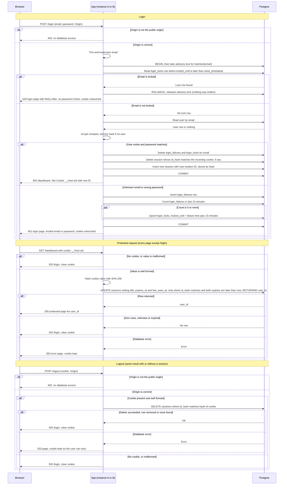

# Login with server-side sessions: design

## Decisions

1. **Storage: Postgres, not Redis.** Sessions, failure records and lock records live in the existing Postgres database.
   - Both instances share one source of truth, so no sticky sessions are needed.
   - Session checks and the user lookup use one database, so there is no second system to keep consistent.
   - One indexed primary-key lookup per protected request is well within what Postgres handles for a small team.
   - Redis would add a service with its own failure mode, backups and monitoring, and no capability the requirements need. Revisit only if session-check load becomes measurable. Keep session access behind one module so a Redis store could replace it later.

2. **Session ID: 256 random bits.** 32 bytes from the platform CSPRNG, base64url-encoded (43 characters). It is an opaque reference with no user data.

3. **The server stores only a hash.** The table keeps `SHA-256(cookie value)`, so a database dump does not yield usable cookies. A cookie value that is not 43 base64url characters is treated as no session, with no database query.

4. **Clock: database time only.** Expiry comparisons use `now()` from Postgres, so the two instances' clocks do not matter. Lock checks and failure timestamps use `clock_timestamp()`, because `now()` is fixed at transaction start and the advisory lock (decision 10) can make a request wait.

5. **Cookie.** Name `__Host-sid`. The value is the opaque session ID only. Attributes: `Path=/`, `HttpOnly`, `Secure`, `SameSite=Lax`, no `Domain`, no `Max-Age`, so it is a browser-session cookie. The server alone enforces the 30-minute and 12-hour limits. Clearing sends the same attributes with `Max-Age=0`.

6. **Expiry, stored in the row.**
   - `absolute_expires_at = login time + 12 hours`. Set once, never extended.
   - `idle_expires_at = least(now() + 30 minutes, absolute_expires_at)`. Rewritten on every protected request.
   - Login inserts the row with `created_at = last_seen_at = now()` and both expiries computed as above.
   - A session is valid only while both expiries are in the future. A protected request runs one statement, so the check and the idle refresh have no read-then-write gap:

     ```sql
     UPDATE sessions
        SET last_seen_at = now(),
            idle_expires_at = least(now() + interval '30 minutes', absolute_expires_at)
      WHERE id_hash = $1
        AND idle_expires_at > now()
        AND absolute_expires_at > now()
      RETURNING user_id;
     ```

   - No write throttling. Skipping refreshes would expire active users early.
   - States: **Active** while both expiries are in the future. **Expired** once either passes; expired rows are rejected at check time and deleted by cleanup. **Destroyed** when logout or a replacing login deletes the row. There are no tombstones.

7. **Cleanup.** Correctness does not depend on cleanup, because the per-request check rejects expired rows. A job runs every 5 minutes and deletes:
   - `sessions WHERE idle_expires_at <= now()`. This covers the absolute limit too, because idle expiry is capped at it.
   - `login_failures` older than 10 minutes.
   - `login_locks` past `locked_until`.

8. **Failure counting: exact sliding 10-minute window.** Each failed attempt inserts a `login_failures` row stamped with `clock_timestamp()`. In the same transaction, count the failures including the new one:

   ```sql
   SELECT count(*) FROM login_failures
    WHERE email = $1 AND failed_at > clock_timestamp() - interval '10 minutes';
   ```

   Fixed time buckets are not used.

9. **Lockout, per email.**
   - The lock check runs before any user lookup, for known and unknown emails alike. Failures for unknown emails are counted and locked the same way, so the lock cannot reveal whether an account exists.
   - When a failure makes the 10-minute count reach 5, write or update the `login_locks` row with `locked_until = failure time + 15 minutes`.
   - While locked, every attempt gets 429 with `Retry-After` (seconds until `locked_until`, rounded up). The lock blocks the correct password too, for its full 15 minutes, without a password check. The transaction is rolled back before the 429 is sent, since nothing was written.
   - Attempts refused by the lock are not counted and do not extend it.
   - A successful login deletes that email's failure rows and lock row. This can only happen after the lock has expired.
   - Example: failures at 00:00, 00:02, 00:04, 00:06 and 00:08 lock the email until 00:23. At 00:23 those failures are all older than 10 minutes. A failure at 00:24 starts a new count, and five new failures are needed to lock again.

10. **One attempt per email at a time.** Each login takes `pg_advisory_xact_lock(hashtext(email))`, where `email` is trimmed and lowercased. The lock ends with the transaction. Every path ends the transaction before the response is sent. Concurrent guesses for one email queue, so parallel requests cannot overshoot the limit of 5. Bcrypt already makes each guess slow, so queueing is acceptable.

11. **Timing equalisation.** If no user matches the email, bcrypt still runs against a dummy hash computed once at startup with the same cost factor. Unknown-email and wrong-password responses take the same time.

12. **Origin check first, on `POST /login` and `POST /logout`.** Compare the `Origin` header (or `Sec-Fetch-Site`) with the configured public origin, not `Host`, because a load balancer may rewrite `Host`. A failure returns 403 before any database access and records nothing. `SameSite=Lax` does not stop login CSRF, so this check does.

13. **Old session on login.** Only a successful login destroys the session the incoming cookie points to, in the same transaction as the new session. If the cookie is missing, stale or belongs to another user, the delete matches zero or one row. A failed login does not touch the cookie or any session.

14. **Users.** `sessions.user_id` references `users(id)` with `ON DELETE CASCADE`, so deleting a user ends their sessions. The protected request trusts `user_id` from the `UPDATE` and does not reload the user. A changed email does not end the session. Page data loads by `user_id`, and a missing record shows the page's normal not-found response.

15. **Status codes.** Login success and protected-page redirects to `/login` are `303 See Other`. Login, protected and logout responses send `Cache-Control: no-store`. The response table below lists every case.

## Sequence diagram



## Responses

`GET /login` always shows the form. It does not read the session, check Origin or touch the cookie. A visitor with a valid session also sees the form, and signing in again replaces the old session under decision 13.

| Situation | Status | Body | Cookie | Notes |
|---|---|---|---|---|
| Origin not the public origin | 403 | none | untouched | No database access, nothing recorded |
| Correct password, not locked | 303 to /dashboard | none | new `__Host-sid` set | Old session destroyed |
| Unknown email or wrong password | 401 | login page, "Invalid email or password" | untouched | Same text, status and timing |
| 5th failure in window | 401 | same as above | untouched | The lock begins here |
| Locked email, known or unknown | 429 | login page, "Too many failed attempts. Try again later." | untouched | `Retry-After` in seconds |
| Protected page, no, malformed or invalid session | 303 to /login | none | cleared | |
| Logout, with or without session | 303 to /login | none | cleared | |
| Storage failure on login | 503 | login page, "Sign-in is temporarily unavailable. Try again shortly." | untouched | See failure behaviour |

Unknown email and wrong password match because the lock check runs before any user lookup and failures are recorded for every email. The 429 and 503 responses do not depend on whether the account exists.

## Failure behaviour

The rule is fail closed, never fail open.

- **Login, storage unavailable at any step** (advisory lock, lock read, user read, failure insert, count, lock upsert, COMMIT). Roll back and return 503. Rollback releases the advisory lock and discards any failure row, so the failed attempt is not counted. A lock row that cannot be read is never treated as "no lock", so the password is not checked. The app does not fall back to memory. The 503 comes before any user lookup result is used, so it does not reveal whether the account exists. `Set-Cookie` is sent only after COMMIT succeeds, so a failed COMMIT creates no session and sends no cookie.
- **Login, failure row cannot be written after a password mismatch.** Roll back, return 503 and do not count the attempt. The attacker gains nothing, and the user can retry.
- **Protected request, storage unavailable.** Return 503 with a generic error page. Protected content is never served without a confirmed session. The cookie is kept, so a transient fault does not log the user out.
- **Logout, storage unavailable.** Return 503 and keep the cookie so the user can retry. The session is destroyed before the browser is told it is gone. If the user cannot retry, the session still ends within 30 minutes idle or 12 hours absolute.
- **Cleanup job failure.** Does not affect correctness, because the per-request check ignores expired rows. Alert if the job fails for more than an hour, since the tables would grow.
- **All storage errors** are logged server-side with request ID and error class. The user sees no database detail.

## Open boundaries and questions

- **Targeted lockout.** Anyone who knows an email address can lock that person out for 15 minutes with five wrong passwords. This follows from the per-email rule in the requirements and is accepted. Mitigating it needs IP-based limits, which need a decision on trusted proxy headers behind the load balancer.
- **Credential stuffing across many emails.** The per-email rule does not slow one password tried against many accounts. A global or per-IP limit is outside this spec and should be scoped separately.
- **Per-email serialisation.** A flood against one email holds connections while bcrypt runs. Watch the pool size.
- **Session fixation.** Handled by a new ID on login and deleting the old one. There is no mid-session rotation, and the spec does not require it.
- **Password reset and sign-up.** Out of scope. Reset will need to end all of a user's sessions, which the `ON DELETE CASCADE` path does not cover on its own.
- **Cookie lifetime.** The browser keeps the cookie until it closes. The server ends sessions regardless, so a browser left open past 30 minutes of inactivity is sent to `/login` on its next request.
- **HTTP in local development.** `Secure` cookies are not sent over plain HTTP. Local setups need HTTPS or a documented exception.
- **Where TLS ends (open).** The brief does not say whether the load balancer terminates TLS. The Origin check and any scheme-dependent behaviour need the public scheme and host. The `Secure` cookie is set by the app either way, since the browser sees HTTPS.

### Schema (sketch)

```sql
CREATE TABLE sessions (
  id_hash             bytea PRIMARY KEY,           -- SHA-256 of the cookie value
  user_id             bigint NOT NULL REFERENCES users(id) ON DELETE CASCADE,
  created_at          timestamptz NOT NULL DEFAULT now(),
  last_seen_at        timestamptz NOT NULL DEFAULT now(),
  idle_expires_at     timestamptz NOT NULL,
  absolute_expires_at timestamptz NOT NULL
);
CREATE INDEX sessions_idle_idx ON sessions (idle_expires_at);

CREATE TABLE login_failures (
  email      text NOT NULL,                        -- trimmed, lowercased
  failed_at  timestamptz NOT NULL DEFAULT clock_timestamp()
);
CREATE INDEX login_failures_email_idx ON login_failures (email, failed_at);

CREATE TABLE login_locks (
  email        text PRIMARY KEY,
  locked_until timestamptz NOT NULL
);
```