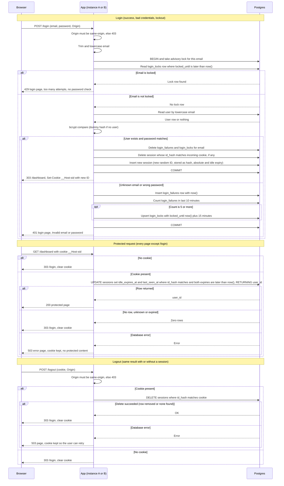

# Login with server-side sessions: design

## Decisions

Each choice below is explicit so it can be reviewed on its own.

1. **Storage: Postgres, not Redis.** Sessions, failure records and lock records live in the existing Postgres database.
   - Both instances share one source of truth with no sticky sessions.
   - Session checks and the users lookup use the same database, so there is no second system to keep consistent.
   - Expected load is a small team, so one indexed primary-key lookup per protected request is well within what Postgres handles.
   - Redis would add a service, its own failure mode, and its own backup and monitoring story, for no capability the requirements need. Revisit only if database load from session checks becomes measurable. Keep session access behind one module so a Redis store could replace it later.

2. **Session ID: 256 random bits.** Generated with the platform CSPRNG (32 bytes, base64url, 43 characters). It is an opaque reference with no user data.

3. **Server stores only a hash of the session ID.** The table keeps `SHA-256(session_id)`, not the ID itself. A leaked database dump does not yield usable session cookies.

4. **Clock: the database clock only.** Every expiry comparison uses `now()` from Postgres. Expiry therefore does not depend on the clocks of the two app instances.

5. **Cookie.** Name `__Host-sid`, value is the opaque session ID only. Attributes: `Path=/`, `HttpOnly`, `Secure`, `SameSite=Lax`, no `Domain`, no `Max-Age`. It is a browser-session cookie; the server alone enforces the 30-minute and 12-hour limits. Clearing sends the same attributes with `Max-Age=0`.

6. **Session expiry, recorded in the row.**
   - `absolute_expires_at = login time + 12 hours`. Set once, never extended.
   - `idle_expires_at = least(now() + 30 minutes, absolute_expires_at)`. Rewritten on every protected request, so each request restarts the idle clock.
   - A session is valid only while both are in the future. The check and the idle refresh happen in one `UPDATE ... RETURNING`, so there is no read-then-write gap.
   - No write throttling. Skipping idle refreshes would expire active users early.

7. **Abandoned session removal.**
   - Correctness does not depend on cleanup: the per-request check rejects expired rows.
   - A cleanup job runs every 5 minutes and deletes `sessions WHERE idle_expires_at <= now()`. Because `idle_expires_at` is capped at the absolute expiry, this one predicate covers both limits.
   - The same job deletes `login_failures` older than 10 minutes and `login_locks` past `locked_until`.

8. **Failure counting: a sliding 10-minute window.** Each failed attempt inserts a timestamped row, so "5 failures within any 10 minutes" is counted exactly rather than approximated with fixed buckets.

9. **Lockout.** When a failure makes the count in the last 10 minutes reach 5, a `login_locks` row is written with `locked_until = failure time + 15 minutes`.
   - A lock on an email applies whether or not the account exists. Failures for unknown emails are counted and locked the same way, so the lock cannot reveal existence.
   - Attempts refused by the lock are not counted and do not extend it.
   - A successful login deletes that email's failure rows and lock row.

10. **Serialising attempts per email.** Each login takes `pg_advisory_xact_lock(hashtext(email))` for the whole attempt. Concurrent guesses for one email queue behind each other, so the limit of 5 cannot be overshot by parallel requests. The cost is that guesses for the same email are serialised, which is acceptable because bcrypt already makes each guess slow.

11. **Timing equalisation.** When no user matches the email, the app still runs bcrypt against a dummy hash computed once at startup with the same cost factor. Unknown-email and wrong-password responses take the same time.

12. **Origin check on the POST routes.** `POST /login` and `POST /logout` reject requests whose `Origin` (or `Sec-Fetch-Site`) is not same-origin. `SameSite=Lax` stops cookies on cross-site POSTs, but it does not stop login CSRF, where an attacker signs the victim into the attacker's account. The Origin check closes that gap without a token.

13. **Login success status.** `303 See Other` to `/dashboard`. Protected-page redirects to `/login` are also `303`.

14. **Cache headers.** Login, protected and logout responses send `Cache-Control: no-store`.

### Schema (sketch)

```sql
CREATE TABLE sessions (
  id_hash            bytea PRIMARY KEY,           -- SHA-256 of the cookie value
  user_id            bigint NOT NULL REFERENCES users(id),
  created_at         timestamptz NOT NULL DEFAULT now(),
  last_seen_at       timestamptz NOT NULL DEFAULT now(),
  idle_expires_at    timestamptz NOT NULL,
  absolute_expires_at timestamptz NOT NULL
);
CREATE INDEX sessions_idle_idx ON sessions (idle_expires_at);

CREATE TABLE login_failures (
  email      text NOT NULL,                       -- trimmed, lowercased
  failed_at  timestamptz NOT NULL DEFAULT now()
);
CREATE INDEX login_failures_email_idx ON login_failures (email, failed_at);

CREATE TABLE login_locks (
  email        text PRIMARY KEY,
  locked_until timestamptz NOT NULL
);
```

## Sequence diagram



## State and rules

**Session states.** `Active` (both expiries in the future) becomes `Expired` when the idle or absolute expiry passes. `Expired` rows are rejected at check time and deleted by cleanup. `Destroyed` is reached by logout or by a successful login that replaces the session. Destroyed rows are deleted, so there is no tombstone.

**Session limits.** Idle timeout 30 minutes, reset by every protected request. Absolute limit 12 hours from login, never extended. Whichever expires first ends the session.

**Lockout states per email.** `Clear` (fewer than 5 failures in the last 10 minutes) becomes `Counting` on each failure. The 5th failure inside any 10-minute span moves it to `Locked` until failure time plus 15 minutes. While locked, every attempt gets 429 without a password check, and none of those attempts are counted. When `locked_until` passes, the email is `Clear` again with its old failures already past the window. A successful login returns it to `Clear` immediately.

**Response matrix.**

| Situation | Status | Body | Notes |
|---|---|---|---|
| Correct password, not locked | 303 to /dashboard | none | Cookie issued |
| Unknown email or wrong password | 401 | login page, "Invalid email or password" | Same text, same status, same timing |
| 5th failure in window | 401 | same as above | The lock begins here |
| Locked email | 429 | "Too many failed attempts. Try again later." | Same for known and unknown emails |
| Protected page, no or invalid session | 303 to /login | none | Cookie cleared |
| Logout, with or without session | 303 to /login | none | Cookie cleared |
| Storage failure | 503 | "Sign-in is temporarily unavailable. Try again shortly." on login | See failure section |

**Why unknown email and wrong password match.** The lock check happens before any user lookup, and failures are recorded for every email. The only differences an attacker can see are the 429 for a locked email, which is shown for any email that has been tried five times, and the 503 during an outage, which does not depend on the account.

**Lockout trade-off.** An attacker who knows an email address can lock that person out for 15 minutes by sending five wrong passwords. That is a consequence of the per-email rule in the requirements. It is accepted here and listed under open boundaries.

## Failure behaviour

The rule for storage failure is fail closed, never fail open.

- **Login, storage unavailable at any step.** Roll back and return 503 with "Sign-in is temporarily unavailable. Try again shortly." The app does not fall back to memory or skip the lock check. Lockout and password checks both need the database, so neither runs without it. The 503 comes before any user lookup result is used, so it does not reveal whether the account exists.
- **Login, failure record cannot be written after a password mismatch.** Roll back, return 503 and do not count the attempt as a success. The attacker gets no benefit; the user can retry.
- **Protected request, storage unavailable.** Return 503 with a generic error page. Protected content is never served without a confirmed session. The cookie is not cleared, because a transient fault should not log the user out.
- **Logout, storage unavailable.** Return 503 and keep the cookie, so the user can retry. The server-side session must be destroyed before the browser is told it is gone, as the requirements state. If the user cannot retry, the session still ends within 30 minutes idle or 12 hours absolute.
- **Cleanup job failure.** Harmless to correctness, because the per-request check ignores expired rows. Alert if the job fails for more than an hour, since the tables would grow.
- **All storage errors** are logged server-side with request ID and error class. The user sees no database detail.

## Open boundaries

- **Targeted lockout.** As noted above, anyone can lock out a known email for 15 minutes. Mitigating it would mean adding IP-based limits, which needs a decision on trusted proxy headers behind the load balancer.
- **Credential stuffing across many emails.** The per-email rule does not slow an attacker who tries one password against many accounts. Adding a global or per-IP limit is outside this spec and should be scoped separately.
- **Per-email serialisation.** Concurrent guesses for one email queue on the advisory lock. This is intended, but a flood against one email will hold connections while bcrypt runs. Watch the pool size.
- **Session fixation.** Handled by issuing a new ID on login and deleting the old one. There is no mid-session rotation; the spec does not require it.
- **Password reset and sign-up.** Out of scope. Reset flows will need to end all sessions for the user, which means a `DELETE FROM sessions WHERE user_id` path that does not exist yet.
- **Cookie lifetime.** The browser keeps the cookie until it closes. The server ends sessions regardless, so a browser that is kept open past 30 minutes of inactivity will be sent to `/login` on its next request.
- **HTTP in local development.** `Secure` cookies are not sent over plain HTTP. Local setups need HTTPS or a documented exception.