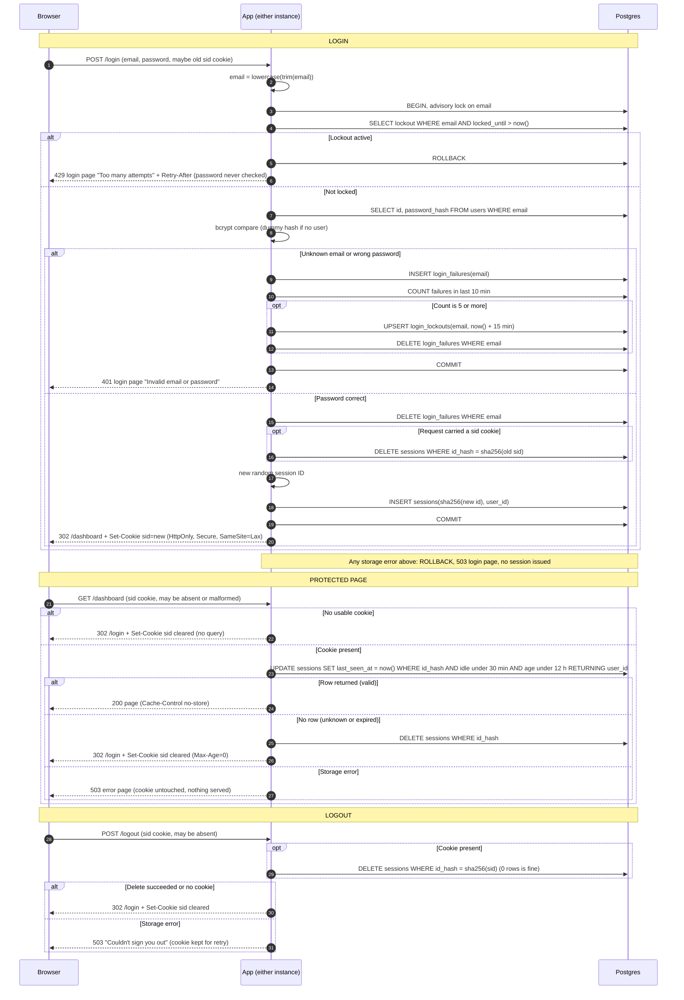

# Login with server-side sessions: design for review

## Decisions

**1. Storage: Postgres, no Redis.**
- Sessions, failure records and lockouts go in the existing Postgres database. Both instances already share it, so the "two instances, no sticky sessions" problem is solved with no new infrastructure.
- Redis would give native TTLs and cheaper writes. For a small team app, the cost is a new service to run, secure, monitor and back up, plus a second place for session state to fail. I judge that cost higher than the extra write per request.
- If the per-request `UPDATE` ever hurts, moving sessions to Redis is a contained change behind the session functions.

**2. Session ID and cookie.**
- The ID is 32 bytes from a CSPRNG, base64url-encoded. The database stores only `sha256(id)`, so a leaked table or backup cannot be replayed as cookies.
- The cookie is `sid=<id>; Path=/; HttpOnly; Secure; SameSite=Lax`, with no `Max-Age` (a browser-session cookie). It carries no user data. The server is the only authority on expiry.
- Clearing the cookie sends the same name, path and flags with `Max-Age=0`.
- A request with no `sid` cookie, or a malformed one, counts as "no session". Nothing is hashed or queried.

**3. Schema.**

The existing `users` table (`id`, `email` lowercase and unique, `password_hash` bcrypt) is unchanged. New tables:

```
sessions(
  id_hash      bytea primary key,        -- sha256 of session ID
  user_id      bigint not null references users(id),
  created_at   timestamptz not null default now(),
  last_seen_at timestamptz not null default now()
)
login_failures(email text not null, attempted_at timestamptz not null default now())
  -- index on (email, attempted_at)
login_lockouts(email text primary key, locked_until timestamptz not null)
```

All time comparisons use the database clock (`now()`), never instance clocks, so the two instances cannot disagree about expiry.

**4. Expiry: checked and recorded on every protected request.**

One atomic statement checks the session and restarts the idle timer:

```sql
UPDATE sessions SET last_seen_at = now()
WHERE id_hash = $1
  AND last_seen_at > now() - interval '30 minutes'   -- idle limit
  AND created_at   > now() - interval '12 hours'     -- absolute limit
RETURNING user_id;
```

- One row back: valid, idle clock restarted.
- Zero rows: unknown or expired. The app runs `DELETE FROM sessions WHERE id_hash = $1`, clears the cookie and redirects to `/login`. With no usable cookie it skips the SQL and does the same clear and redirect.
- `created_at` is never updated, so the 12-hour limit cannot be extended.
- Expiry is enforced on every read, so cleanup (decision 6) only reclaims space.

**5. Brute-force limiting.**
- The email is trimmed and lowercased first; every step below uses that form.
- Login runs in a transaction that first takes `pg_advisory_xact_lock(hashtext(email))`, so parallel guesses for one email are serialized and a burst cannot slip past the limit. The lock lives in Postgres, so it works across both instances.
- If a `login_lockouts` row has `locked_until > now()`, the app returns 429 without touching bcrypt. The body is the login page with "Too many attempts. Please try again later." `Retry-After` is the seconds until `locked_until`, computed by the database. Failures during the lock are not recorded, so the lock does not extend itself.
- Otherwise it compares the password with bcrypt. For an unknown email it compares against a fixed dummy bcrypt hash, so timing does not reveal whether the account exists.
- A failure (unknown email or wrong password) inserts a `login_failures` row, for unknown emails too, so a 429 does not reveal real accounts. When 5 or more failures fall within the last 10 minutes, the app writes `login_lockouts(email, locked_until = now() + 15 min)` and deletes that email's `login_failures` rows. When the lock ends the count starts from zero.
- The fifth failing attempt itself gets 401. The lock applies from the next attempt.
- Success deletes that email's `login_failures` rows.
- Accepted trade-off: anyone can lock a known email out for 15 minutes. This follows from the requirement. A per-IP limit would help but is out of scope.

**6. Cleanup of abandoned sessions.**
- Each instance runs a job every 10 minutes. The statements are idempotent, so running on both is harmless.
- It deletes sessions with `last_seen_at < now() - 30 min` or `created_at < now() - 12 h`, `login_failures` older than 10 minutes, and `login_lockouts` whose `locked_until` has passed. This also bounds growth from made-up emails.
- If a run fails, the instance logs the error and the next run (or the other instance) catches up. Nothing else is done.

**7. When storage fails: fail closed.** Never grant access and never create a session without a successful write.

| Where | What the user sees | Cookie |
|---|---|---|
| Login (any read or write) | HTTP 503, login page with "Something went wrong. Please try again." The transaction rolls back. The page does not say whether the credentials were right. | Unchanged |
| Protected request | HTTP 503 error page, no content served. Not redirected to `/login`, because the session may still be valid. | Unchanged |
| Logout | HTTP 503, "We couldn't sign you out. Please try again." The session may still exist. | Kept, to allow a retry |

## Notes on rules that don't fit on the arrows

- **Route guard.** Every route needs a valid session except `GET /login`, `POST /login` and `POST /logout`. `/logout` is exempt so it behaves the same with no session. Protected responses send `Cache-Control: no-store`.
- **Login page when signed in.** `GET /login` does not check the session and always shows the form.
- **Logout with no session.** With no `sid` cookie, `POST /logout` skips the delete and replies `302 /login` with the cookie cleared, as in the success case.
- **Fixation.** The old session (if the request carried a valid-looking `sid`) is deleted in the same transaction that creates the new one. The new ID is always freshly generated. A malformed or unknown incoming `sid` is ignored.
- **Identical failure responses.** Unknown email and wrong password produce the same status, body and headers. Only the 429 lockout differs, and it applies equally to emails that don't exist.
- **CSRF.** `SameSite=Lax` keeps the cookie off cross-site `POST`s, including `/logout`. No separate CSRF token is added in this change.
- **Two instances.** Instances hold no session state, so either can serve any step.

## Open questions

- Should failed cleanup runs alert someone? Not decided.
- `/dashboard` is assumed to exist or be built separately. This design only protects it.

## Sequence diagram


