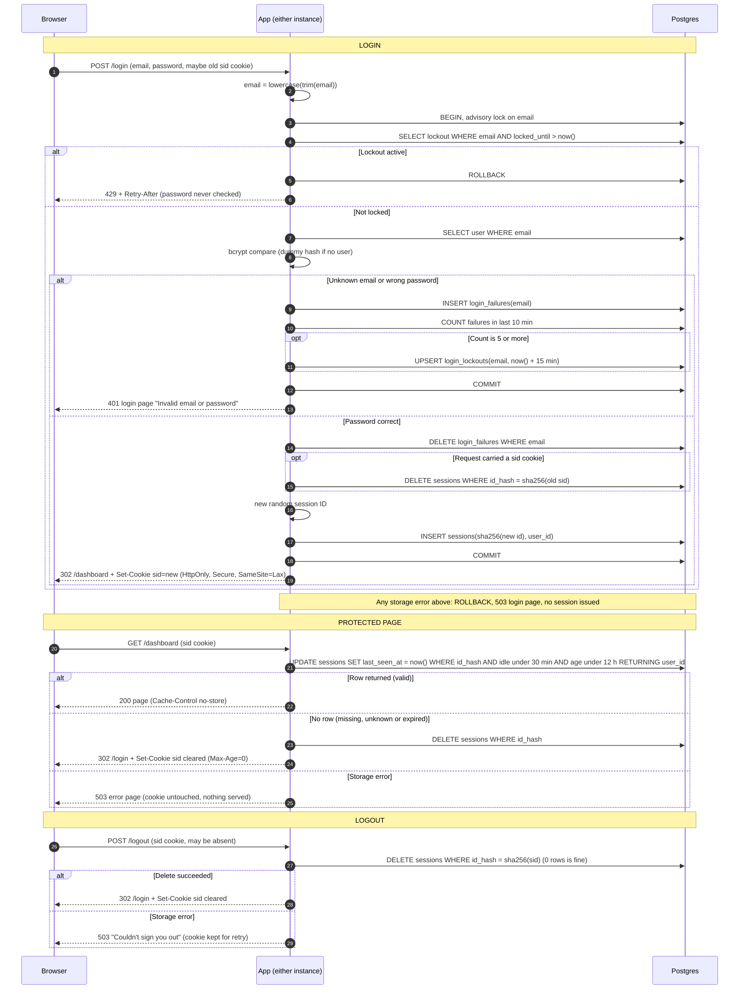

# Login with server-side sessions: design for review

## Decisions

**1. Storage: Postgres, no Redis.**
- Sessions, failure records and lockouts go in the existing Postgres database. Both instances already share it, so the "two instances, no sticky sessions" problem is solved with no new infrastructure.
- Redis would give native TTLs and cheaper writes. For a small team app, the cost is a new service to run, secure, monitor and back up, plus a second place for session state to fail. I judge that cost higher than the extra write per request.
- If load ever makes the per-request `UPDATE` hurt, moving sessions to Redis is a contained change behind the session functions.

**2. Session ID and cookie.**
- The ID is 32 bytes from a CSPRNG, base64url-encoded.
- The database stores only `sha256(id)`, so a leaked table or backup cannot be replayed as cookies.
- The cookie is `sid=<id>; Path=/; HttpOnly; Secure; SameSite=Lax`. It has no `Max-Age`, so it is a browser-session cookie. The server is the only authority on expiry.
- No user data goes in the cookie.
- Clearing the cookie sends the same name, path and flags with `Max-Age=0`.

**3. Schema (new tables).**

```
sessions(
  id_hash      bytea primary key,        -- sha256 of session ID
  user_id      bigint not null references users(id),
  created_at   timestamptz not null default now(),
  last_seen_at timestamptz not null default now()
)
login_failures(email text not null, attempted_at timestamptz not null default now())
  -- index on (email, attempted_at)
login_lockouts(email text primary key, locked_until timestamptz not null)
```

All time comparisons use the database clock (`now()`), never instance clocks, so the two instances cannot disagree about expiry.

**4. How expiry is checked and recorded.**
- The check and the idle-timer restart are one atomic statement per protected request:

```sql
UPDATE sessions SET last_seen_at = now()
WHERE id_hash = $1
  AND last_seen_at > now() - interval '30 minutes'   -- idle limit
  AND created_at   > now() - interval '12 hours'     -- absolute limit
RETURNING user_id;
```

- One row back means the session is valid and its idle clock has restarted.
- Zero rows means the session is missing, unknown or expired. The app also runs `DELETE FROM sessions WHERE id_hash = $1`, clears the cookie and redirects to `/login`.
- `created_at` is never updated, so the 12-hour limit cannot be extended.
- Expiry is enforced on every read. Cleanup (decision 6) only reclaims space and is not needed for correctness.

**5. Brute-force limiting.**
- The email is trimmed and lowercased first. Every step below uses that form.
- A failure is a row in `login_failures`. A fifth failure within any 10-minute window (`attempted_at > now() - 10 min`) writes `login_lockouts(email, locked_until = now() + 15 min)`.
- Login runs in a transaction that first takes `pg_advisory_xact_lock(hashtext(email))`. Parallel guesses for one email are therefore serialized, and a burst cannot slip past the limit.
- If a lockout row has `locked_until > now()`, the app returns 429 with a `Retry-After` header and never touches bcrypt. Failures during the lock are not recorded, so the lock does not extend itself.
- The fifth failing attempt itself gets 401. The lock applies from the next attempt.
- Failures are recorded for unknown emails too. An attacker cannot tell real accounts from fake ones by whether a 429 ever appears.
- For an unknown email, the app compares against a fixed dummy bcrypt hash, so response time does not reveal whether the account exists.
- Success deletes that email's `login_failures` rows.
- Accepted trade-off: anyone can lock a known email out for 15 minutes. This follows from the requirement. A per-IP limit would help but is out of scope.

**6. Cleanup of abandoned sessions.**
- Each instance runs a job every 10 minutes. Deleting twice is harmless because the statements are idempotent.
- It deletes sessions where `last_seen_at < now() - 30 min` or `created_at < now() - 12 h`.
- It deletes `login_failures` older than 10 minutes and `login_lockouts` whose `locked_until` has passed.
- This also bounds growth from attackers submitting made-up emails.

**7. When storage fails.** The rule is to fail closed: never grant access and never create a session without a successful write.

| Where | What the user sees | Cookie |
|---|---|---|
| Login (lockout check, user lookup, or any write) | HTTP 503, login page with "Something went wrong. Please try again." The transaction rolls back. | Unchanged |
| Protected request | HTTP 503 error page. The page content is not served. The user is not sent to `/login`, because the session may still be valid. | Unchanged |
| Logout | HTTP 503, "We couldn't sign you out. Please try again." The session may still exist, so the cookie is kept to allow a retry. | Kept |

The 503 login page does not say whether the credentials were right.

## Notes on rules that don't fit on the arrows

- **Route guard.** Every route needs a valid session except `GET /login`, `POST /login` and `POST /logout`. `/logout` is exempt so it can behave identically with no session. Protected responses should send `Cache-Control: no-store`.
- **Fixation.** The old session is destroyed in the same transaction that creates the new one. The new ID is always freshly generated, whatever cookie arrived. A malformed or unknown incoming `sid` is simply ignored.
- **Identical failure responses.** Unknown email and wrong password produce the same status, body and headers. Only the 429 lockout response differs, and it applies equally to emails that don't exist.
- **CSRF.** `SameSite=Lax` keeps the cookie off cross-site `POST`s, including `/logout`. No separate CSRF token is added in this change.
- **Two instances.** Instances hold no session state. Either one can serve any step of the flow, and the advisory lock works across them because it lives in Postgres.

## Sequence diagram


