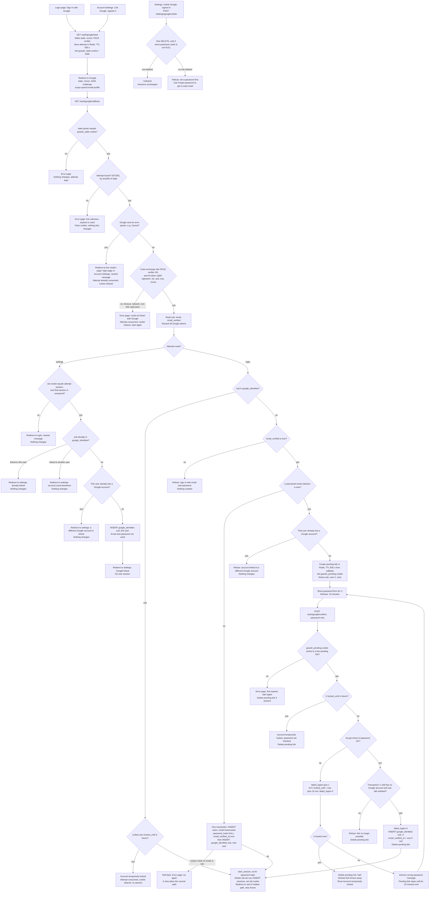

# Sign in with Google: flow and state

This adds Google sign-in (OpenID Connect, authorization-code flow with PKCE, `state`, `nonce`, scopes `openid email profile`) beside password login. Google accounts are identified only by `sub`. Every successful Google sign-in calls the existing `start_session`, so it ends in the same session as a password login.

There are two entry points: the login page (sign in) and Account Settings (link, while signed in). Both use the same start and callback routes. The attempt record stores the mode, which says where the user started and where errors return them.

## Flow

## Notes

**Start.** The server makes `state`, `nonce` and the PKCE verifier from a cryptographically secure random generator (32 bytes each, base64url). The browser gets `state` as the `goauth_state` cookie and as the Google redirect parameter. Google gets `nonce` and the S256 challenge; the verifier is sent only at the code exchange. Redis stores the attempt under the SHA-256 of `state`, so the raw state is never stored server-side. In login mode, `next` must be a relative path on our site, otherwise it becomes `/home`. Settings mode needs a valid session; without one, start redirects to login. For settings mode, the attempt also stores the session id.

**Callback order.**
1. The `state` query parameter must equal the `goauth_state` cookie. If not, show the error page and change nothing, so a link crafted in another browser cannot start a sign-in or link in the victim's browser.
2. After that check, the callback clears the cookie and takes the attempt with GETDEL. An unknown, expired or used attempt gets the error page, so a replay fails. GETDEL also returns the mode and `next`.
3. A Google error param returns the user to the attempt's page (login or Account Settings) with a neutral message.
4. The code exchange and ID token checks follow. The exchange is one HTTP call with a timeout fixed in code. A timeout counts as a failure, handled like a bad token.
5. Read `sub`, `email` and `email_verified`, then discard all Google tokens.

Error messages are fixed codes shown as neutral text. No free text from the URL is shown.

**Settings session check.** The request's `sid` cookie must equal the attempt's session id, and that sessions row must exist and be unexpired. The linking user is that row's user. If the check fails, the user lands on login with a neutral message; nothing is linked, and they can start again from settings.

**start_session.** Same as password login (`existing/auth_flow.md`): delete the sessions row for the browser's `sid` cookie, if any; insert a new row; set `sid`; redirect to `next` if relative, else `/home`. The next successful sign-in in a browser removes that browser's old session, password or Google, even one for a different user. Sessions in other browsers are unaffected.

**New users.** The user insert and the Google link are one transaction. If a parallel request wins and causes a unique clash on email or sub, the transaction rolls back and the error page is shown. A retry takes the normal path and finds the other account. There is no second pass in code.

**Password confirmation.** The form posts only the password. The `goauth_pending` cookie holds a random id; the server loads `goauth:pending:<id>` and takes the user, `sub` and `next` from that record, so the form cannot change the user. The cookie is SameSite=Lax, so a cross-site POST does not carry it. Retries do not extend the 10 minutes. The lock check runs before every password check. A NULL `password_hash` always has a Google link (Google-created users are linked on creation, and unlink needs a password), so the password check never runs against a NULL hash here. The cookie is cleared whenever the pending record is deleted or found missing. The password step exists because a matching existing account may belong to someone else or may never have been verified; the correct password shows the owner agrees to the link.

**Failed logins.** In the Google flow, only the password step changes `failed_logins`. A linked Google sign-in and a new user leave it alone; a new user starts at 0. The POST /login change under "Changes" is the one other place it changes.

**Unlink.** One statement deletes the link only if the user has a password: `DELETE FROM google_identities g USING users u WHERE g.user_id = u.id AND u.id = $1 AND u.password_hash IS NOT NULL`. Unlinking does not end sessions.

**Tokens and email.** No Google access or refresh token is stored. Google never changes `users.email`. Lookups use `sub`, so a changed Google email still reaches the same account.

## State and where it lives

| Piece of state | Where | Lifetime | Removed by |
|---|---|---|---|
| Attempt: hash of state (key), nonce, PKCE verifier, mode, next, settings session id | Redis `goauth:attempt:<sha256 of state>` | TTL 600 s from start | GETDEL at the first callback with a matching cookie, or TTL |
| `goauth_state` cookie (equals state) | Browser; HttpOnly, Secure, SameSite=Lax, Path=/auth/google | Max-Age 600 s | Cleared by the callback once its cookie check passes, or expiry |
| Pending link: sub, user U, next | Redis `goauth:pending:<random id>`; `goauth_pending` cookie with the same attributes | TTL 600 s from callback, not extended | Success, lock, failed re-check, expired POST, or TTL. The cookie is cleared with the record. |
| Google identity: `google_identities(sub PK, user_id UNIQUE, linked_at)` | Postgres | Permanent | Settings unlink (password users only), user deletion (cascade) |
| Google-created user: lowercased email, `password_hash` NULL, `email_verified_at` set | `users` | Permanent | Account deletion only |
| Lockout: `failed_logins`, `locked_until` | `users` | Existing rules | Existing rules |
| Session: `sessions` row and `sid` cookie | Postgres and browser | 14 days, slid on each request | Sign-out, password reset, account deletion, or the next start_session in the same browser |

## Failure outcomes

| Trigger | Outcome | Changes |
|---|---|---|
| `state` param differs from cookie, or cookie missing | Error page | None; cookie and attempt untouched |
| Cookie matches, but attempt unknown, expired or used | Error page | Cookie cleared |
| Google error param (e.g. Cancel) | Back to the attempt's page (login or Account Settings), neutral message | Attempt consumed, cookie cleared |
| Code exchange failure or timeout, or ID token invalid | Error page, start again | Attempt consumed, cookie cleared; no tokens kept |
| Redis unavailable | Error page; start, callback and confirm all fail closed | At start or confirm: None. At callback: cookie cleared, attempt unchanged (Redis unreachable) |
| Settings: session missing, expired or not the attempt's | Redirect to login, neutral message | None |
| Linked sub, locked user (login) | Account temporarily locked | Attempt consumed, cookie cleared |
| Unlinked sub, `email_verified` false | Refuse, use email and password | None |
| Unlinked sub, no email match | Create user, link, sign in | users, google_identities, sessions |
| Unlinked sub, email match, user has another Google account | Refuse | None |
| Unlinked sub, email match, otherwise | Password form | Pending link (Redis, cookie) |
| Wrong password | Generic message | failed_logins +1 |
| Fifth wrong password | Lock, pending link deleted | failed_logins, locked_until |
| Correct password, re-check fails | Refuse, pending link deleted | None |
| Correct password | Link, sign in | google_identities, users, sessions |
| Unique clash on new user | Error page, retry | Rolled back |
| Settings: sub linked to this user / another user / user has another account | Already linked, or refuse | None |
| Unlink without a password | Refuse, use Forgot password | None |

## Changes to existing behaviour

- **Schema.** Drop NOT NULL on `users.password_hash`. Add `google_identities` as above, with `user_id` referencing `users(id) ON DELETE CASCADE`. Google-only users always keep a link, because unlink needs a password, so every account stays reachable.
- **POST /login.** When `password_hash` is NULL, return the generic message and count it as a wrong attempt, so the response does not reveal whether the account is Google-only.
- **Password reset.** Unchanged. It sets the hash for Google-created users and marks the email verified.

## Open questions

1. **Lockout and Google sign-in.** A linked Google sign-in is refused while `locked_until` is in the future. The brief does not say. Blocking is the conservative choice, but a password lockout also blocks Google for 15 minutes.
2. **`email_verified_at` on link.** It is set when a verified Google email links to an existing user. Confirm this is acceptable.
3. **NULL hash counts as a failed login.** A login attempt against a Google-only account counts toward lockout, as described above. Confirm.