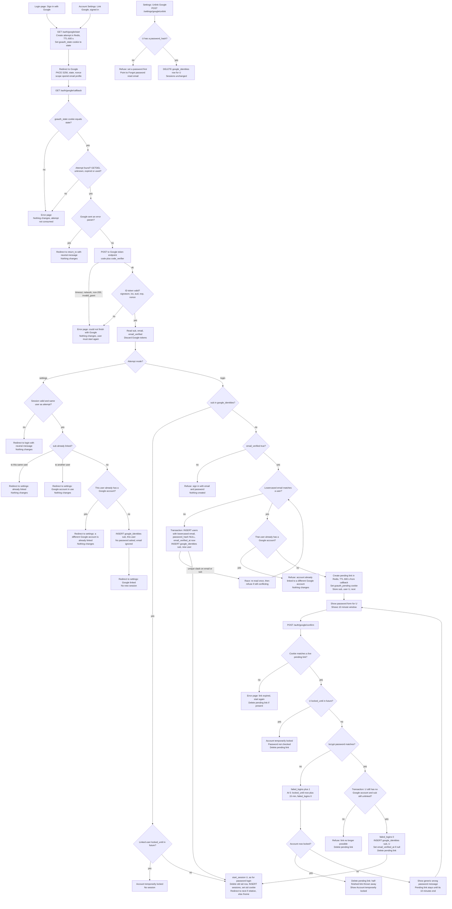

# Sign in with Google: flow and state

This adds Google sign-in (OpenID Connect, authorization-code flow with PKCE, `state`, `nonce`, scopes `openid email profile`) beside password login. Google accounts are identified only by `sub`. Every successful Google sign-in calls the existing `start_session`, so the result is the same session as a password login.

Two entry points: the login page (sign in) and Account Settings (link, while signed in). Both use the same start and callback routes. The attempt record says which one started it.

## Notes

**Entry and callback.** Start stores the attempt in Redis under a hash of `state`, with the nonce, the PKCE verifier, the mode (`login` or `settings`), the `next` or return path, and for settings the linking user id and session id. The callback checks the `goauth_state` cookie first, so a crafted link from another browser cannot start a link or sign-in in the victim's browser. Only then does it consume the attempt with an atomic GETDEL. The first callback consumes the attempt whatever happens next, so a replay gets the error page. Attempts expire after 600 s, which covers the round trip to Google. If Redis is unavailable, the callback fails closed with the error page.

**Failed code exchange.** The attempt is already consumed, so the user must start again. The error page shows neutral text. Nothing is written, and no tokens are kept, including any that Google did return.

**Password confirmation.** The pending link lives 600 s from the callback and is not extended by retries. Wrong passwords use the existing counter and lock rules, so a wrong password here and a wrong password at `/login` share one counter. Locking deletes the pending link. A lock check runs before each password check, and while locked the password is not checked.

**Settings link.** The email is not used for matching, so an unverified Google email does not block it. The user does not get a new session.

**Unlink.** The `password_hash IS NULL` check and the DELETE should be one statement, so the rule holds under concurrent requests. Unlinking does not end sessions.

## State and where it lives

| Piece of state | Where | Lifetime | Removed by |
|---|---|---|---|
| Attempt: state hash, nonce, PKCE verifier, mode, return path, settings user and session | Redis `goauth:attempt:<sha256(state)>` | TTL 600 s from start | GETDEL at first callback, or TTL |
| `goauth_state` cookie (equals state) | Browser, HttpOnly, Secure, SameSite=Lax, Path=/auth/google | Max-Age 600 s | Cleared at callback, or expiry |
| Pending link: sub, candidate user U, next | Redis `goauth:pending:<random id>` plus `goauth_pending` cookie | TTL 600 s from callback, not sliding | Success, lock, failed re-check, expired-on-POST, or TTL |
| Google identity: `google_identities(sub PK, user_id UNIQUE, linked_at)` | Postgres, permanent | Until removed | Settings unlink (password users only), user deletion (cascade) |
| Google-created user: email lowercased, `password_hash` NULL, `email_verified_at` set | `users`, permanent | Until account deletion | Account deletion only |
| Lockout: `failed_logins`, `locked_until` | `users` | Existing rules | Existing rules |
| Session: `sessions` row and `sid` cookie | Postgres and browser | 14 days, slid on each request | Sign-out, password reset, account deletion, or the next start_session for the same browser |

No Google access or refresh token is stored anywhere. Google never changes `users.email`. Lookups use `sub`, so a changed Google email still reaches the same account.

## Failure outcomes

| Trigger | Outcome | Changes |
|---|---|---|
| Missing cookie, mismatched state, unknown, expired or used state | Error page | None; attempt not consumed on cookie mismatch |
| Google error param (e.g. Cancel), valid state | Back to start with neutral message | None |
| Settings: session gone or different user | Redirect to login, neutral message | None |
| Token exchange failure or timeout | Error page, start again | None |
| ID token invalid (signature, iss, aud, exp, nonce) | Error page | None; tokens discarded |
| Linked sub, locked account (login) | Account temporarily locked | None |
| Unlinked sub, `email_verified` false | Refuse, use email and password | None |
| Unlinked sub, no email match | Create user, link, sign in | users, google_identities, sessions |
| Unlinked sub, email match, user already has a Google account | Refuse | None |
| Wrong password | Generic message, counter +1 | failed_logins |
| Fifth wrong password | Lock, pending deleted | failed_logins, locked_until |
| Correct password, re-check fails | Refuse, pending deleted | None |
| Correct password | Link, sign in | google_identities, users, sessions |
| Settings: sub linked to this user | Already linked | None |
| Settings: sub linked to someone else, or user has a different Google account | Refuse | None |
| Unlink without a password | Refuse, use Forgot password | None |

## Changes to existing behaviour

- **Schema.** Drop NOT NULL on `users.password_hash`. Add `google_identities` as above. Google-only users always keep a link, because unlink needs a password. This keeps every account reachable.
- **POST /login.** When `password_hash` is NULL, return the generic message. Treat it as a wrong attempt, so behaviour does not reveal whether the account is Google-only.
- **Password reset.** Unchanged. It sets the hash for Google-created users and marks the email verified.

## Decisions to confirm

1. **Lockout and Google sign-in.** This document blocks a linked Google sign-in while `locked_until` is in the future. The brief does not say. Blocking is the conservative choice, but it means a password lockout also blocks Google for 15 minutes.
2. **`email_verified_at` on link.** This document sets it when a verified Google email links to an existing user. Confirm this is acceptable.
3. **NULL hash counts as a failed login.** Confirm that this counts toward lockout, as above.