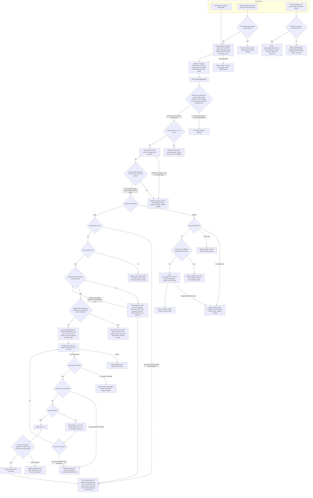

# Sign in with Google: design and flow

This adds Google sign-in (OpenID Connect) next to email and password login. Every successful Google sign-in ends in the existing `start_session(user_id)`, so there is no new session type.

## Existing code you need to know

- `POST /login` lowercases the email and refuses if `locked_until` is in the future. Otherwise it runs bcrypt. A wrong password adds 1 to `failed_logins`. At 5, it sets `locked_until = now + 15 min` and resets `failed_logins` to 0. A right password resets `failed_logins` to 0 and calls `start_session`.
- `start_session(user_id)` deletes the old `sessions` row if a `sid` cookie came in, inserts a new row, sets the `sid` cookie and redirects to `next` (a relative path only) or `/home`.
- Redis holds only short-lived data. PostgreSQL holds permanent data.

## Where the new state lives

**Permanent (PostgreSQL)**

| Change | Purpose | Removed by |
|---|---|---|
| New table `user_google_accounts(user_id BIGINT PRIMARY KEY REFERENCES users ON DELETE CASCADE, google_sub TEXT NOT NULL UNIQUE, linked_at TIMESTAMPTZ NOT NULL DEFAULT now())` | `PRIMARY KEY` on `user_id`: one Google account per user. `UNIQUE` on `google_sub`: one user per Google account. We store `sub` only, never Google's email, so an email change at Google has no effect. | Unlink, or deleting the user (cascade). A password reset does not touch it. |
| `ALTER TABLE users ALTER COLUMN password_hash DROP NOT NULL` | Users created through Google have no password. | A password reset fills it in. |

In `/login`, a NULL `password_hash` counts as a wrong password: run a dummy bcrypt compare, show the same generic message and count a failed login. Nothing else in password login changes.

**Temporary (Redis)**

| Key and cookie | Contents | Lifetime and removal |
|---|---|---|
| `g:state:<state>`, cookie `g_flow` (HttpOnly, Secure, SameSite=Lax) | PKCE `code_verifier`, `nonce`, `origin` (`login` or `settings`), validated `next`, the signed-in `user_id` (settings only), and a random browser token that must equal the `g_flow` cookie. | TTL 600 s from the start of the attempt. The callback reads and deletes it in one atomic `GETDEL`, so an attempt is honoured once, and clears `g_flow`. If the user never returns, the TTL removes it. |
| `g:pending:<token>`, cookie `g_pending` (HttpOnly, Secure, SameSite=Lax, path `/auth/google`) | `target_user_id`, `sub`, `next`. No email, no tokens. | TTL 600 s from creation, not extended by wrong passwords. Deleted on a correct password, on lockout, on Cancel and on expiry. |

We keep no Google access or refresh tokens. The callback reads `sub`, `email` and `email_verified` from the ID token, uses them, and discards everything.

## Endpoints

- `GET /auth/google/start`: entry from the login page, with optional `next`. A `next` that is not a relative path on our site is dropped (the user lands on `/home`).
- `POST /settings/google/link`: entry from Account Settings. Needs a session and the app's normal CSRF protection.
- `GET /auth/google/callback`: Google's redirect.
- `GET` and `POST /auth/google/confirm`: password confirmation page. The user has no session here. The `g_pending` cookie is the only link to the attempt: it is a random secret, and `SameSite=Lax` keeps browsers from sending it on a cross-site POST.
- `POST /settings/google/unlink`: needs a session and the same CSRF protection.

## Failure handling

Every failure leaves PostgreSQL unchanged and creates no session.

- **Unknown, expired, reused or mismatched `state`** (including a wrong `g_flow` cookie, or a settings attempt whose current session user differs from the recorded one): error page.
- **Google returns `error=` (for example, Cancel) or no `code`:** the `state` is valid and already consumed. Redirect to where the user started with "Google sign-in was not completed." Do not echo Google's error code.
- **Code exchange fails** (network error, timeout of about 5 s, non-200, `invalid_grant`) **or the ID token is invalid** (bad signature, `iss`, `aud`, expired, `nonce` mismatch, missing `sub`): the `state` is already used, so there is no retry. Redirect to the start with "We couldn't complete sign-in with Google. Please try again."
- **Redis unavailable:** fail closed. At start, show "Could not start Google sign-in". At the callback or on the confirm page, show the error page. Any pending record expires after 10 minutes and the user starts again.
- **Concurrent callbacks:** `GETDEL` lets only one proceed. For database races, the `UNIQUE` constraints are the final guard, and a unique violation is a refusal, except in the create-user case below.

## Flowchart

## Notes for the implementer

- **One callback for both entries.** `origin` is stored in Redis at start, never read from the callback URL. Callback order: validate and consume `state`, handle a Google error, exchange the code, validate the ID token, branch on `origin`. Because `state` comes first, a forged callback carrying a Google `error` gets the error page, not a redirect.
- **A linked `sub` is trusted on its own.** Ignore the email and `email_verified` entirely. That is what lets a user keep their account after changing their Google email. Google never changes a stored email: the email is written once, into a brand-new user (the `CRE` step), whose other columns take their defaults.
- **No takeover by email.** A verified email alone never signs anyone into an existing account. Linking by matching email needs the target account's password first. If the match has a different Google account linked or has no password, we refuse before asking.
- **Lockout on the confirm form reuses the `/login` logic:** same counters, same 15-minute lock, lock check before any password check. A lock, whether just triggered or already in effect, discards the pending link. Wrong passwords that do not lock leave the pending record with its original expiry, so the 10 minutes is a hard limit.
- **Assumption: a locked account can still sign in through an already linked Google account.** Lockout protects against password guessing and Google sign-in uses no password. To block it too, add a `locked_until` check at the `LK` node.
- **Signing in while already signed in.** Allowed. `start_session` deletes the old session row, and the user who ends up signed in is the one the Google account resolves to, which may differ from the old session's user.
- **Create-user race.** If the create transaction hits a unique constraint (someone registered between our check and insert), re-run the match once. It then takes the "matches an existing user" path. If it conflicts again, show the generic failure message.
- **`next`** is validated as a relative path when saved at start. `start_session` re-checks it on redirect.
- **Settings link adds no session**, only a row. The user keeps their current `sid`.

## Open questions

- Whether the app's existing CSRF protection works on forms with no session (needed for the confirm page). If not, the `g_pending` cookie with `SameSite=Lax` is the only guard.
