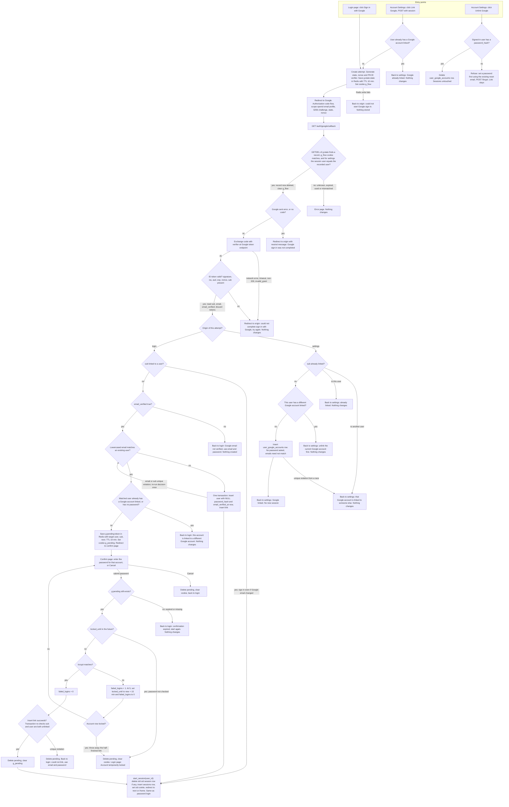

# Sign in with Google: design and flow

This adds Google sign-in (OpenID Connect) next to the existing email and password login. Every successful Google sign-in ends in the existing `start_session(user_id)`, so there is no new session type.

## What you need to know about the existing code

- `POST /login` lowercases the email and refuses if `locked_until` is in the future. Otherwise it runs bcrypt. A wrong password adds 1 to `failed_logins`. At 5, it sets `locked_until = now + 15 min` and resets `failed_logins` to 0. A right password resets `failed_logins` to 0 and calls `start_session`.
- `start_session(user_id)` deletes the old `sessions` row if a `sid` cookie came in. It then inserts a new row, sets the `sid` cookie and redirects to `next` (a relative path only) or `/home`.
- Redis is already available and is used only for short-lived data. PostgreSQL holds permanent data.

## Where the new state lives

**Permanent (PostgreSQL)**

| Change | Purpose | Removed by |
|---|---|---|
| New table `user_google_accounts(user_id BIGINT PRIMARY KEY REFERENCES users ON DELETE CASCADE, google_sub TEXT NOT NULL UNIQUE, linked_at TIMESTAMPTZ NOT NULL DEFAULT now())` | `PRIMARY KEY` on `user_id` means one Google account per user. `UNIQUE` on `google_sub` means one user per Google account. We store `sub` only, never Google's email, so an email change at Google has no effect. | The unlink action, or deleting the user (cascade). A password reset does not touch it. |
| `ALTER TABLE users ALTER COLUMN password_hash DROP NOT NULL` | Users created through Google have no password. | A password reset fills it in. |

Changes to `/login`: a NULL `password_hash` counts as a wrong password. Run a dummy bcrypt compare for timing, show the same generic message and count it as a failed login. Nothing else in password login changes.

**Temporary (Redis)**

| Key and cookie | Contents | Lifetime and removal |
|---|---|---|
| `g:state:<state>`, with cookie `g_flow` (HttpOnly, Secure, SameSite=Lax) | PKCE `code_verifier`, `nonce`, `origin` (`login` or `settings`), validated `next`, the signed-in `user_id` (settings only), and a random browser token that must equal the `g_flow` cookie. | TTL 600 s from the start of the attempt. The callback reads and deletes it in one atomic `GETDEL`, so the attempt can be honoured only once. If the user never returns, the TTL removes it. The callback also clears `g_flow`. |
| `g:pending:<token>`, with cookie `g_pending` (HttpOnly, Secure, SameSite=Lax, path `/auth/google`) | `target_user_id`, `sub`, `next`. It holds no email and no tokens. | TTL 600 s from when the callback creates it. It is not extended on wrong passwords. It is deleted on a correct password (success), on lockout, on Cancel and on expiry. |

We keep no Google access or refresh tokens. The ID token is read in the callback, and only `sub`, `email` and `email_verified` are used. They are then discarded.

## Endpoints

- `GET /auth/google/start`: entry from the login page.
- `POST /settings/google/link`: entry from Account Settings. It needs a session and the app's normal CSRF protection.
- `GET /auth/google/callback`: Google's redirect.
- `GET` and `POST /auth/google/confirm`: the password confirmation page.
- `POST /settings/google/unlink`: unlink Google.

## Failure handling

Every failure leaves PostgreSQL unchanged and creates no session.

- **Unknown, expired, reused or mismatched `state`** (including a wrong `g_flow` cookie, or a settings attempt where the current session user differs from the recorded one): show an error page. Nothing changes.
- **Google returns `error=` (for example, Cancel) or no `code`:** the `state` is valid and already consumed. Redirect to where the user started (login page or settings) with a neutral message, "Google sign-in was not completed." Do not echo Google's error code.
- **Code exchange fails** (network error, timeout, non-200, `invalid_grant`): the `state` is already used, so there is no retry. Redirect to the start with "We couldn't complete sign-in with Google. Please try again." Nothing is stored. Use a short HTTP timeout, about 5 s.
- **ID token invalid** (bad signature, `iss`, `aud`, expired, `nonce` mismatch, missing `sub`): treated exactly like a failed exchange.
- **Redis unavailable:** fail closed. At start, show "Could not start Google sign-in". At callback, show the error page.
- **Concurrent callbacks:** `GETDEL` lets only one proceed. For database races, `UNIQUE` constraints are the final guard. A unique violation is treated as a refusal, except in the create-user case described in the notes.

## Flowchart

## Notes for the implementer

- **Both entries share one callback.** `origin` is stored in Redis at start, never taken from the callback URL. That keeps the callback the one place that checks `state`, the PKCE exchange and the ID token.
- **Check order at the callback.**
  1. Validate and consume `state`.
  2. Handle a Google error.
  3. Exchange the code.
  4. Validate the ID token.
  5. Branch on `origin`.

  Because `state` is validated first, a forged callback with a Google `error` still gets the error page and not a redirect.
- **A linked `sub` is trusted on its own.** For a linked `sub`, ignore the email and `email_verified` entirely. That is what lets the user keep their account after changing their Google email. We never write Google's email into `users.email`.
- **Account takeover guard.** Linking by a matching email is allowed only after the target account's password is proven. A verified email alone never signs someone into an existing account. If the match has a different Google account linked, or has no password, we refuse before asking.
- **Lockout on the confirm form reuses the `/login` logic.** The same counters and the same 15-minute lock apply. A lock check comes before any password check. A lock, whether just triggered or already in effect, discards the pending link. Wrong passwords that do not lock leave the pending record in place with its original expiry, so the 10 minutes is a hard limit.
- **Assumption: a locked account can still sign in through an already linked Google account.** The lockout protects against password guessing and Google sign-in uses no password. If the product wants lockout to block Google sign-in too, add a `locked_until` check at the `LK` node.
- **Create-user race.** If the create transaction hits the unique constraint on `users.email` (someone registered between our check and insert), re-run the match once. It will then take the "matches an existing user" path. If it conflicts again, show the generic failure message.
- **`next`.** Validate it as a relative path when saving it at start. `start_session` already re-checks it on redirect.
- **Settings link adds no session.** It adds only a row. The user stays signed in with their current `sid`.
