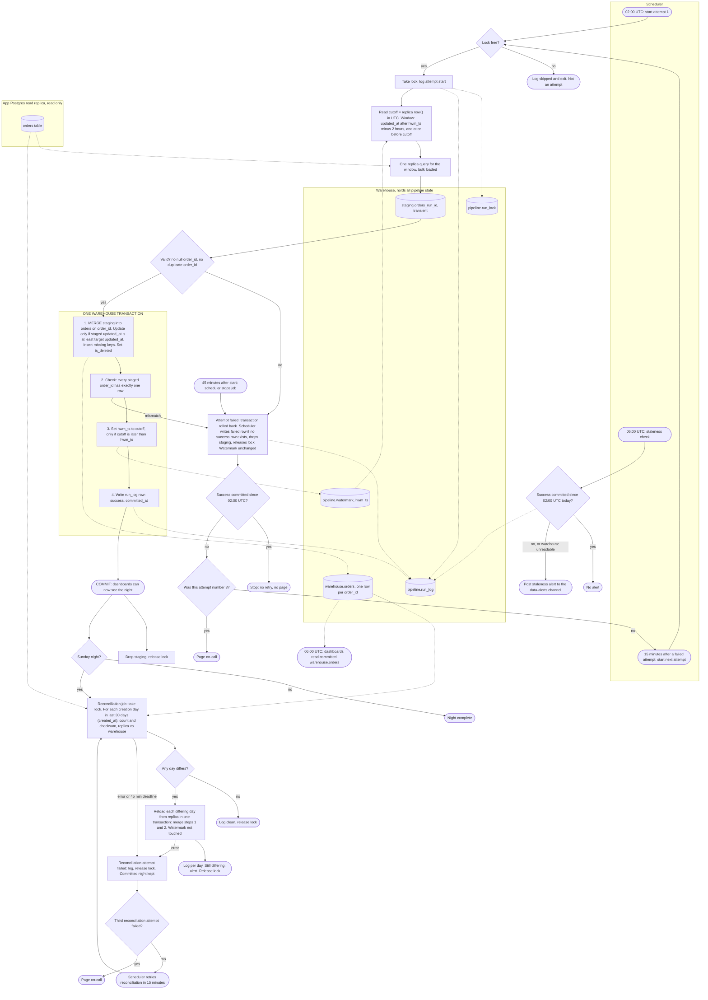

# Nightly orders ETL into the warehouse: pipeline design

## Components

- **Scheduler:** one scheduling tool (the brief does not name the product). It starts attempt 1 at 02:00 UTC and each retry 15 minutes after a failed attempt. It creates the `run_id` and attempt number (1, 2 or 3) and passes both to the job. It stops an attempt at 45 minutes, writes the failed `run_log` row, releases the lock, pages on-call, starts reconciliation, and runs the 06:00 staleness check as its own job.
- **Pipeline job:** the code the scheduler starts for each attempt. It takes the lock, extracts, validates and merges. It reads the replica and writes only to the warehouse.
- **Reconciliation job:** a separate job the scheduler starts after a Sunday night commits. It has its own lock and its own 45-minute deadline.

## Flowchart

## Triggers and data moves

- **Attempt 1:** scheduler cron at 02:00 UTC. **Attempts 2 and 3:** scheduler, 15 minutes after the previous attempt is marked failed.
- **Reconciliation:** scheduler, after a Sunday night commits, and 15 minutes after a failed reconciliation attempt.
- **06:00 staleness check:** its own scheduled job, so a hung run cannot suppress it.
- **Replica to staging:** one read-only query, bulk loaded into `staging.orders_<run_id>`.
- **Staging to `warehouse.orders`:** one warehouse transaction (the merge).
- **Dashboards:** read committed `warehouse.orders` only, never staging.

## State (all in the warehouse)

- `pipeline.watermark(job, hwm_ts, last_run_id)`: the only high-water mark.
- `pipeline.run_lock(job, run_id, lease_expires_at)`: stops overlapping runs.
- `pipeline.run_log(run_id, job, attempt, window_start, cutoff, status, rows_extracted, rows_merged, error, started_at, committed_at)`: one row per attempt.
- `pipeline.reconciliation(run_id, creation_day, replica_count, replica_checksum, warehouse_count, warehouse_checksum, action)`: one row per checked day.
- `staging.orders_<run_id>`: transient, read only by its own attempt. Leftovers from killed attempts have unique names and can be dropped later.
- `warehouse.orders`: `order_id` unique, all source columns, `updated_at`, `deleted_at`, `is_deleted`, `source_run_id`, `loaded_at`.

## Lock

- The job takes the lock at attempt start, with `lease_expires_at` = take time plus 45 minutes.
- The job releases it at commit. The scheduler releases it on failure, so a retry 15 minutes later does not find a stale lock. The lease matters only if the scheduler itself dies.
- Reconciliation takes the same lock, so it cannot overlap a manual rerun.
- A run that finds the lock held logs "skipped" and exits. It is not an attempt and does not change the count.

## Window and high-water mark

- **Window:** `updated_at` after `hwm_ts` minus 2 hours, and at or before `cutoff`.
- **Cutoff:** the replica's `now()` in UTC, read before the extract. The new HWM is `cutoff`, not `max(updated_at)`, so the edge moves even when the extract is empty. Rows written during the extract have `updated_at` after `cutoff` and fall into the next window.
- **Why the 2-hour lookback:** bulk-import transactions can stay open up to 90 minutes after `updated_at` is stamped, so a row can become visible after its window has run. Starting 2 hours before the HWM re-reads it.
- **Replica lag:** a row with `updated_at` before `cutoff` that has not reached the replica is missed tonight. The next window starts 2 hours before the new HWM, so it is picked up if it arrives in time. Longer lag is caught by Sunday reconciliation.
- **HWM moves only inside the commit transaction**, and only if `cutoff` is later than the stored HWM. A failed night leaves it in place, so the next successful run covers the gap. If `cutoff` is not later (a replica clock moved backward, or a bad seed), the merge still commits, the HWM stays, and the run is logged as success. This is safe because the merge is idempotent.
- **First run:** a person seeds `pipeline.watermark` with one start time before the first run. The first window runs from that time minus 2 hours to `cutoff`. Without a seed, the attempt fails before extract.

## Extract, validate and merge

- **Extract:** one replica query for the window. A replica error or the 45-minute deadline fails the attempt.
- **Validate** before the merge: no null `order_id` and no duplicate `order_id` in the extract. Failure fails the attempt.
- **Deletes need no special path:** the app's delete is a write that sets `deleted_at` and `updated_at`, so the extract picks it up like any update.
- **Merge, one warehouse transaction:**
  1. MERGE staging into `warehouse.orders` on `order_id`. Update a row only if `staged.updated_at >= target.updated_at`. Insert missing keys. Set `is_deleted = deleted_at IS NOT NULL`. Deleted rows stay. Ties rewrite identical values, so a rerun changes nothing.
  2. Check that every `order_id` in this run's staging has exactly one row in `warehouse.orders`. This can fail only if the target already holds duplicates for these keys.
  3. Set `hwm_ts` to `cutoff`, only if `cutoff` is later than `hwm_ts`.
  4. Write the `run_log` row with status `success` and `committed_at`.
- Any error or failed check before COMMIT rolls back all four steps. The success row is in the same transaction, so every commit has its log row.

## Failure and retry

- **Failure** is any error, a failed check, or the job still running at 45 minutes. The scheduler stops the job at 45 minutes.
- **On failure**, the scheduler writes the failed `run_log` row (only if no success row exists for this `run_id`), drops this run's staging, and releases the lock. The watermark stays put. The warehouse rolls back the stopped job's open transaction when its connection closes (see open questions).
- **Before a retry or a page**, the scheduler checks for a success committed since 02:00 UTC. If one exists, it stops. This covers a commit that lands just before the deadline stop.
- **Retry:** 15 minutes after the failed attempt is marked, a full rerun starts with a new `run_id` and the next attempt number. This is safe because the merge is idempotent and the watermark only moves forward.
- **After attempt 3 fails:** the scheduler pages on-call.
- **Worst case:** attempt 1 runs 02:00 to 02:45. Attempt 2 starts by 03:00 and ends by 03:45. Attempt 3 starts by 04:00 and ends by 04:45. On-call is paged by 04:45 if all three fail.

## Sunday reconciliation

- **When:** on the Sunday run, after the night commits. It has its own lock and its own 45-minute deadline. If the Sunday night never commits, reconciliation is skipped and runs after the next successful night (our assumption).
- **Scope:** order-creation days in the last 30 days, by `created_at`. Older rows are out of scope.
- **Comparison:** per day, on each side, `count(*)` and a checksum. The checksum is the sum over rows of `hash(order_id, updated_at as UTC microseconds)`, deleted rows included. It is a sum, not XOR, so duplicates do not cancel. The replica side is computed on the replica. Both sides use the same hash and timestamp format.
- **Reload:** a mismatched day is staged from the replica by `created_at`, then merge steps 1 and 2 run in one transaction. The reload does not touch the watermark or the night's `run_log` row. It catches late rows of any age inside the 30 days.
- **Still mismatched after reload:** log and alert. This most likely means replica lag.
- **Reconciliation failure:** the committed night is kept. The reconciliation job alone is retried 15 minutes apart, up to two more times. After the third failed attempt, on-call is paged. These attempts are counted separately from nightly attempts (our assumption).

## 06:00 staleness check and dashboards

- **The check** passes if `run_log` has a row with status `success` and `committed_at` at or after 02:00 UTC today. Failed attempts are ignored, so a success on attempt 2 or 3 counts.
- **If there is none,** or the warehouse cannot be read, the check posts a staleness alert to the data-alerts channel. It runs even while attempts are retrying or hung.
- **Dashboards** refresh at 06:00 regardless and read only committed `warehouse.orders`. The merge commits in one transaction, so a dashboard sees the previous night or the new one, never a mix.

## Open questions

- Assumes `orders` has a `created_at` column (used for the reconciliation scope).
- Assumes the warehouse supports multi-statement transactions with MERGE. If not, build the new state in a side table and swap it in atomically.
- Confirm that the warehouse rolls back an open transaction when the job's connection drops after a deadline stop.
- The 45-minute attempt deadline must be checked against measured nightly runtime.
- `updated_at` is stamped by the app, so it relies on app clock accuracy. The 2-hour lookback absorbs modest skew. Skew above about an hour needs review.
- The Sunday failure policy and the reconciliation retry policy are assumptions to confirm.
- The scheduler product is not named in the brief.
- Who seeds the first watermark, and to what start time?
- No row-count sanity bound is in validation. Any threshold needs a source, such as past nightly counts.
- Should a retry that finds the lock held page on-call? Today it does not count as an attempt.
- If the warehouse is unreachable when the scheduler marks an attempt failed, the failed row and the lock release can fail. A retry may then find the lock held and be skipped.