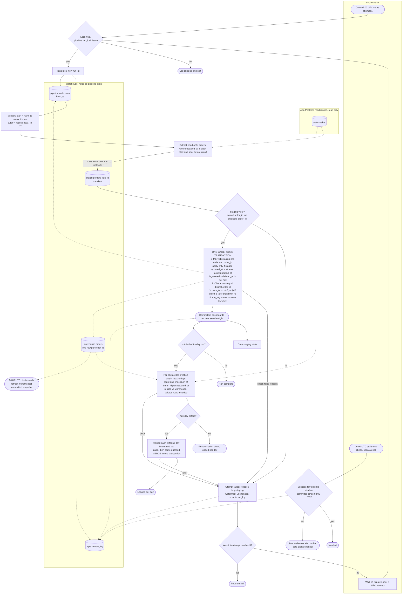

# Nightly orders ETL into the warehouse: pipeline design

## Flowchart

## What starts each step

- **Attempt 1:** the scheduler's cron at 02:00 UTC.
- **Attempts 2 and 3:** an orchestrator timer, 15 minutes after the previous attempt fails.
- **Reconciliation:** runs inside the Sunday run, only after that night's load commits.
- **06:00 staleness check:** a separate scheduled job, so a hung pipeline cannot suppress it.
- **Dashboards:** their own 06:00 refresh. They read committed warehouse tables only.

## Where data moves

- Replica to warehouse staging. The replica is read-only, and nothing is written to the app database.
- Staging to `warehouse.orders` through a single transactional MERGE.
- The dashboards read `warehouse.orders` and never touch staging.

## Where state lives (all in the warehouse)

- `pipeline.watermark(job, hwm_ts, last_run_id)`: the only high-water mark.
- `pipeline.run_lock(job, run_id, lease_expires_at)`: stops a retry and a manual rerun from overlapping.
- `pipeline.run_log(run_id, job, attempt, window_start, cutoff, status, rows_extracted, rows_merged, error, started_at, committed_at)`.
- `pipeline.reconciliation(run_id, creation_day, replica_count, replica_checksum, warehouse_count, warehouse_checksum, action)`.
- `staging.orders_<run_id>`: transient, dropped after commit or failure.
- `warehouse.orders`: `order_id` unique, all source columns, `updated_at`, `deleted_at`, `is_deleted`, `source_run_id`, `loaded_at`.

## Merge logic

- Key is `order_id`. A staged row replaces the target only if `staged.updated_at >= target.updated_at`.
- Ties rewrite identical values, so a rerun changes nothing. Out-of-order duplicates from the 2-hour overlap lose to the newer version.
- `is_deleted = deleted_at IS NOT NULL`. Deleted rows stay in the table.
- Before commit, the transaction checks that row count equals distinct `order_id` count. A mismatch rolls back.

## Staging

- Each run bulk-loads its extract into its own staging table, keyed by `run_id`.
- Validation runs before the merge: no null `order_id`, no duplicate `order_id` in the extract, and a sane row count.

## High-water mark

- The new HWM is `cutoff`, the replica's `now()` in UTC captured before the extract. It is not `max(updated_at)`. This sets a fixed window edge even when the extract is empty.
- The extract's upper bound is `updated_at <= cutoff`. Rows written during the extract fall into the next window.
- The watermark moves only inside the commit transaction, and only if `cutoff > hwm_ts`. A backfill or a rerun of an older night therefore cannot move it backwards.
- The window always starts from the current HWM, so a manual rerun needs no date. A failed night leaves the HWM in place, and the next successful run covers the gap.

## Failure and retry

- Any failure before COMMIT rolls back the merge, the watermark, and the success log entry together. Nothing partial is visible.
- Each attempt has a deadline, which we set to 45 minutes as an assumption. A hung attempt counts as failed.
- A retry is a full rerun with a new `run_id`. This is safe because the merge is idempotent and the HWM is monotonic.
- If the process dies after COMMIT but before the log write, the next attempt reruns harmlessly.
- Worst-case timeline: attempt 1 by 02:45, attempt 2 starts by 03:00 and ends by 03:45, attempt 3 starts by 04:00 and ends by 04:45. On-call is paged before 06:00 if all three fail.
- The retry policy also applies to the Sunday reconciliation. This is our assumption, since the brief only covers the nightly run.

## 06:00 staleness and dashboards

- Dashboards refresh at 06:00 regardless. Staging is never visible, and the merge commits in one transaction, so a dashboard sees either the previous committed night or the new one, never a mix.
- The staleness job looks for a successful `run_log` entry for tonight's window. If none exists, it posts to the data-alerts channel. It still fires while attempts are retrying or hung.

## Sunday reconciliation

- Runs after the Sunday load commits. Scope is the last 30 days of order-creation days, using `created_at`. We assume that column exists.
- Per day, compare `count(*)` and `checksum`, where the checksum is the sum of `hash(order_id || updated_at normalized to UTC microseconds)` across all rows, deleted rows included.
- Use a sum rather than XOR so duplicates do not cancel, and use no ordering so no sort is needed. Both sides must use the same hash and the same timestamp normalization. The replica side is computed on the replica.
- A mismatched day is reloaded by `created_at`, not `updated_at`. This catches late-visible rows of any age inside the 30-day scope. The reload stages the day and runs the same guarded MERGE in one transaction.
- If a day still mismatches after reload, log it and alert. This likely means replica lag.
- If the Sunday load never commits, reconciliation is skipped and queued for the next successful run. This is our assumption.
- Rows created more than 30 days ago are outside the reconciliation scope.

## Assumptions and open questions

- `orders` has a `created_at` column for the reconciliation scope.
- The warehouse supports multi-statement transactions with MERGE. If it does not, build the new state in a side table and swap it in atomically.
- The 45-minute attempt deadline must be checked against measured nightly runtime.
- App-stamped `updated_at` relies on app clock accuracy. The 2-hour lookback absorbs modest skew, but skew above about an hour needs a look.
- The Sunday failure policy and the reconciliation retry policy are assumptions to confirm.