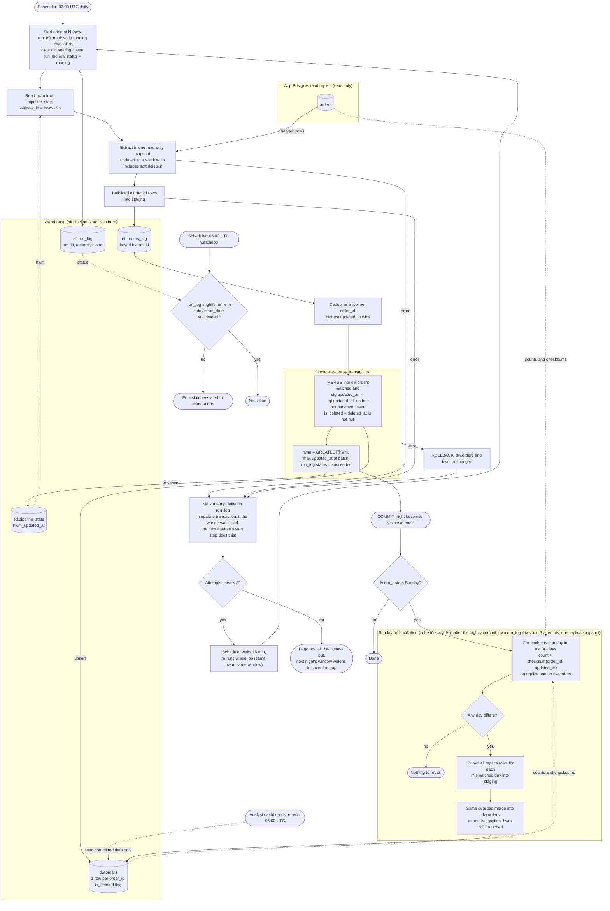

# Nightly orders ETL: replica to warehouse

## Design in brief

**Who runs what.** The scheduler is the external job orchestrator. It starts the job, runs retries, pages on-call, and runs the 06:00 watchdog. It passes each attempt its `kind` (`nightly` or `reconcile`), `run_date` and `attempt` number. The job is one worker process that reads the replica and writes the warehouse (extract, staging load, merge). The scheduler runs only one attempt at a time across both kinds. If another is due, it waits, and when two are due it runs the earlier one first. It kills an attempt that runs past a fixed timeout, which counts as a failure.

**Where state lives (all in the warehouse, schema `etl`)**

| Object | Purpose |
|---|---|
| `etl.pipeline_state` | One row per pipeline (`orders`). Columns: `hwm_updated_at`, `last_success_run_id`, `last_success_at`. This is the **high-water mark (HWM)**. |
| `etl.run_log` | One row per attempt. Columns: `run_id`, `run_date`, `kind`, `attempt` (1 to 3), `status` (`running`, `succeeded` or `failed`), `window_lo`, `window_hi`, `rows_extracted`, `error`. It is the audit trail, and the watchdog reads it. `run_date` is the UTC date of the 02:00 scheduled start. The scheduler passes it, and retries keep it, even after midnight. Every attempt gets a new `run_id`. |
| `etl.orders_stg` | Staging, keyed by `run_id`. Never visible to dashboards. |
| `dw.orders` | The served table. One row per `order_id` (primary key), always the most recent version. It includes `is_deleted` and `deleted_at`. |

**Start of every attempt (nightly or reconcile)**
1. Mark any leftover `running` row as `failed` (a crashed or killed attempt). Only one attempt runs at a time, so any such row is dead.
2. Delete staging rows of all earlier `run_id`s, so a retry starts clean.
3. Insert a new `run_log` row with `status = running`.

**Extract (nightly, starting at 02:00 UTC)**
- Read the replica in one repeatable-read, read-only snapshot.
- Read `hwm_updated_at` and set `window_lo = hwm - 2 hours`. A bulk-import row can become visible up to 90 minutes after its `updated_at`, so the window reaches back past the HWM. Re-reading rows is harmless because of the guarded merge.
- Query `WHERE updated_at > window_lo`, with no upper bound. Changes after the snapshot are picked up by the next night's lookback.
- Soft deletes need no special case: they bump `updated_at`, so they are extracted like any change. The load sets `is_deleted = (deleted_at IS NOT NULL)`.
- Bulk-load the rows into `etl.orders_stg` tagged with the `run_id`.
- With no HWM (the very first run), use the epoch, which is a full backfill. Start it by hand with the scheduler timeout raised high enough to finish.
- The worker does not check replica lag. The HWM follows the data actually loaded.

**Merge and commit (one warehouse transaction)**
1. Deduplicate staging to one row per `order_id`, keeping the highest `updated_at`. Break ties by the later `deleted_at`, then by the highest staging row id.
2. `MERGE INTO dw.orders`: `WHEN MATCHED AND stg.updated_at >= tgt.updated_at THEN UPDATE` all columns (the guard stops an older re-extracted version from overwriting a newer one); `WHEN NOT MATCHED THEN INSERT`.
3. Set `hwm_updated_at = GREATEST(hwm_updated_at, MAX(updated_at) of this batch)`, unchanged if the batch is empty. Mark the `run_log` row `succeeded`.
4. `COMMIT`.

Data, HWM and `succeeded` status commit together: everything becomes visible at once, or none of it does. Re-runs are harmless because the merge is keyed on `order_id` and guarded by `updated_at`, and the HWM moves only in the same commit as the data. A retry or manual re-run reads the same window and writes the same final rows.

**Failure and retry**
- Any failure (replica read, staging load, merge, timeout) fails the attempt. The open transaction rolls back, so the HWM is untouched, and `failed` is written in a separate small transaction. If the worker is killed, the warehouse rolls back when the connection drops, and the next attempt's start step marks the row `failed`.
- The scheduler re-runs the whole job 15 minutes after a failure, up to two more times (three attempts in total). Each retry re-reads the HWM, so it uses the same window.
- After the third failure the scheduler pages on-call and the job stops. The HWM stays put, so the next night's window widens to cover the gap. No human action is needed to recover. The page is a notice to look at the cause.

**Dashboards and staleness**
- Dashboards refresh at 06:00 UTC and read only `dw.orders`. Because the load is a single commit, they see either last night's data or tonight's, never a partial night.
- A scheduler watchdog at 06:00 UTC checks `run_log` for a succeeded nightly run with today's (UTC) `run_date`. If there is none, including when the job is still running, it posts a staleness alert to #data-alerts. It does not stop the job. If a retry commits later, dashboards pick it up at their next refresh.

**Sunday reconciliation**
- The scheduler starts it when a nightly run whose `run_date` is a Sunday commits. It uses `run_date`, not commit time, so a retry that commits after midnight still triggers it. It has its own `run_log` rows (`kind = reconcile`), its own three attempts, and the same start steps, retry and paging policy. Its row uses the triggering nightly's `run_date`, leaves `window_lo` and `window_hi` empty, and sets `rows_extracted` to the rows reloaded.
- It reads the replica in one repeatable-read snapshot. For each order-creation day (by `created_at` date) in the last 30 days, it computes `COUNT(*)` and a checksum over `order_id` + `updated_at` on both the replica and `dw.orders`. Deleted orders are included on both sides.
- Every mismatched day is reloaded: extract all replica rows with that `created_at` date from the same snapshot into staging, then apply the same guarded merge in one transaction. Rows that change after the snapshot are left to the next nightly run.
- It does **not** touch the HWM. It is a repair path only.
- If Sunday's nightly exhausted its retries, reconciliation does not start that week, since it would only compare against a stale warehouse. The next Sunday covers it.
- If the replica is still behind, a reloaded day can still mismatch. The guard keeps the newer warehouse row, so no data is lost, and the mismatch shows up again next Sunday.

## Flowchart

## What starts each step

| Step | Trigger |
|---|---|
| Nightly run, attempt 1 | Scheduler, 02:00 UTC |
| Attempts 2 and 3 | Scheduler, 15 minutes after the previous attempt fails |
| Page on-call | Third failed attempt |
| Merge and HWM advance | Staging load finishes successfully (inside one transaction) |
| Staleness check | Scheduler, 06:00 UTC, independent of the job |
| Dashboard refresh | Dashboard tool, 06:00 UTC (reads only committed data) |
| Reconciliation | Scheduler, after the nightly load commits for a Sunday `run_date` |

## Notes and assumptions

- The HWM is the maximum `updated_at` actually loaded, not wall-clock time. If the replica lags, the HWM lags with it and the 2-hour lookback covers the difference. Lag beyond that is left to the Sunday reconciliation.
- The warehouse MERGE must be atomic with the HWM update. If the warehouse engine cannot put both in one transaction, write the HWM into a staging row and swap both with a single atomic table-swap or view-flip step, so dashboards still see one consistent version.
- If the 02:00 job overruns past 06:00, the watchdog alerts, and dashboards show the previous night's data until the commit lands.

## Open questions

- The scheduler product, the worker's host, and the per-attempt timeout value are not decided.
- The size of the orders table is not known, so how long the first full backfill takes is not known.
