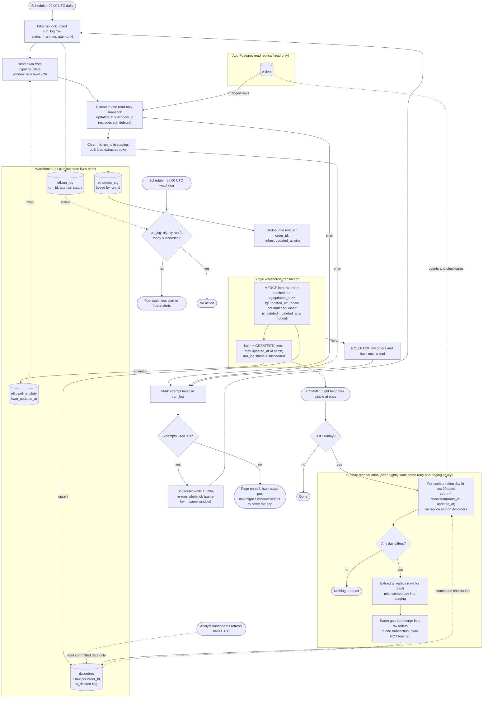

# Nightly orders ETL: replica to warehouse

## Design in brief

**Where state lives (all in the warehouse, schema `etl`)**

| Object | Purpose |
|---|---|
| `etl.pipeline_state` | One row per pipeline (`orders`). Columns: `hwm_updated_at`, `last_success_run_id`, `last_success_at`. This is the **high-water mark (HWM)**. |
| `etl.run_log` | One row per attempt. Columns: `run_id`, `run_date`, `kind` (`nightly` or `reconcile`), `attempt` (1 to 3), `status` (`running`, `succeeded` or `failed`), `window_lo`, `window_hi`, `rows_extracted`, `error`. It is the audit trail, and the 06:00 watchdog reads it. |
| `etl.orders_stg` | Staging, keyed by `run_id`. Written freely and never visible to dashboards. An attempt first deletes any rows for its own `run_id`, so a retry starts clean. |
| `dw.orders` | The served table. Exactly one row per `order_id` (primary key), always the most recent version. It includes `is_deleted` and `deleted_at`. |

**Extract (nightly, starting at 02:00 UTC)**
- Read the replica in one repeatable-read, read-only snapshot.
- Read `hwm_updated_at` from the warehouse and set `window_lo = hwm - 2 hours`.
- Query `WHERE updated_at > window_lo`. The window is open-ended on the upper side, so the snapshot defines the upper edge.
- Deletes need no special case. A soft delete sets `deleted_at` and bumps `updated_at`, so it is extracted like any other change. The load sets `is_deleted = (deleted_at IS NOT NULL)`.
- Bulk-load the rows into `etl.orders_stg` tagged with the `run_id`.
- On the very first run there is no HWM. Treat it as the epoch, which is a full backfill.

**Merge and commit (one warehouse transaction)**
1. Deduplicate staging to one row per `order_id`, keeping the highest `updated_at`. Break ties by the later `deleted_at`, then by the arbitrary but deterministic highest staging row id.
2. `MERGE INTO dw.orders`:
   - `WHEN MATCHED AND stg.updated_at >= tgt.updated_at THEN UPDATE` all columns. The guard stops an older re-extracted version from overwriting a newer one.
   - `WHEN NOT MATCHED THEN INSERT`.
3. In the same transaction, set `hwm_updated_at = GREATEST(hwm_updated_at, MAX(updated_at) of this batch)`. If the batch is empty, leave it unchanged. Mark the `run_log` row `succeeded`.
4. `COMMIT`.

Everything becomes visible at once, or none of it does. A failure at any point before the commit rolls back, so the HWM is untouched.

**Why re-runs are harmless:** the merge is keyed on `order_id` and guarded by `updated_at`. The HWM only moves inside the same commit as the data. A retry or manual re-run therefore re-reads the same window and writes the same final rows.

**Failure and retry**
- Any failure (replica read, staging load, merge) marks the attempt `failed` and rolls back.
- The scheduler re-runs the whole job 15 minutes after the failure, up to two more times, for three attempts in total.
- Each retry re-reads the HWM, so it uses the same window as before.
- If the third attempt fails, the scheduler pages on-call and the job stops. The HWM stays where it was, so the next night's window automatically widens to cover the gap.
- A lock on `(pipeline, kind)`, such as a unique `running` row in `run_log`, prevents two runs from overlapping.

**Dashboards and staleness**
- Dashboards refresh at 06:00 UTC and read only `dw.orders`. Because the load is a single commit, they see either last night's data or tonight's, never a partial night.
- A separate watchdog is scheduled at 06:00 UTC. It checks `run_log` for a succeeded nightly run for today's `run_date`. If there is none, it posts a staleness alert to #data-alerts.
- The watchdog does not stop the job. If a retry commits later, dashboards pick it up at their next refresh.

**Sunday reconciliation (starts after Sunday's nightly load succeeds)**
- For each order-creation day (by `created_at` date) in the last 30 days, compute `COUNT(*)` and a checksum over `order_id` + `updated_at` on both the replica and `dw.orders`. Deleted orders are included on both sides.
- Collect the days that mismatch. Reload each one by extracting all replica rows with that `created_at` date into staging.
- Apply the same guarded merge in one transaction, so the reload commits atomically.
- Reconciliation does **not** touch the HWM. It is a repair path only.
- It follows the same retry and paging policy (three attempts, 15 minutes apart, then page).
- If Sunday's nightly load exhausted its retries, skip reconciliation. It would only compare against a stale warehouse.
- Caveat: if the replica is still behind, a reloaded day can still mismatch. The guard keeps the newer warehouse row, so no data is lost. The mismatch simply shows up again the following Sunday.

## Flowchart

## What starts each step

| Step | Trigger |
|---|---|
| Nightly run, attempt 1 | Scheduler, 02:00 UTC |
| Attempts 2 and 3 | Scheduler, 15 minutes after the previous attempt fails |
| Page on-call | Third failed attempt |
| Merge and HWM advance | Staging load finishes successfully (inside one transaction) |
| Staleness check | Scheduler, 06:00 UTC, independent of the job |
| Dashboard refresh | Dashboard tool, 06:00 UTC (reads only committed data) |
| Reconciliation | Sunday's nightly load committing successfully |

## Notes and assumptions

- The HWM is the maximum `updated_at` actually loaded, not the wall-clock time. If the replica lags, the HWM stays behind with it, and the 2-hour lookback covers the difference.
- The warehouse MERGE must be atomic with the HWM update. If the warehouse engine cannot put both in one transaction, write the HWM into a staging row and swap both with a single atomic table-swap or view-flip step. Dashboards must still see one consistent version.
- If the 02:00 job overruns past 06:00, the watchdog alerts. Dashboards show the previous night's data until the commit lands.
