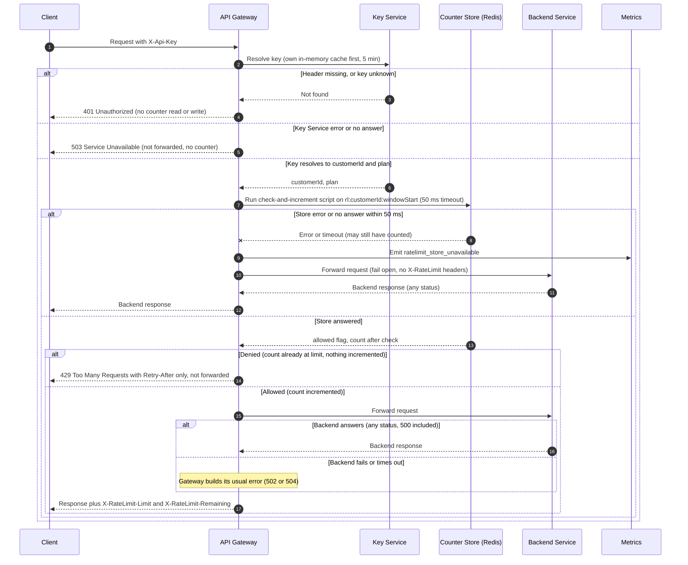

# Per-customer rate limiting on the public API: v1 design

## Summary

The API Gateway checks a per-customer counter after it authenticates the key and before it forwards the request. The counter lives in a shared Redis store, so all six gateway instances share one budget per customer. Each check is one atomic Lua script that increments the counter only when the request is under the limit. If the store errors or does not answer within 50 ms, the gateway forwards the request and emits `ratelimit_store_unavailable`.

## Sequence



## How each step works

**Authentication.** The gateway resolves the key from its own in-memory cache (per instance, up to 5 minutes), and asks the Key Service on a miss. A missing header and an unknown key get the same `401`, with no detail on which case it was. Neither touches a counter. If the Key Service errors or does not answer, the gateway cannot tell who the caller is, so it returns `503` and does not forward (open item 2).

**Identity and limit.** The counter is keyed by `customerId`, so all of a customer's keys share one budget. The gateway config maps each plan to a limit: Standard = 100 per minute, Enterprise = OPEN (open item 1). The gateway passes the plan's limit to the script as `ARGV[1]`. A plan with no configured limit must not ship.

**Check and count.** One Redis call runs the script below on `rl:{customerId}:{windowStart}`. Redis runs a Lua script as one atomic unit, so two gateways cannot both take the last slot. The 50 ms timeout applies to this call. The store is shared Redis; any store with an atomic conditional increment would also work.

```lua
local count = tonumber(redis.call('GET', KEYS[1]) or '0')
local limit = tonumber(ARGV[1])
if count < limit then
  count = redis.call('INCR', KEYS[1])
  if count == 1 then redis.call('EXPIRE', KEYS[1], ARGV[2]) end
  return {1, count}
end
return {0, count}
```

`ARGV[2]` is 120 seconds, so each key outlives its 60-second window and expires on its own. No cleanup job is needed. The script returns the allowed flag and the count after the check. Denied requests are not incremented.

**Window.** One minute, aligned to UTC. Each gateway computes `windowStart = floor(now / 60) * 60` from its own clock, which must be NTP-synced. Clock skew moves a window boundary by the amount of the skew. Known v1 tradeoff: a customer can send up to about twice the limit across a boundary within a few seconds (open item 3). A sliding window can replace this later without changing the response contract.

**Allowed requests.** `X-RateLimit-Limit` is the plan's limit. `X-RateLimit-Remaining` is `limit - count`, using the count the script returned. These headers go on whatever response the client gets after an allowed request, including the gateway's own 502 or 504.

**Backend failure.** The request was already counted, so it uses budget. If the backend returns any status, including 500, the gateway passes that response through with the headers. If the backend fails or times out, the gateway sends its usual 502 or 504 with the same headers. The gateway does not retry. The backend timeout is open (open item 4).

**Denied (429).** When the script denies, the gateway returns `429` with `Retry-After = ceil(windowStart + 60 - now)` in whole seconds, using its own clock at the moment of denial. A denied request always falls inside a live window, so the value is at least 1. The 429 carries `Retry-After` only, with no `X-RateLimit-*` headers, and is not forwarded.

**Fail open.** On a store error or timeout, the gateway forwards the request, emits `ratelimit_store_unavailable`, and omits the `X-RateLimit-*` headers. It cannot know whether the script ran. If it ran and the reply was lost, the request was counted and is still forwarded; nothing is rolled back. Clients must not treat a missing header as an error. During an outage each request waits up to 50 ms before it is forwarded. A circuit breaker is left out of v1.

**Plan changes.** The plan comes from the in-memory Key Service cache, so a customer who changes plan may see the old limit for up to 5 minutes per instance. Accepted for v1.

## Open items

1. **Enterprise limit.** Not decided by Product. The Enterprise branch has no value and must not ship until it is set.
2. **Key Service failure.** v1 returns `503`. The team should confirm this.
3. **Boundary burst.** Accepted for v1. Revisit if customers report it or if the limit is used for cost protection.
4. **Timeouts and alerts.** The team must choose timeouts for the Key Service and backend calls. No metrics destination or alert is named for `ratelimit_store_unavailable`. v1 only emits it, so during a long store outage no limit applies and nobody is told.