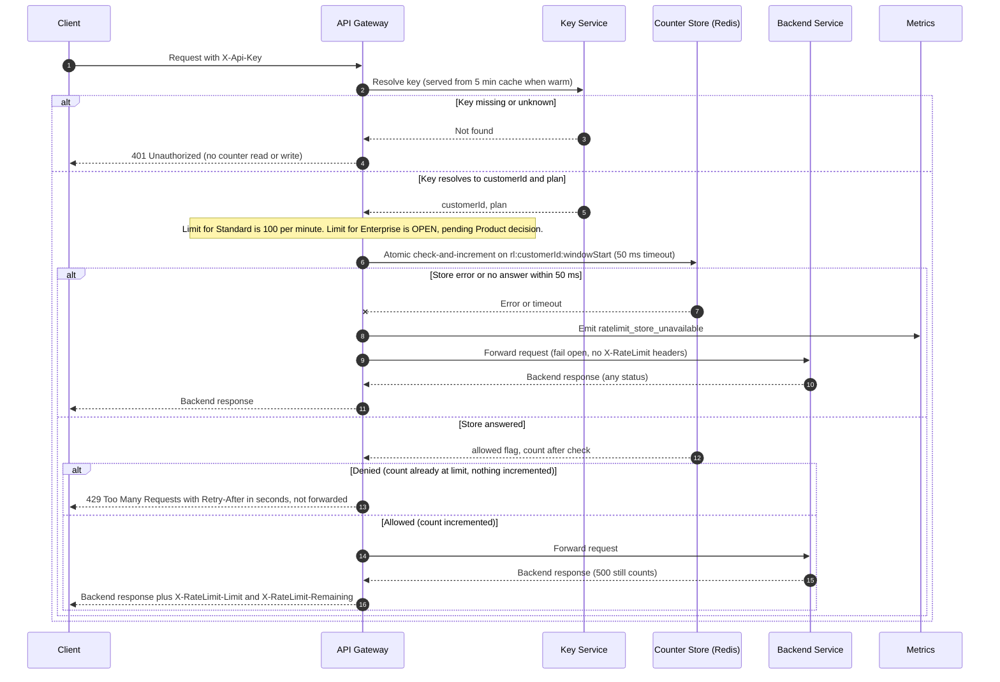

# Per-customer rate limiting on the public API: v1 design

## Summary

The API Gateway checks a per-customer counter after it authenticates the key and before it forwards the request. The counter lives in a shared Redis store, so all six gateway instances see one budget per customer. Each check is a single atomic script that increments the counter only when the request is under the limit. Requests that are rejected never touch the budget. If the store errors or does not answer within 50 ms, the gateway forwards the request and emits `ratelimit_store_unavailable`.

## Sequence



## Notes on the diagram

**Identity and counting unit.** The counter key uses `customerId`, not the API key, so a customer with several keys shares one budget (requirement 1). The Key Service already returns `customerId`, so no new lookup is needed.

**Auth first.** The 401 branch returns before any counter access (requirement 3).

**Check and count in one step.** The Redis script reads the count, increments it only if the count is below the limit, and returns whether the request was allowed along with the new count. Denied requests do not increment (requirement 4). Allowed requests are counted before forwarding, so a backend 500 or timeout still uses budget (requirement 5). Because the check and increment are one atomic script, two instances handling requests for the same customer at the same moment cannot both pass the last slot (requirement 7).

Sketch of the script (for review, not final code):

```lua
local count = tonumber(redis.call('GET', KEYS[1]) or '0')
local limit = tonumber(ARGV[1])
if count < limit then
  count = redis.call('INCR', KEYS[1])
  if count == 1 then redis.call('EXPIRE', KEYS[1], ARGV[2]) end
  return {1, count}
end
return {0, count}
```

`ARGV[2]` is 120 seconds, so a key outlives its 60-second window and expires on its own. No cleanup job is needed.

**Window.** The window is a fixed one-minute window aligned to UTC: `windowStart = floor(now / 60) * 60`. The gateway computes `X-RateLimit-Remaining` as `limit - count`. Known tradeoff for v1: a customer can send up to about twice the limit across a window boundary within a few seconds. A sliding window can replace this later without changing the response contract.

**Retry-After.** On a 429 the gateway sends `Retry-After = ceil(windowStart + 60 - now)` in whole seconds. Because a denied request always falls inside a live window, the value is at least 1.

**Fail open.** Each store call has a 50 ms timeout. On error or timeout the gateway forwards the request, emits `ratelimit_store_unavailable`, and omits the `X-RateLimit-*` headers. Nothing is counted for that request. Clients must not treat a missing header as an error. During an outage every request waits up to 50 ms before it is forwarded. A circuit breaker could skip the store after repeated failures; that is left out of v1 to keep it simple.

**Plan changes.** The plan comes from the Key Service cache, which holds for up to 5 minutes. A customer who changes plan may see the old limit for up to 5 minutes. This is accepted for v1.

## Decisions

| Topic | Decision for v1 |
|---|---|
| Counter store | Shared Redis. Any store with an atomic conditional increment would also work. |
| Counter key | `rl:{customerId}:{windowStart}`, one key per customer per minute. |
| Window | Fixed, one minute, aligned to UTC. |
| Concurrency | Atomic check-and-increment script. No separate read then write. |
| Retry-After | Seconds until the current window ends, rounded up, minimum 1. |
| Fail-open response | Forward the request, emit `ratelimit_store_unavailable`, no `X-RateLimit-*` headers, no count. |
| Store timeout | 50 ms per call. |

## Open items

1. **Enterprise limit.** Not decided. The design uses one per-plan limit lookup, so the Enterprise value only needs to be filled in once Product decides it. Until then, the Enterprise branch has no value and must not ship.
2. **Boundary burst.** Accepted for v1 as described above. Revisit if customers report it or if the limit is used for cost protection.
3. **Metrics for denied requests.** The brief does not ask for a metric on 429s. Adding one is a small, optional change if the team wants to see throttled traffic.