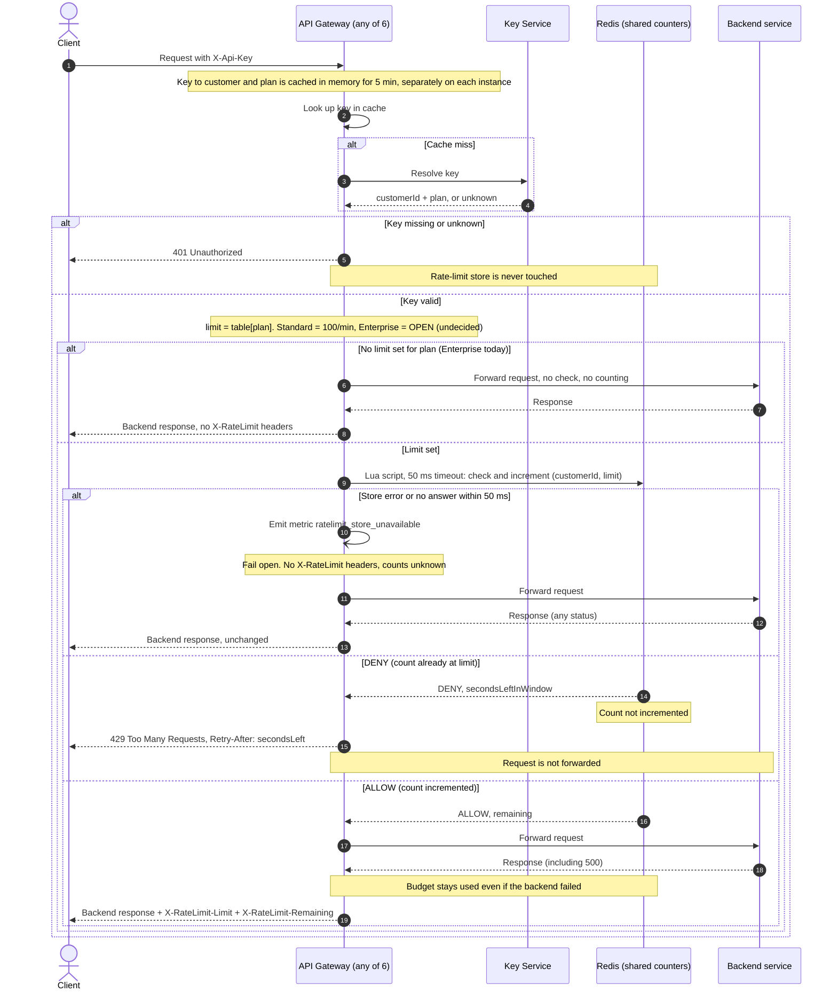

# Per-customer rate limiting on the public API: design

## Decisions

- **Store:** one shared Redis instance (with a replica for failover) holds all counters. All 6 gateway instances use it, so counts are shared (req. 7).
- **Window:** fixed one-minute window aligned to the clock. Key: `rl:{customerId}:{floor(now/60)}`, expiring 120 s after the first increment. A fixed window allows up to 2x the limit across a window boundary. We accept this for a first version.
- **Atomicity:** the gateway calls one Lua script on Redis, passing `customerId` and `limit`. The script builds the key itself from Redis `TIME` (so gateway clock skew cannot matter) and runs as a single step, so concurrent requests on different instances cannot overshoot:
  1. Read the current count `c` (0 if the key does not exist).
  2. If `c >= limit`, return `DENY` with the seconds left in the window. Do not increment (req. 4).
  3. Otherwise `INCR` the key. If `INCR` returns 1, set the 120 s expiry. Return `ALLOW` with `remaining = limit - (c+1)`.
- **Retry-After:** seconds until the current window ends, rounded up, never below 1.
- **Limits:** the plan from the Key Service picks the limit from a config table. Standard is 100 per minute. **Enterprise is OPEN: product has not decided, and the table entry is unset.** While a plan has no limit, its requests skip the rate-limit check: they are not counted, are forwarded, and get no `X-RateLimit-*` headers. Do not guess a value in code. Product must decide before launch.
- **Per customer:** the counter key uses the customer ID from the Key Service, never the API key (req. 1).
- **Headers:** `X-RateLimit-Limit` is the customer's limit per minute. `X-RateLimit-Remaining` is how many more requests fit in the current window after this one. They go on passed requests only, except that 429 responses also carry `X-RateLimit-Limit` and `X-RateLimit-Remaining: 0`.
- **Fail open (req. 8):** the Redis call has a 50 ms timeout. On error or timeout the gateway forwards the request, emits `ratelimit_store_unavailable`, sends **no** `X-RateLimit-*` headers (the real values are unknown) and does not retry. If the script still ran after the gateway gave up, its increment is kept.
- **Backend failures:** the count is incremented before forwarding and never rolled back, so a backend 500 still uses budget (req. 5). The backend response is returned as the gateway does today.

## Notes

- **Overshoot:** Redis runs a script to completion before the next one, so two instances cannot both see 99 and both pass.
- **Cache staleness:** a plan change can take up to 5 minutes to take effect, because of the existing key cache. Acceptable.
- **Redis failover:** a failover may lose the last few increments, so a customer could briefly get a little extra budget. Acceptable for a first version.
- **Out of scope:** sliding windows, per-route limits, and burst allowances.

## Open questions

- Enterprise limit: product has not decided. Until then Enterprise traffic is unlimited (see Limits).
- Existing behavior this design does not change and the author has not verified: what the gateway does when the Key Service is down or slow on a cache miss, whether unknown keys are cached, and what the client sees if the backend is unreachable or times out.
