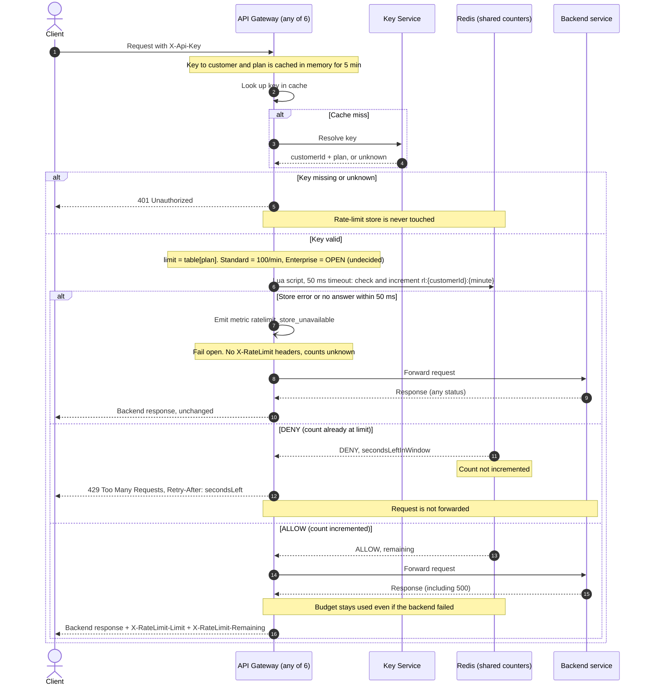

# Per-customer rate limiting on the public API: design

## Decisions

- **Store:** one shared Redis instance (replicated, with a replica for failover) holds all counters. All 6 gateway instances use it, so counts are shared (req. 7).
- **Window:** fixed one-minute window aligned to the clock. Key: `rl:{customerId}:{floor(now/60)}`. The key expires 120 s after creation, so old windows clean themselves up. Fixed windows allow up to 2x the limit across a window boundary. We accept this for a first version.
- **Atomicity:** one Lua script runs on Redis. It does a check-and-increment as a single step, so concurrent requests on different instances cannot overshoot:
  1. Read the current count `c`.
  2. If `c >= limit`, return `DENY` with the seconds left in the window. Do not increment (req. 4).
  3. Otherwise `INCR` the count, set the expiry on the first increment, and return `ALLOW` with `remaining = limit - (c+1)`.
- **Time source:** the script computes the window and seconds remaining from Redis `TIME`, so gateway clock skew cannot matter.
- **Retry-After:** `Retry-After = seconds until the current window ends`. The result is rounded up and never below 1.
- **Limits:** Standard is 100 per minute. **Enterprise is OPEN: product has not decided.** The plan from the Key Service drives the lookup. The limit comes from a config table keyed by plan, with the Enterprise entry unset. Until a number is set, an Enterprise request has no known limit. This needs a product decision before launch. Do not guess a value in code.
- **Per customer:** the counter key uses the customer ID from the Key Service, never the API key (req. 1).
- **Fail open (req. 8):** the gateway gives the Redis call a 50 ms timeout. On error or timeout it forwards the request, emits `ratelimit_store_unavailable`, and sends **no** `X-RateLimit-*` headers, because the real values are unknown. It does not retry.
- **Backend failures:** the count is incremented before forwarding and is never rolled back, so a backend 500 still uses budget (req. 5).

## Notes

- **Overshoot:** the check and the increment happen in one Lua script. Redis runs scripts one at a time, so two instances cannot both see 99 and both pass.
- **429 responses** carry `Retry-After` only. We also add `X-RateLimit-Limit` and `X-RateLimit-Remaining: 0` for convenience, since this is harmless. Requirement 6 only requires them on passed requests.
- **Cache staleness:** a plan change can take up to 5 minutes to take effect, because of the existing key cache. This is acceptable.
- **Redis failover:** a failover may lose the last few increments. A customer could briefly get a little extra budget. This is acceptable for a first version.
- **Open item:** the Enterprise limit. It is the only undecided requirement.
- **Out of scope:** sliding windows, per-route limits, and burst allowances.
