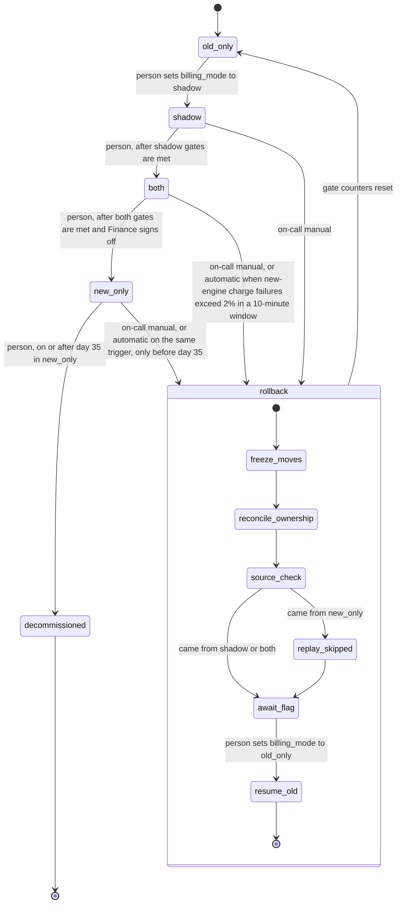

# Billing engine rollout: state machine

Days are UTC calendar days. Modes are `old_only`, `shadow`, `both` and `new_only`. Rollback ends in `old_only`. `decommissioned` is terminal.

## Modes

- **old_only.** The old engine reads usage events, computes invoices, writes the ledger and charges. The new engine is off.
- **shadow.** The old engine is unchanged. The new engine runs in the billing workers on the same usage events and writes its invoices to the shadow store. It never charges and never writes the ledger. Its errors are recorded and never trigger rollback.
- **both.** The new engine computes, charges and writes the ledger. The old engine keeps computing every invoice into the shadow store without charging, so it stays current. Automatic rollback is armed.
- **new_only.** The new engine does everything. The old engine stops computing. Entry starts the 35-day clock and stores the cutoff timestamp (the last usage event the old engine processed). Rollback is possible until day 35, because the usage event log keeps only 35 days.
- **decommissioned.** The old engine may be retired on or after day 35 in `new_only`. No rollback is possible after this.

In `shadow` and `both`, a nightly job compares both engines' invoices per customer and billing period. A mismatch is any invoice total that differs by more than one cent. A mode change applies to worker runs that start after the audited write. A run that started earlier finishes in its old mode.

## Moves and gates

- Forward moves go one step at a time, in the order above, with no skipping. A person makes each move with an audited write. The system checks the gates when the write arrives and refuses it if a gate is not met or the kill switch is set.
- **shadow to both.** 7 consecutive UTC days, each with a completed nightly comparison and a mismatch rate below 0.1% (mismatched invoices divided by invoices compared that day). At least 5,000 invoices compared across the 7 days. A missed or failed nightly run breaks the streak. The streak starts at zero on entry.
- **both to new_only.** 14 UTC days in `both`, no unresolved mismatches at the time of the move, and a Finance sign-off recorded by a named Finance approver. Mismatches do not reset the day count. A person closes each mismatch in the rollout record.

## One charge in both

1. The new engine computes the invoice for a customer and billing period from the usage events.
2. Its idempotency key is the customer ID plus the billing period ID. The key is recorded before the first provider call, and every retry reuses it.
3. Before its first call, the new engine checks the provider by key. If a charge already exists under that key, it writes the ledger entry from the provider record and does not charge. Otherwise it charges with the key. If the outcome is unknown, it checks the provider by key before any retry and never resends blind.
4. On provider success, it writes the ledger entry.

The old engine's invoice for the same period goes only to the shadow store. Both engines use the same key, so reconciliation can match them.

## Rollback

**Start.** On-call can start rollback by hand at any time in `shadow`, `both` or `new_only`. It also starts automatically in `both` or `new_only` when the new engine's charge failure rate is above 2% in any 10-minute window. The rate is failed new-engine charge attempts divided by all new-engine charge attempts in that window. Windows with no attempts never trigger. The charge path writes these counts to the rollout record, and the rollout controller computes the rate. An automatic trigger starts the steps below and never writes `billing_mode`.

**Effect.** Rollback always ends in `old_only` and resets the gates. The rollout goes through `shadow` again, and the 7-day count starts over. While the kill switch is set, ordinary worker runs of either engine make no charges and write no ledger entries. Only the rollback steps do.

**Steps.** The steps run in order. Each is idempotent, so an interrupted rollback resumes at its last completed step. The kill switch stays set until `resume_old` completes. The rollout controller runs the steps; its form is an open question.

1. **freeze_moves.** Set the kill switch in the rollout record. Forward moves are refused while it is set. `billing_mode` does not change. Charges that fall due are held, not dropped.
2. **reconcile_ownership.** For each billing period with a new-engine charge attempt since the last reconciliation, check the provider by key:
   - Provider success: the new engine owns the period. If the ledger lacks the entry, add it from the provider record. Charge nothing.
   - Final failure, or no record under the key: the period is unowned and still due. The old engine charges it once, under the same key, in `resume_old`.
   - No final outcome yet: the period is held. Reconciliation does not finish until every such period has an outcome.
   - No attempt: the period is not yet charged. The old engine charges it in `resume_old`.

   Record ownership per period in the rollout record.
3. **source_check.** If the rollback came from `new_only`, run `replay_skipped`. Otherwise go to `await_flag`. From `shadow` the reconciliation set is empty, and from `both` the old engine's shadow invoices are already current, so neither needs a replay.
4. **replay_skipped.** The old engine computes invoices for usage events after the cutoff timestamp into the shadow store. It charges nothing. It writes ledger entries only where they are missing. Periods the new engine owns are computed but not charged.
5. **await_flag.** The controller reports steps 1 to 4 as complete. Nothing charges. On-call writes `billing_mode` to `old_only` with an audited write. That write confirms the reconciliation has been reviewed.
6. **resume_old.** Starts when the controller sees `old_only`. Before charging, the old engine checks that the shadow store covers every period up to the latest usage event, and computes any gap. It then charges each unowned or not-yet-charged period once under its key, writes missing ledger entries, clears the kill switch and resets the gate counters. Ordinary charging resumes only after the switch is cleared.

## Where the rollout state lives

- **`billing_mode`**, in the config service. Workers read it at the start of every run. It changes only through an audited, person-initiated write.
- **Rollout record**, in the billing store. It holds the current mode, the entry timestamp, the `new_only` cutoff timestamp, daily comparison results (completed flag, invoices compared, mismatches), the shadow streak, unresolved mismatches, the Finance sign-off (approver and time), per-period charge ownership, new-engine attempt and failure counts, the kill switch, and the rollback log.
- **Usage event log** (35 days). **Shadow store** (both engines' invoices). **Ledger** (system of record). **Payment provider** (charge records keyed by idempotency key).

## What happens when something fails

- **Config service unreadable.** Workers hold: no charges, no ledger writes, and an alert. They never fall back to `old_only`, because after `new_only` that would re-charge periods the new engine already charged.
- **Shadow mismatch.** Recorded. It breaks the streak. No automatic action.
- **Nightly comparison does not complete.** The day is not counted, the streak breaks, and an alert fires.
- **Charge outcome unknown.** Check the provider by key before any retry.
- **Charge failure rate above 2%** in `both` or `new_only`. Automatic rollback starts.
- **Rollback interrupted.** Resume from the last completed step.
- **Day 35 in `new_only` with no rollback.** The old engine may be decommissioned, and rollback is no longer possible. Skipped usage events age out from the oldest one forward, so the practical deadline is earlier than day 35.

## Open questions

- After an automatic rollback, charges wait until on-call writes `old_only`. The brief allows only person-initiated writes to `billing_mode`. Whether automation may make that write as an audited system action is open.
- What the rollout controller is (a service, a scheduled job or part of the workers), and what happens to a rollback if it is down.
- Minimum attempt count before the 2% rule applies, and whether unknown-outcome timeouts count as failures.
- Whether the provider reports a pending outcome, whether "no record under the key" is final, and whether repeated same-key calls from both engines are safe.
- Who may give Finance sign-off.
- Margin for the 35-day deadline, since skipped events age out from the oldest one.
- What retiring the old engine involves in practice.