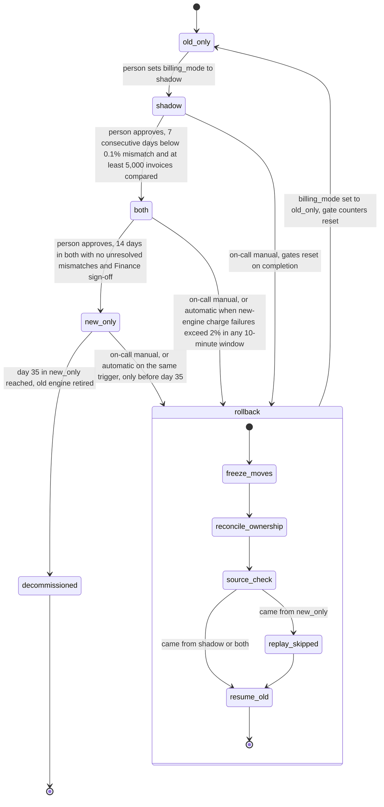

# Billing engine rollout: state machine

## What each mode does

- **old_only.** The old engine reads usage events, computes invoices, writes the ledger and charges. The new engine is off.
- **shadow.** The old engine is unchanged. The new engine reads the same usage events and writes its invoices to the shadow store. It never charges and never writes the ledger. A nightly job compares the two engines' invoices per customer; a mismatch is any total differing by more than one cent. The 7-day streak starts at zero on entry. New-engine errors are recorded but never trigger rollback.
- **both.** The new engine charges and writes the ledger. The old engine keeps computing every invoice into the shadow store without charging, so it stays current and can take over. The comparison continues, and automatic rollback is armed.
- **new_only.** The new engine does everything. The old engine stops computing. The 35-day clock runs from entry. Rollback stays possible until day 35, because it depends on replaying usage events, which the 35-day log keeps only that long. Skipped events age out from the oldest one forward, so the practical deadline is before day 35.
- **rollback.** Runs in order: (1) freeze forward moves and new-engine charging; (2) reconcile per-period charge ownership, so every charge is owned by exactly one engine; (3) if the source is new_only, the old engine replays skipped usage events, computing without charging for periods already charged; (4) the old engine resumes, the flag becomes old_only, and the shadow-gate counters reset. Any later return to shadow starts a fresh 7-day count.
- **decommissioned.** Terminal. No transition back exists.

## Rollback rules

- No double charge: every charge carries a stable idempotency key per invoice and billing period. Before retrying a charge whose outcome is unknown (for example a timeout), check the payment provider by that key. Never resend blind.
- No dropped charge: a charge the new engine attempted and failed without a provider success is still due. The old engine takes it over once, under the same key.
- The ledger stays the system of record. The old engine writes only ledger entries that are missing for a period.

## Where the rollout state lives

- The single `billing_mode` flag lives in the config service. Workers read it on every run, and the value changes only through an audited, person-initiated write.
- The brief does not say where gate evidence lives. Proposed: a rollout record in the billing store, holding current mode, entry timestamp (for the 35-day clock), daily mismatch counts, the shadow streak, invoices compared, the Finance sign-off, and a rollback log.
- The rollback freeze needs a marker separate from `billing_mode`, because the flag has only four values. Proposed: a kill switch in the rollout record that the new engine checks before every charge.
- Usage event log: 35 days. Shadow store: holds both engines' invoices for comparison. Ledger: system of record. Payment provider: charge records keyed by idempotency key.

## What happens when something fails

- **Config service unreadable.** Workers hold: no charges, no ledger writes, and an alert. They must not fall back to old_only. After new_only, the old engine would then re-charge periods the new engine already charged.
- **Shadow mismatch.** Recorded. It breaks the streak, but triggers no automatic action.
- **Charge failure rate above 2% over any 10-minute window in both or new_only.** Automatic rollback starts.
- **Rollback interrupted.** Resume from the last completed step. Each step is idempotent, and the freeze stays in force until resume_old completes.
- **Day 35 in new_only with no rollback.** The old engine may be decommissioned. From that point rollback is no longer possible.

## Open points the brief leaves to the implementer

- Where gate counters and sign-off are stored (proposed above).
- Whether the freeze runs before or after `billing_mode` changes (proposed: before).
- How the 35-day clock counts days, including time zone.
- How the Finance sign-off is recorded and who may give it.
- Whether a rollback should require a person to confirm reconciliation before resume_old.