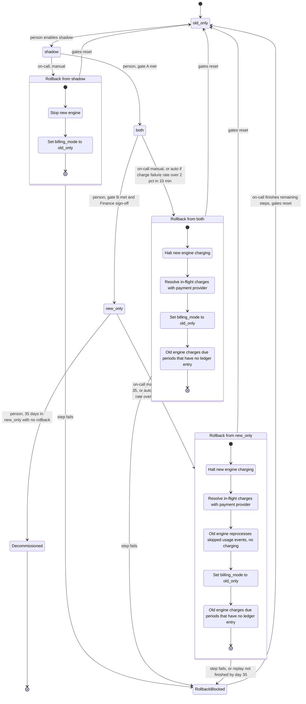

# Billing engine rollout: state machine

This models the rollout of the new billing engine as modes and transitions. It does not cover the controller's code. Where the brief is silent I made an assumption, listed under "Open questions".

## State diagram

## What each mode does

| Mode | Old engine | New engine | Charges | Writes ledger |
|---|---|---|---|---|
| `old_only` | Computes, charges, writes ledger | Off | Old | Old |
| `shadow` | Computes, charges, writes ledger | Reads the same usage events, writes invoices to the shadow store only | Old | Old |
| `both` | Computes every invoice into the shadow store only, no charging | Computes, charges, writes ledger | New | New |
| `new_only` | Stops computing | Computes, charges, writes ledger | New | New |
| `Decommissioned` | Removed | Only engine | New | New |

In `shadow` and `both`, a nightly job compares the two engines' invoices per customer: the ledger copy of one engine against the shadow-store copy of the other. A mismatch is a total differing by more than 1 cent. Each night it writes one result row (date, invoices compared, mismatches, mismatch rate = mismatches / compared) and updates the unresolved-mismatch list. The gates read these rows.

## Gates and guards

No forward move may skip a mode, and none is automatic.

| Transition | Condition |
|---|---|
| `old_only` to `shadow` | A person. No gate. |
| `shadow` to `both` (gate A) | 7 consecutive nightly results, each with mismatch rate under 0.1%, and at least 5,000 invoices compared in total across them (question 1). |
| `both` to `new_only` (gate B) | At least 14 days in `both` with no unresolved mismatches, plus Finance sign-off. The move sets the flag and the `new_only` clock together. |
| `new_only` to `Decommissioned` | A person, after 35 days in `new_only` with no rollback and no rollback in flight. The flag stays `new_only`; nothing can be rolled back to afterwards. |
| Manual rollback | On-call, from `shadow`, `both` or `new_only`. Refused in `new_only` from day 35 on. |
| Automatic rollback | In `both` or `new_only` only: the new engine's charge failure rate is above 2% over any 10-minute window (question 3). Errors in `shadow` are recorded and never trigger one. |

## Rollback

Rollback always ends in `old_only`. It is a path with steps, not a mode.

**Who runs it.** On-call (manual) or the charge monitor (automatic) opens the rollback record. Only one can be open at a time; a second request is ignored. A rollback worker then runs the steps below in order. On-call acts only in `RollbackBlocked`.

**Steps.**
1. **From `shadow`.** The new engine never charged or wrote the ledger. Stop it and set the flag to `old_only`.
2. **From `both`.**
   1. Halt new-engine charging, then resolve every in-flight or unknown-outcome charge (below).
   2. Set the flag to `old_only`.
   3. The old engine charges the periods with no live ledger entry. Its invoices are already current.
3. **From `new_only`.**
   1. Halt and resolve charges, as above.
   2. The old engine reprocesses every usage event logged since the `new_only` clock into the shadow store. This computes only and does not charge. It comes before the flag flip so the catch-up never charges from incomplete invoices (question 4). The oldest skipped event expires on day 35; if replay is not finished by then, go to `RollbackBlocked` as an urgent escalation.
   3. Set the flag to `old_only`.
   4. The old engine charges the periods with no live ledger entry, from the recomputed invoices.

Between the halt and the final catch-up nobody charges. Periods that fall due then wait and are charged in the catch-up, so none is dropped.

**Never charging twice.**
- A billing period is the invoiced period for one customer. The billing ledger (system of record) holds one row per customer and period, enforced by a uniqueness constraint.
- Before sending a charge, the engine writes the row as `pending`, which reserves the period. It becomes `charged` or `not charged` once the outcome is known. The row's key is also sent to the payment provider as its idempotency key. A `pending` row left by a crash is an unknown-outcome charge.
- **Handover rule.** Whenever charging passes from one engine to the other (`shadow` to `both`, or any rollback), the new charger charges a period only if the ledger has no entry for it or the entry is `not charged`. Periods already charged or pending are skipped.
- **Resolving an unknown outcome.** The worker asks the provider about the charge by its key. If charged, it completes the ledger entry. If not, it marks the entry `not charged`, so the handover rule lets the old engine charge it later. If the provider cannot say, the rollback goes to `RollbackBlocked` (question 5).

**Failure.** Any failed step, or a worker crash mid-step, sends the rollback to `RollbackBlocked` and pages on-call. Nothing restarts automatically. The new engine stays halted. On-call finishes the remaining steps from the step saved in the record. A step counts as failed only when it errors or its worker crashes (question 7).

**Ending.** The worker, or on-call after `RollbackBlocked`, closes the record when the last step is done. Closing clears the gate counters: consecutive days, invoices compared, days in `both` and the Finance sign-off. The rollout restarts at `old_only` and must go through `shadow` again. Earlier comparison results do not count.

## Where state lives

- **Mode:** the `billing_mode` flag in the config service. The only source of truth for the mode; workers read it.
- **Rollback progress:** a rollback record stored beside the billing ledger, because the four-value flag cannot express "rollback in progress" (question 2). It holds the current step, the trigger and the start time.
  - Before every charge, a worker reads the flag and the record. While a record is open, the new engine may not start a charge, even if the flag still says `both` or `new_only`. This closes the gap between the trigger and the flag flip. A charge already sent may finish or be left unknown; the resolve step settles it.
  - The charge monitor counts new-engine charge attempts per 10-minute window and opens the record when failures exceed 2%.
- **Gate counters:** the nightly result rows, the unresolved-mismatch list, the date `both` began and the Finance sign-off. They live with the comparison job's results. A person marks mismatches resolved and records the sign-off (question 6).
- **`new_only` clock:** when `new_only` began. It drives the day-35 cutoff for manual rollback and decommissioning, and marks where replay starts.
- **Invoices and charges:** the ledger holds the real ones. The shadow store holds comparison copies and the old engine's recomputed invoices, and is never used to charge.
- **Usage events:** the usage event log, kept 35 days.

## What happens when something fails

Failures covered above (rollback step fails, charge rate over 2%, manual refusal) are not repeated here.

| Failure | Behaviour |
|---|---|
| New-engine errors in `shadow` | Logged and shown in the comparison. They can raise the mismatch rate and so block gate A. |
| Nightly comparison job fails or does not run | That day does not count; the consecutive count is broken. |
| Gate not met | The rollout stays in its mode. Nobody can override the numeric gate. |
| Mismatch found in `both` | It stays unresolved and blocks gate B until a person resolves it. |
| Config service unreachable | Workers keep the last known mode. With none, they do not charge and they retry. Delay is accepted; a double charge is not. The ledger uniqueness constraint backs this up. |
| Automatic trigger after day 35 in `new_only` | No rollback is possible. Treat it as an incident on the new engine. |

## Open questions

1. **Gate A volume.** I read "at least 5,000 invoices compared" as the total across the 7 days, not per day. Please confirm.
2. **Rollback record.** It needs agreement from whoever owns the config service.
3. **Charge failure.** I assumed provider errors and timeouts count, customer declines do not. With few charges in a window, one failure could trigger a rollback; consider a minimum attempt count. The brief has none.
4. **Order in a `new_only` rollback.** I replay before flipping the flag, so due charges are delayed, not dropped. The alternative is to flip first, which resumes sooner but lets the old engine charge from incomplete invoices.
5. **Unconfirmable charge.** How on-call decides when the provider cannot say is not decided. Charging risks a double charge; not charging risks dropping a due charge, and the brief forbids both.
6. **Sign-off and mismatch tooling.** I assumed a person records Finance's sign-off and resolves mismatches in the gate counter store. The tool is not chosen.
7. **Step time limit.** The brief gives none, so a hung step is not caught.
8. **Day 35.** I read "from day 35 on there is no way back" as: manual rollback allowed through day 34, refused from day 35, decommission allowed from day 35. A rollback started before day 35 may complete, and decommissioning waits for it.
9. **Open in the brief.** Whether `shadow` to `both` should wait for a period boundary, and what happens to the shadow store after decommissioning, are not decided. The handover rule covers the first.