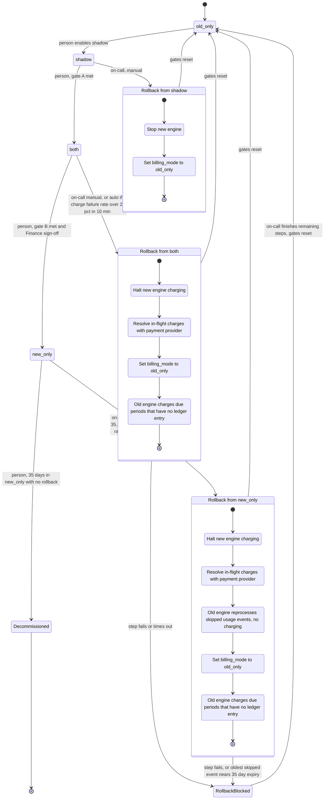

# Billing engine rollout: state machine

## Scope and assumptions

This models the rollout of the new billing engine as modes and transitions. It does not cover the rollout controller's code. Where the brief is silent, I made an assumption and list it under "Assumptions and open questions". Each assumption needs a decision before the controller is built.

## State diagram

## Gates and guards

| Transition | Condition |
|---|---|
| `old_only` to `shadow` | A person makes the move. No automated gate. |
| `shadow` to `both` (gate A) | 7 consecutive nightly comparisons, each with a mismatch rate under 0.1%. At least 5,000 invoices compared (see open question 1). A mismatch is an invoice total that differs by more than 1 cent. |
| `both` to `new_only` (gate B) | At least 14 days in `both` with no unresolved mismatches, plus Finance sign-off. |
| `new_only` to `Decommissioned` | A person decides, after 35 days in `new_only` with no rollback. Blocked while a rollback is in flight. |
| Manual rollback | On-call can start it from `shadow`, `both` or `new_only`. In `new_only` it is refused from day 35 on. |
| Automatic rollback | In `both` or `new_only` only. Triggered when the new engine's charge failure rate is above 2% over any 10-minute window. |
| New-engine errors in `shadow` | Recorded only. They never trigger a rollback. |

No forward move may skip a mode. There is no automatic forward move.

## What each mode does

| Mode | Old engine | New engine | Who charges | Who writes the ledger |
|---|---|---|---|---|
| `old_only` | Computes, charges, writes ledger | Off | Old | Old |
| `shadow` | Computes, charges, writes ledger | Reads the same usage events and writes invoices to the shadow store. Never charges and never writes the ledger. | Old | Old |
| `both` | Computes every invoice into the shadow store only. It does not charge. | Computes, charges, writes ledger | New | New |
| `new_only` | Stops computing | Computes, charges, writes ledger | New | New |
| `Decommissioned` | Removed | Only engine | New | New |

In `shadow` and `both`, a nightly job compares the two engines' invoices per customer. In `both`, the comparison runs between the new engine's ledger invoices and the old engine's shadow-store invoices.

## Rollback steps

Rollback always ends in `old_only`. It is a path with steps, not a mode. The flag has four values, so progress through the steps is tracked in a separate rollback record (see "Where state lives").

1. **From `shadow`.** The new engine never charged and never wrote the ledger. Stop it and set the flag to `old_only`. No charge reconciliation is needed.
2. **From `both`.**
   1. Halt new-engine charging first. Then resolve every in-flight or unknown-outcome charge against the payment provider, so each is either confirmed charged (and in the ledger) or confirmed not charged.
   2. Set the flag to `old_only`.
   3. The old engine charges only billing periods that have no ledger entry. Its invoices are already current, because it kept computing into the shadow store.
3. **From `new_only`.**
   1. Halt new-engine charging first. Then resolve in-flight charges, as above.
   2. The old engine reprocesses every usage event it skipped since `new_only` began. This step computes only and does not charge.
   3. Set the flag to `old_only`.
   4. The old engine charges only periods that have no ledger entry.

**Double-charge and dropped-charge protection.**
- The ledger is the system of record. A charge is keyed by customer and billing period, with a uniqueness constraint in the ledger.
- The same key is sent to the payment provider as its idempotency key.
- Whichever engine charges must first check the ledger. If the new engine already charged a period, the old engine skips it.
- Charging halts before the handover. Unresolved charges are settled before the old engine takes over, so no period is left in an unknown state.
- Periods due during the rollback are not dropped. They wait and are picked up in the final catch-up step.

**After any rollback.** The rollout restarts at `old_only` and must pass through `shadow` again. The 7-day count and the 14-day count both start from zero. Earlier comparison results do not count.

## Where state lives

- **Mode:** the `billing_mode` flag in the config service. It is the only source of truth for the mode, and workers read it.
- **Rollback progress:** a rollback record stored beside the billing ledger, not only in the config service. It holds the current step, who or what triggered it, when it started, and the timestamp of the oldest skipped usage event (new_only rollbacks only).
  - While a rollback record is open, workers must treat the new engine as not allowed to charge, even if the flag still shows `both` or `new_only`. This closes the window between the trigger and the flag flip.
- **Gate counters:** the consecutive-day count, the compared-invoice count, the mismatch rate per day, the unresolved-mismatch list, the date `both` began, and the Finance sign-off. These live with the comparison job's results, not in the flag.
- **`new_only` clock:** the timestamp when `new_only` began. It drives the day-35 cutoff for both manual rollback and decommissioning.
- **Invoices and charges:** the billing ledger holds the real ones. The shadow store holds only comparison copies and is never used to charge.
- **Usage events:** the usage event log, which keeps events for 35 days.

## What happens when something fails

| Failure | Behaviour |
|---|---|
| New-engine errors in `shadow` | Logged and shown in the comparison. Never a rollback. They can lower the mismatch rate's quality and so block gate A. |
| Charge failure rate above 2% over a 10-minute window in `both` or `new_only` | Automatic rollback starts. Charging halts first. |
| Nightly comparison job fails or does not run | That day does not count toward gate A. The consecutive count is not advanced and is treated as broken. No guesses are made. |
| Gate A or B not met | The rollout stays in the current mode. A person cannot override the numeric gate. |
| Mismatch found in `both` | It becomes an unresolved mismatch and blocks gate B until resolved. |
| Config service unreachable | Workers keep the last known mode. If they have none, they do not charge and retry. Delay is accepted. A wrong double charge is not. The ledger uniqueness constraint backs this up if two engines briefly disagree on mode. |
| Rollback step fails or times out | The rollback stays open in `RollbackBlocked` and pages on-call. The new engine stays halted. On-call finishes the remaining steps. |
| Skipped-event reprocessing in a `new_only` rollback cannot finish before the oldest skipped event expires (35 days after it was logged) | The rollback goes to `RollbackBlocked` as an urgent escalation. Expired events cannot be recovered. |
| Automatic rollback trigger after day 35 in `new_only` | No rollback is possible. Treat it as an incident on the new engine. |
| Manual rollback requested on or after day 35 in `new_only` | Refused. |

## Assumptions and open questions

1. **Gate A volume.** "At least 5,000 invoices compared" could mean in total across the 7 days or on each day. I assumed the total across the window. Please confirm.
2. **Mismatch rate definition.** I assumed mismatched invoices divided by invoices compared, calculated per nightly run.
3. **Rollback marker.** The four-value flag cannot express "rollback in progress". I added a separate rollback record that overrides the flag for charging. This needs agreement from whoever owns the config service.
4. **Charge failure rate at low volume.** The brief gives 2% over any 10 minutes. With very few charges in a window, one failure could trigger a rollback. Consider a minimum attempt count. I did not add one because the brief did not.
5. **Order in a `new_only` rollback.** The brief requires reprocessing first. I place the flag flip after reprocessing, so charging pauses while it runs. Due charges are delayed, not dropped. The alternative is to flip first and replay afterwards. That is faster to resume but means the old engine charges before its invoices are complete.
6. **Day 35 boundary.** The brief says "from day 35 on there is no way back". I read that as: manual rollback is allowed through day 34 and refused from day 35. I read decommission as allowed from day 35.
7. **A rollback in flight at day 35.** I assumed a rollback that started before day 35 may complete, and that decommissioning is blocked until it ends.
