# Checkout across Cart, Inventory, Payment and Order

## Overview

- The customer presses **Place order**. Cart sends its cart id, lines and unit prices to Order, which stores them as a snapshot. Cart rows change only when the order is confirmed.
- Order runs the checkout. It calls Inventory to reserve stock, Payment to charge, and Inventory again to claim or release. The customer's page polls Order for status.
- Inventory reserves all lines in one transaction, or none. A reservation holds stock for 10 minutes. When it lapses, the stock goes back on sale, whatever the payment state.
- Only Payment calls the provider. A charge uses the order id as its idempotency key. A refund uses the order id plus `refund`.
- A payment that succeeds after the hold has lapsed fails the claim. Order cancels the order as out of stock, Payment refunds the full amount, and Order emails the customer.
- Every call and event can arrive twice. Each receiver answers a repeat without changing anything.
- **Outbox:** each service writes its events to an `outbox` table in its own database, in the same transaction as the state change. A relay sends unsent rows to the broker and marks them sent. An event may therefore be sent twice, and receivers ignore repeats.

Order statuses: `PLACED`, `REJECTED_OUT_OF_STOCK`, `PAYMENT_PENDING`, `PAYMENT_DECLINED`, `CONFIRMED`, `CANCELLED_OUT_OF_STOCK`.

The customer's page keeps polling while the status is `PLACED` or `PAYMENT_PENDING`, and shows `PAYMENT_PENDING` as "Payment is being processed" (up to 30 minutes). It stops at any other status.

## Services

| Service | Stores | Talks by |
|---|---|---|
| Cart | `carts`, `cart_lines`. Changed by customer edits and by emptying on `OrderConfirmed`. Nothing is written on Place order. | HTTP from the customer page; event `OrderConfirmed` out |
| Inventory | `stock_levels` (sku, on_hand, held), `reservations` (order id, lines, status HELD / CLAIMED / RELEASED / EXPIRED, expires_at). Free stock = on_hand minus held. Claim, release and expiry are conditional updates on status, so only one wins. | HTTP from Order: reserve, claim, release (each keyed by order id) |
| Payment | `charges` (order id key, amount, provider charge id, status), `refunds` (order id, provider refund id, amount, status, attempts, last error), `webhook_events` (provider event id unique, processed_at), `outbox` | HTTP to the provider; webhooks in; events `PaymentSucceeded`, `PaymentDeclined`, `PaymentRefunded` out |
| Order | `orders` (id, cart id, status, total, short SKUs), `order_lines` (sku, qty, unit price snapshot), `order_status_history`, `outbox`. Only Order emails the customer. | HTTP from Cart and the customer page; events `PaymentRefundRequired` and `OrderConfirmed` out |

## Flowchart

```mermaid
flowchart TD
    START(["Customer presses Place order"]):::cart
    START --> CART_REQ["Cart: POST /orders to Order<br/>cart id, lines, unit prices<br/>Cart rows unchanged"]:::cart
    CART_REQ --> ORDER_NEW["Order: create order PLACED<br/>Stores: orders, order_lines (snapshot)<br/>Replies with order id; page starts polling"]:::order
    ORDER_NEW --> RESERVE["Order: POST /reservations to Inventory<br/>order id and lines<br/>Retried with same order id until a reply"]:::order
    RESERVE --> SHORT{"Inventory: does every line have enough free stock?"}:::inv

    SHORT -->|"No"| NOTHING["Inventory: reserve nothing<br/>Stores: no rows changed<br/>Replies 409 with short SKUs"]:::inv
    NOTHING --> OUT["Order: REJECTED_OUT_OF_STOCK<br/>Stores short SKUs; no payment requested"]:::order
    OUT --> SHORT_END(["Customer sees short items; cart unchanged"]):::cart

    SHORT -->|"Yes"| HOLD["Inventory: one transaction for all lines<br/>Free to held per line<br/>Stores: reservations HELD, expires_at = now + 10 min"]:::inv
    HOLD -.->|"10 min pass with no claim"| EXPIRE["Inventory expiry job: reservation EXPIRED<br/>Held back to free stock; Order not changed"]:::inv

    HOLD --> PAYREQ["Order: save PAYMENT_PENDING, then POST /charges to Payment<br/>key = order id"]:::order
    PAYREQ --> CHARGE["Payment: store charge PENDING<br/>Call provider with key = order id<br/>Replies 202 once provider accepts, 503 if not reached"]:::pay
    CHARGE -.->|"seconds, up to 30 min"| HOOK(["Provider charge webhook: event id, charge id, succeeded or declined"]):::ext
    HOOK --> DUP{"Payment: event id already in webhook_events?"}:::pay
    DUP -->|"Yes, repeat"| ACK_DUP["Payment: reply 200, change nothing, publish nothing"]:::pay
    DUP -->|"No"| APPLY["Payment: one DB transaction<br/>Insert event id; set charge outcome if still PENDING<br/>Stores: webhook_events, charges"]:::pay
    APPLY --> OUTCOME{"Charge outcome?"}:::pay

    OUTCOME -->|"Declined"| DECL["Payment: publish PaymentDeclined"]:::pay
    DECL --> REL["Order: PAYMENT_DECLINED; POST release to Inventory"]:::order
    REL --> FREE["Inventory: release if still HELD; no-op if EXPIRED"]:::inv
    FREE --> DECL_END(["Customer sees payment failed; cart unchanged"]):::cart

    OUTCOME -->|"Succeeded"| SUCC["Payment: publish PaymentSucceeded"]:::pay
    SUCC --> CLAIM["Order: POST claim to Inventory"]:::order
    CLAIM --> HELD{"Inventory: reservation HELD and not expired?"}:::inv
    HELD -->|"Yes"| SOLD["Inventory: reservation CLAIMED; held becomes sold<br/>Stores: reservations"]:::inv
    SOLD --> CONF["Order: CONFIRMED; publish OrderConfirmed<br/>Confirmation email in same transaction<br/>Stores: order_status_history"]:::order
    CONF --> EMPTY["Cart: on OrderConfirmed, delete cart lines"]:::cart
    EMPTY --> DONE_OK(["Customer gets confirmation email"]):::order

    HELD -->|"No, lapsed (409)"| LATE["Order: CANCELLED_OUT_OF_STOCK<br/>Publish PaymentRefundRequired (order id, full amount)<br/>Email: cancelled as out of stock, refund on its way"]:::order
    LATE --> REFUND["Payment: find charge by order id; store refund PENDING<br/>POST full refund to provider, key = order id plus refund"]:::pay
    REFUND --> REFOK{"Provider accepted the refund request?"}:::pay
    REFOK -->|"No, error or timeout"| RETRY["Payment: store attempts and last error<br/>Retry with backoff, same key<br/>After N attempts: alert ops; row kept"]:::pay
    RETRY --> REFUND
    REFOK -->|"Yes"| RWH(["Provider refund webhook: event id, refund id, succeeded or failed"]):::ext
    RWH --> RDUP{"Payment: event id already in webhook_events?"}:::pay
    RDUP -->|"Yes, repeat"| ACK_REF["Payment: reply 200, change nothing"]:::pay
    RDUP -->|"No, failed"| RRETRY["Payment: keep refund PENDING; retry with backoff"]:::pay
    RRETRY --> REFUND
    RDUP -->|"No, succeeded"| RDONE["Payment: refund SUCCEEDED; publish PaymentRefunded"]:::pay
    RDONE --> REFMAIL["Order: email customer refund confirmed<br/>Stores: order_status_history"]:::order
    REFMAIL --> DONE_REF(["Customer has full refund"]):::ext

    classDef cart fill:#e0f2fe,stroke:#0369a1,color:#0c4a6e
    classDef order fill:#fef9c3,stroke:#a16207,color:#422006
    classDef inv fill:#dcfce7,stroke:#15803d,color:#14532d
    classDef pay fill:#fce7f3,stroke:#be185d,color:#500724
    classDef ext fill:#f1f5f9,stroke:#475569,color:#0f172a,stroke-dasharray: 4 3
```

Colours: blue Cart, yellow Order, green Inventory, pink Payment, grey dashed External. Solid arrows are HTTP calls, unless labelled event. Dashed arrows are timers or external callbacks.

## Failure branches

| Scenario | What happens | What the customer sees |
|---|---|---|
| Short stock | Nothing reserved, no payment, `REJECTED_OUT_OF_STOCK` with short SKUs | Short items listed; cart unchanged |
| Reserve reply lost | Order retries with the same order id; Inventory returns the existing reservation | Nothing; order stays `PLACED` |
| Declined payment | Hold released (no-op if already expired), `PAYMENT_DECLINED` | Payment failed; cart unchanged |
| Late success after hold lapsed | Claim returns 409, full refund, `CANCELLED_OUT_OF_STOCK`, email | Cancellation email now; refund email once the provider confirms |
| Failed refund | Retry with backoff and the same key; ops alerted after N attempts; row kept until confirmed | Refund email only when the provider confirms |
| Duplicate webhook | Repeat returns 200 and changes nothing | Nothing |
| Retried `POST /charges` | Same key; Payment returns the existing charge | Nothing |
| Claim reply lost | Order retries the claim. A claim on a reservation already CLAIMED by the same order returns 200. Order acknowledges `PaymentSucceeded` only after a 200 or 409 reply. | Nothing, unless the hold has lapsed by then |

## Decisions

1. **Late success with stock still free.** We refund whenever the claim finds the hold gone, even if nobody has bought the stock. This follows "never keep money for an order we can't fulfil" literally. Re-reserving free stock would be a separate product decision.
2. **Payment still pending at 10 minutes.** Stock returns to sale at 10 minutes. The order stays `PAYMENT_PENDING` until the webhook arrives, so the customer may see "being processed" for up to 30 minutes.
3. **First outcome wins.** A charge's outcome is set once. A later event for an already decided charge is recorded and ignored.

## Open questions

- **Calls that never get a reply.** Order retries reserve and charge with the same key. The brief gives no rule for when Order gives up. If Payment never gets the provider to accept a charge, the hold lapses and the order stays `PAYMENT_PENDING`.
- **Webhook never arrives.** The brief does not cover a provider outage beyond 30 minutes. A recommended addition is a Payment reconciler that polls the provider for charges still PENDING after 30 minutes. This is not in the brief.
- **Failed refund retry.** If the provider keeps the failed refund under the same key, retries with that key may never succeed. We have not decided on a new key for retries after a failed refund.
- **Conflicting charge outcomes.** We do not know whether the provider can send two different outcomes for one charge. Decision 3 handles it either way.